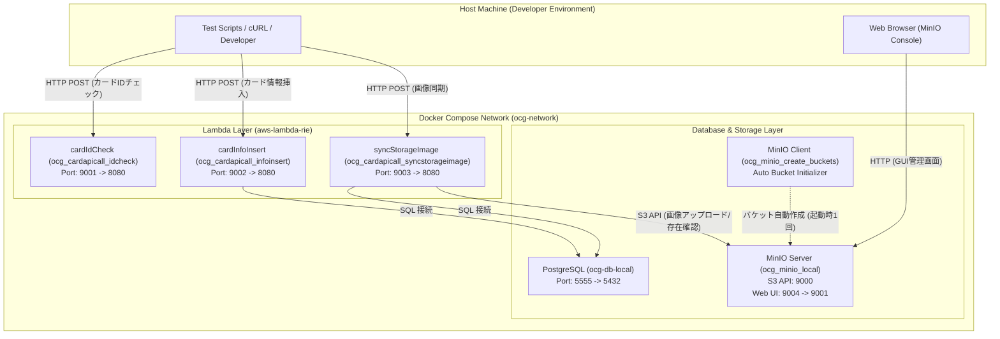

# ローカルインフラ検証環境 (Docker Compose) とポート一覧

本ドキュメントは、`ocg_statistics` プロジェクトにおいて一部のクラウドインフラ（AWS Lambda、Amazon S3、Neon / PostgreSQL データベース）をローカル環境で迅速・オフラインに検証するための Docker Compose 構成およびポート一覧を定義するものです。

---

## 1. ローカルインフラ検証における Docker Compose の活用

本システムでは、本番・開発環境として AWS（Lambda、S3、ECR 等）および Neon DB を採用していますが、開発中の動作検証・単体/結合テストをクラウド環境に都度デプロイして行うと、レイテンシ、AWS コスト、ネットワーク依存などのオーバーヘッドが発生します。

そのため、[compose.yaml](../../compose.yaml) を利用し、**主要インフラのモック/エミュレータをローカルコンテナとして起動・連動させるアーキテクチャ** を採用しています：

1. **RDB（PostgreSQL / Neon 相当）**:
   - `postgres:16.7-bookworm` コンテナ（`ocg-db-local`）を用いて、ローカルで完全互換の PostgreSQL 環境を起動。
   - `database/localsetup` 配下の初期化 SQL スクリプトをコンテナ起動時に自動流し込み。
2. **オブジェクトストレージ（AWS S3 相当）**:
   - `minio/minio` コンテナ（`ocg_minio_local`）を用いて、S3 互換 API（PutObject, GetObject, HeadObject 等）を提供。
   - `minio/mc` コンテナ（`ocg_minio_create_buckets`）により、起動時に画像保存用バケット（`ocg-card-images`）を自動作成しダウンロード権限を自動付与。
3. **AWS Lambda 実行環境 (Lambda RIE)**:
   - AWS 公式の [AWS Lambda Runtime Interface Emulator (RIE)](https://github.com/aws/aws-lambda-runtime-interface-emulator) をコンテナ Entrypoint に組み込み、ローカル HTTP POST リクエスト経由で Lambda ハンドラーを実行可能にする。



---

## 2. Docker コンテナ ポート一覧

ローカル検証環境で公開されているホストポートおよびコンテナポートの対応表です。ポート重複を防ぎ、直感的に識別できるよう 9000 番台および 5500 番台に体系化されています。

| ホストポート | コンテナポート | サービス名 | コンテナ名 | 用途・プロトコル | 認証情報 / 備考 |
| :---: | :---: | :--- | :--- | :--- | :--- |
| **`9000`** | `9000` | `minio` | `ocg_minio_local` | **MinIO S3 API** (HTTP)<br>S3 互換ストレージエンドポイント | `minioadmin` / `minioadmin`<br>Lambda からは `http://minio:9000` で参照 |
| **`9001`** | `8080` | `cardapicall_idcheck` | `ocg_cardapicall_idcheck` | **cardIdCheck Lambda**<br>カード ID 存在確認 API (RIE) | エンドポイント:<br>`/2015-03-31/functions/function/invocations` |
| **`9002`** | `8080` | `cardapicall_infoinsert` | `ocg_cardapicall_infoinsert` | **cardInfoInsert Lambda**<br>外部 API カード情報 DB 挿入バッチ (RIE) | エンドポイント:<br>`/2015-03-31/functions/function/invocations` |
| **`9003`** | `8080` | `cardapicall_syncstorageimage` | `ocg_cardapicall_syncstorageimage` | **syncStorageImage Lambda**<br>カード画像 S3 同期・URL更新バッチ (RIE) | エンドポイント:<br>`/2015-03-31/functions/function/invocations` |
| **`9004`** | `9001` | `minio` | `ocg_minio_local` | **MinIO Web Console (UI)**<br>ブラウザ用オブジェクト管理画面 | ブラウザアクセス: `http://localhost:9004`<br>ユーザー: `minioadmin`<br>パスワード: `minioadmin` |
| **`5555`** | `5432` | `ocg_db_local` | `ocg-db-local` | **PostgreSQL Database**<br>Neon 互換ローカル DB (SSL 有効) | ユーザー: `postgres`<br>パスワード: `postgres`<br>DB名: `postgres` |

---

## 3. ボリューム・ネットワーク構成

- **ネットワーク**:
  - `ocg-network` (`driver: bridge`): 全コンテナが名前解決（例: `minio:9000`, `ocg_db_local:5432`）で相互通信可能。
- **データ永続化ボリューム**:
  - `postgres_volume_ocg`: PostgreSQL のデータディレクトリ（`/var/lib/postgresql/data`）を永続化。
  - `minio_volume_ocg`: MinIO のバケットおよび保存画像（`/data`）を永続化。

---

## 4. 運用・検証コマンド

### コンテナ一括起動
```bash
docker compose up -d
```

### 特定サービスの再ビルド・起動（例: syncstorageimage）
```bash
docker compose up -d --build cardapicall_syncstorageimage
```

### MinIO Web Console へのアクセス
ブラウザで [http://localhost:9004](http://localhost:9004) を開き、`minioadmin` / `minioadmin` でログインして `ocg-card-images` バケット内の画像オブジェクトを確認できます。

### Lambda ローカルテストスクリプトの実行
```bash
# cardInfoInsert のテスト（ポート 9002）
bash scripts/code/cardApiCall/cardinfoinsert/local_test.sh

# syncStorageImage のテスト（ポート 9003）
bash scripts/code/cardApiCall/syncstorageimage/local_test.sh "[89631139]"
```
