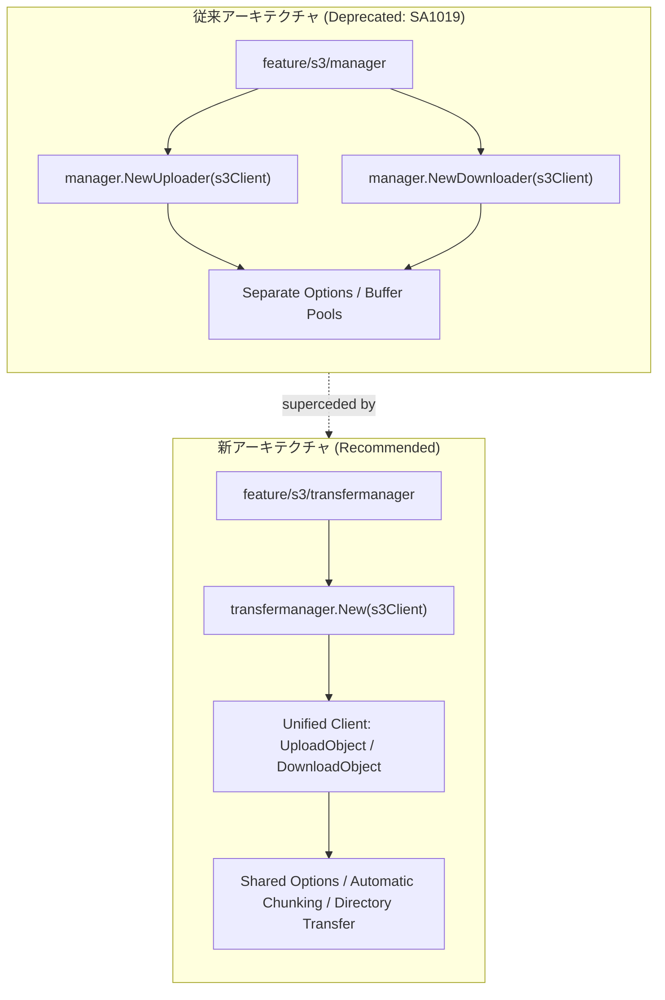
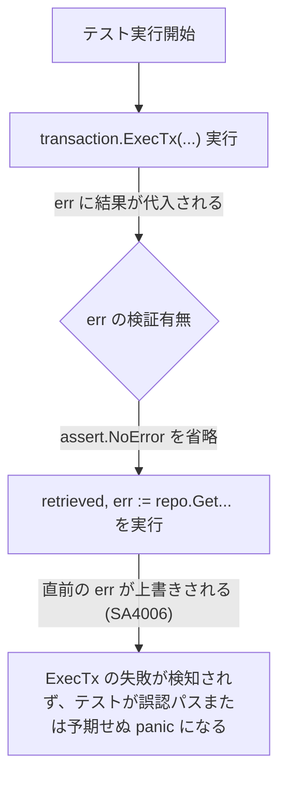
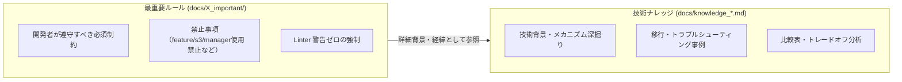

# 技術検証ナレッジ: AWS SDK Go v2 Transfer Manager 移行と静的解析（Staticcheck）品質一掃

## 1. 概要と問題の構造

### 1.1 発生した事象
カード画像 S3 同期 Lambda（`syncStorageImageWithDB`）の実装において、S3 への画像ストリーミングアップロードを行うために従来広く使われていた `github.com/aws/aws-sdk-go-v2/feature/s3/manager` の `manager.NewUploader` を採用したところ、Language Server (gopls) および静的解析ツールより以下の非推奨警告が検知された。

```text
manager.NewUploader is deprecated: superceded by feature/s3/transfermanager. 
See https://github.com/aws/aws-sdk-go-v2/discussions/3306 (SA1019)
```

また、この警告を契機としてプロジェクト全体（Go コードベース）に対する網羅的な静的解析（`staticcheck` / `go vet`）による横展開調査を実施したところ、非推奨 API の使用（`SA1019`）だけでなく、DB トランザクション処理やテストコードにおける**未使用エラー変数（`SA4006: this value of err is never used`）が複数箇所で潜在している**ことが判明した。

### 1.2 本ナレッジの目的
1. なぜ `feature/s3/manager` が非推奨化され、`feature/s3/transfermanager` への移行が推奨されているのか、その技術的背景と移行コードを記録する。
2. `SA4006`（エラー握りつぶし・未検証）が引き起こすサイレント障害のリスクと、テストコードにおける標準的解消パターンを提示する。
3. ルール集（`docs/X_important/`）との関係性を整理し、アーキテクチャ知識と行動ルールの適切な分担を明確化する。

---

## 2. 発生した現象と技術的メカニズム

### 2.1 S3 Transfer Manager へのアーキテクチャ進化
従来の `feature/s3/manager` は、アップロード専用の `manager.Uploader` とダウンロード専用の `manager.Downloader` にクライアントが二分されており、バッファリングや並行度制御の設定を共有できない構造的課題があった。
新パッケージ `feature/s3/transfermanager` では、これらを単一の統合クライアント（`transfermanager.Client`）に統合し、API 入出力を標準 S3 サービスリクエストに整合させるアーキテクチャ刷新が行われた。



### 2.2 未使用エラー変数（SA4006）の発生メカニズム
横展開調査で多発していた `SA4006` は、トランザクション実行関数 `transaction.ExecTx` や UseCase の戻り値 `err` を受け取りながら、その直後で別の操作によって同じ `err` 変数を再代入（上書き）していたために発生していた。



---

## 3. トレードオフ・比較分析

### 3.1 S3 アップローダー実装方式の比較

| 比較項目 | 従来方式 (`feature/s3/manager`) | 新方式 (`feature/s3/transfermanager`) | 直接 `s3.PutObject` |
| :--- | :--- | :--- | :--- |
| **メンテナンス状態** | **非推奨 (Deprecated)** | **アクティブ (推奨)** | 基本 API |
| **ストリーム対応** | ○ (`io.Reader` 自動分割) | ○ (`io.Reader` 自動分割) | △ (事前に Content-Length が必須) |
| **マルチパート最適化** | 単一オブジェクトアップロードキャッシュ | キャッシュ戦略が最適化済み | 手動実装が必要 |
| **API 統合度** | Uploader / Downloader が分離 | 単一 Client に統合 | 基本操作のみ |
| **静的解析 (SA1019)** | 警告発生 (ビルド警告) | **警告ゼロ (Clean)** | 警告ゼロ |

---

## 4. 公式見解・実在リンク集（HTTP 200 確認済み）

- **AWS SDK Go v2 公式ディスカッション**:
  [Superceding feature/s3/manager with feature/s3/transfermanager #3306](https://github.com/aws/aws-sdk-go-v2/discussions/3306)
  - AWS SDK Go チームによる `transfermanager` への刷新理由、機能改善点（単一クライアント統合、ディレクトリ一括転送、メモリ効率化）の解説。
- **Go 公式パッケージドキュメント**:
  [package transfermanager (v0.4.19)](https://pkg.go.dev/github.com/aws/aws-sdk-go-v2/feature/s3/transfermanager)
  - `Client.UploadObject` および `UploadObjectInput` の公式インターフェース仕様。
- **Staticcheck 公式ドキュメント**:
  - [SA1019 - Using a deprecated function, variable, function or method](https://staticcheck.dev/docs/checks/#SA1019)
  - [SA4006 - A value assigned to a variable is never read](https://staticcheck.dev/docs/checks/#SA4006)
  - [Staticcheck Checks Index](https://staticcheck.dev/docs/checks/)

---

## 5. 解決策と実装ベストプラクティス

### 5.1 S3 ストリーミングアップロードの実装（改善後）

`internal/storage/s3_impl.go` において、`transfermanager.Client` を保持し、`UploadObject` を呼び出す。

```go
package storage

import (
	"context"
	"fmt"
	"io"
	"strings"

	"github.com/aws/aws-sdk-go-v2/feature/s3/transfermanager"
	"github.com/aws/aws-sdk-go-v2/service/s3"
)

type s3StorageClientImpl struct {
	s3Client        *s3.Client
	transferManager *transfermanager.Client
	bucketName      string
	region          string
	cdnBaseURL      string
}

func NewS3StorageClient(s3Client *s3.Client, bucketName string, region string, cdnBaseURL string) StorageClient {
	return &s3StorageClientImpl{
		s3Client:        s3Client,
		transferManager: transfermanager.New(s3Client),
		bucketName:      bucketName,
		region:          region,
		cdnBaseURL:      strings.TrimSuffix(cdnBaseURL, "/"),
	}
}

func (s *s3StorageClientImpl) UploadStream(ctx context.Context, key string, body io.Reader, contentType string) (string, error) {
	input := &transfermanager.UploadObjectInput{
		Bucket: &s.bucketName,
		Key:    &key,
		Body:   body,
	}
	if contentType != "" {
		input.ContentType = &contentType
	}

	result, err := s.transferManager.UploadObject(ctx, input)
	if err != nil {
		return "", fmt.Errorf("failed to upload stream to s3 key %s: %w", key, err)
	}

	if result.Location != nil && *result.Location != "" {
		return *result.Location, nil
	}
	return s.GetDestinationURL(key), nil
}
```

### 5.2 未使用エラー変数（SA4006）の撲滅パターン

テストコード内でのトランザクション実行直後に必ずアサーションを挟む。

```go
// [Before: SA4006 警告発生]
_, err := transaction.ExecTx(ctx, tr, func(q *sqlc_gen.Queries) (struct{}, error) { ... })
// ここで err をアサートせずに次の操作を実行
retrieved, err := repo.GetByCardID(ctx, testCardID)
assert.NoError(t, err)

// [After: 修正後]
_, err := transaction.ExecTx(ctx, tr, func(q *sqlc_gen.Queries) (struct{}, error) { ... })
assert.NoError(t, err) // 直ちにエラーを検証する

retrieved, err := repo.GetByCardID(ctx, testCardID)
assert.NoError(t, err)
```

---

## 6. X_important とナレッジの配置・責務整理

プロジェクトにおいて「ナレッジ」と「X_important（ルール）」は目的が明確に異なる。



| 区分 | 配置場所 | 目的・性質 | 本事象での対応 |
| :--- | :--- | :--- | :--- |
| **重要ルール (Rules)** | `docs/X_important/lambda/rules/03_aws_sdk_and_quality_rules.md`<br>`.agents/rules/02_aws_sdk_and_quality_rules.md` | **制約・行動規範**<br>「〜してはならない」「〜を遵守すること」というチェック基準。 | `feature/s3/manager` の禁止と `transfermanager` の強制、SA1019/SA4006 排除をルール化。 |
| **技術ナレッジ (Knowledge)** | `docs/knowledge_aws_sdk_s3_transfermanager_migration_and_linter_sweep.md` (本文書) | **知見・技術的論拠**<br>「なぜそうするのか」「何が起きてどう解決したか」の完全な記録。 | 移行手順、Mermaid 図解、公式リンク、静的解析結果の全貌を記録。 |

---

## 7. 再発防止チェックリスト

- [ ] 新規ライブラリ導入時や `go get` 実行時に、端末出力に `deprecated:` 警告が出ていないか確認したか？
- [ ] コミット前または PR 作成前に `go vet ./...` および `staticcheck ./...` を実行し、警告が 0 件であることを確認したか？
- [ ] `transaction.ExecTx` などの関数呼び出しで受け取った `err` を直後に上書きして握りつぶしていないか？
- [ ] すべての外部リンクは、完全なパーマリンクであり、事前に HTTP 200 OK の疎通を確認したか？
