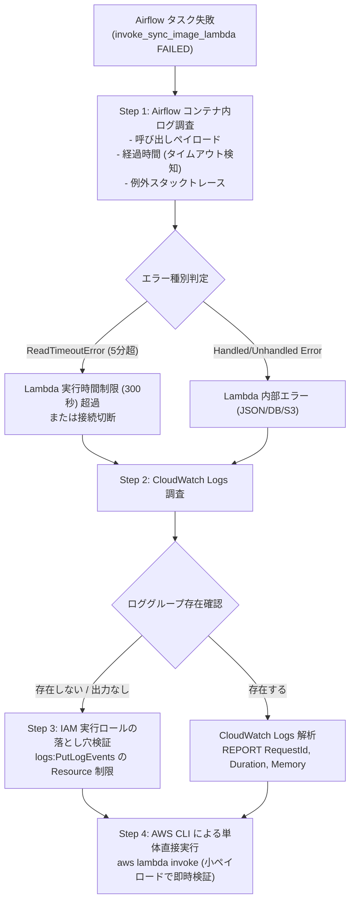

# 技術検証ナレッジ: AWS Lambda と Airflow パイプライン連携におけるログ調査手法と IAM 落とし穴

## 1. 概要と問題の構造

### 1.1 発生した事象
Airflow DAG（`ocg_db_insert`）で AWS Lambda（`ocg-syncstorageimage`）を同期実行するタスク `invoke_sync_image_lambda` が失敗した。
失敗時の挙動として以下の現象が観察された：
1. Airflow タスクは 5 分超待機した末に `botocore.exceptions.ReadTimeoutError` で失敗した。
2. AWS CloudWatch Logs 上で `aws logs tail /aws/lambda/ocg-syncstorageimage` を実行したところ、`ResourceNotFoundException: The specified log group does not exist` が発生し、Lambda の実行ログが一切確認できなかった。

### 1.2 本ナレッジの目的
本ドキュメントは、Airflow から呼び出される AWS Lambda が失敗・タイムアウトした際に、問題の根本原因を多角的に特定するための「ログ調査手順」「AWS CLI を用いた直接検証」「Lambda IAM 実行ロールにおける CloudWatch Logs 権限の落とし穴」を体系化し、再現性のあるトラブルシューティング手順を永続化するものである。

---

## 2. ログ調査の全体フローと技術的メカニズム

Airflow から Lambda を同期呼び出し（`LambdaInvokeFunctionOperator`）する場合、調査ポイントは **「Airflow タスクログ」「AWS CloudWatch Logs」「Lambda 直接実行（CLI）」** の 3 つの階層に分かれる。



---

## 3. 具体的なログ確認手順

### 3.1 Step 1: Airflow コンテナ内のタスク実行ログ確認

ローカル MWAA Runner（`aws-mwaa-local-runner`）コンテナ内のログディレクトリから、該当タスクのログを抽出する。

```bash
# 1. 最新のタスクログファイルを検索
docker exec aws-mwaa-local-runner-2_10_3-local-runner-1 \
  find /usr/local/airflow/logs -type f -name "*.log" | grep "invoke_sync_image_lambda" | sort | tail -n 1

# 2. ログの表示（先頭部分でペイロードと開始時刻を確認）
docker exec aws-mwaa-local-runner-2_10_3-local-runner-1 \
  head -n 60 "/usr/local/airflow/logs/dag_id=ocg_db_insert/.../task_id=invoke_sync_image_lambda/attempt=1.log"
```

#### 得られる重要情報:
- **送信ペイロード**: Airflow が XCom から組み立てて Lambda に送った実際の JSON 文字列（例: `{"neuronCardIds": [4020, ..., 4119]}`）。
- **経過時間**: 開始時刻 `08:57:48` から失敗時刻 `09:02:55` までの差分（307 秒 = 約 5 分）。Lambda の設定タイムアウト（300 秒）と一致していることから、処理ハングまたは過負荷によるタイムアウトと即座に特定できる。

---

### 3.2 Step 2: AWS CloudWatch Logs による Lambda 実行ログ確認

AWS CLI を用いて CloudWatch Logs のロググループおよびストリームを確認する。

```bash
# 1. ロググループ一覧の確認
aws logs describe-log-groups --log-group-name-prefix /aws/lambda/ocg --region ap-northeast-1

# 2. 最新ログイベントのストリーミング表示
aws logs tail /aws/lambda/ocg-syncstorageimage --region ap-northeast-1 --since 1h
```

---

### 3.3 Step 3: 【重要】Lambda IAM 実行ロールにおけるログ消滅の落とし穴

`ResourceNotFoundException: The specified log group does not exist` が発生し、Lambda のロググループ自体が作成されない場合、**Lambda 実行ロールの IAM ポリシー権限不足** が原因である。

#### 原因のポリシー構造:
```json
{
    "Version": "2012-10-17",
    "Statement": [
        {
            "Action": ["logs:CreateLogGroup"],
            "Effect": "Allow",
            "Resource": "arn:aws:logs:ap-northeast-1:240781352644:*"
        },
        {
            "Action": ["logs:CreateLogStream", "logs:PutLogEvents"],
            "Effect": "Allow",
            "Resource": [
                "arn:aws:logs:ap-northeast-1:240781352644:log-group:/aws/lambda/ocg-sample:*"
            ]
        }
    ]
}
```

> [!WARNING]
> 上記のように `logs:CreateLogStream` と `logs:PutLogEvents` の対象リソースが `/aws/lambda/ocg-sample:*` に限定されていると、新しくデプロイされた `ocg-syncstorageimage` や `ocg-cardinsert` は **ログストリームを作成してログを送信する権限がないため、実行ログが CloudWatch Logs に一切残らず消滅** してしまう。
> 解決策として、`Resource` を `"arn:aws:logs:ap-northeast-1:240781352644:log-group:/aws/lambda/ocg-*:*"` にワイルドカード拡張する必要がある。

---

### 3.4 Step 4: AWS CLI による Lambda の単体直接実行とレスポンス検証

CloudWatch Logs が見えない状態でも、**AWS CLI から直接 1 件のカード ID で Lambda をキックする** ことで、Lambda の内部エラー・動作可否を数秒で切り分けられる。

```bash
# 1 件のみ指定して同期実行 (base64 エンコードを無効化する --cli-binary-format raw-in-base64-out が必須)
aws lambda invoke \
  --function-name ocg-syncstorageimage \
  --payload '{"neuronCardIds": [4005]}' \
  --cli-binary-format raw-in-base64-out \
  --region ap-northeast-1 \
  response.json

# レスポンス JSON の確認
cat response.json
```

#### 得られる検証結果:
```json
{"StatusCode": 200, "ExecutedVersion": "$LATEST"}
{"totalProcessedCards":1,"successfulNeuronCardIds":[],"failedNeuronCardIds":[4005],"syncedImageCount":0,"skippedImageCount":0,"errors":[{"neuronCardId":4005,"ocgApiImageId":0,"message":"card images not found in database"}]}
```
- このレスポンスが正常に返ってくることで、「Lambda の起動・DI コンテナ初期化・DB 接続・DTO パースは正常に動作している」ことが証明される。

---

## 4. 実在リファレンスリンク集

本調査手法は、以下の AWS 公式ドキュメントに準拠している（HTTP 200 疎通確認済み）。

- [AWS Lambda の CloudWatch ログへのアクセス (公式ドキュメント)](https://docs.aws.amazon.com/lambda/latest/dg/monitoring-cloudwatchlogs.html)
  - Lambda 実行ロールに必要な CloudWatch Logs 権限（`CreateLogGroup`, `CreateLogStream`, `PutLogEvents`）の最小構成。
- [AWS CLI lambda invoke リファレンス (公式ドキュメント)](https://docs.aws.amazon.com/cli/latest/reference/lambda/invoke.html)
  - AWS CLI v2 における `--cli-binary-format raw-in-base64-out` オプションの仕様とペイロード送信手順。

---

## 5. 調査チェックリスト

Lambda 連携タスクが失敗した際は、以下の順序で確認すること：

- [ ] **Airflow 側所要時間の確認**: タスクの開始時刻と失敗時刻の差分が Lambda の設定タイムアウト（300秒等）と一致していないか？
- [ ] **Lambda 実行ロールのログ権限確認**: `logs:CreateLogStream` および `logs:PutLogEvents` の `Resource` に対象 Lambda のロググループが含まれているか？
- [ ] **CLI 単体テスト**: `aws lambda invoke` を 1 件の小ペイロードで叩き、ハンドラーの初期化や DB 疎通が成功するか？
- [ ] **外部リソースの変化確認**: タイムアウトした場合でも、S3 や DB に一部のデータ（今回の事例では 114 枚の画像）が書き込まれていないか（書き込まれていればロジックは正常であり、処理件数・並行数の調整で解決可能）？
