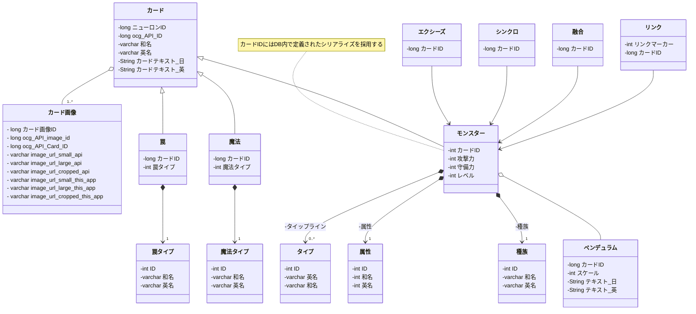

# カード設計図 クラス図 (Card Class Diagram)

## 1. クラス図 (Mermaid)

---

## 2. 実装（DBスキーマ・Go DTO）との対応表

| クラス図のエンティティ | DB テーブル ([schema.sql](../../code/cardApiCall/infoInsert/sqlc/db/schema.sql)) | Go DTO ([dto/cardrecord/](../../code/cardApiCall/infoInsert/dto/cardrecord/)) |
|---|---|---|
| **カード** | `cards` | `AbstractCardSelectResult` ([carddto.go](../../code/cardApiCall/infoInsert/dto/cardrecord/carddto.go)) |
| **カード画像** | `card_images` | `CardImage` ([carddto.go](../../code/cardApiCall/infoInsert/dto/cardrecord/carddto.go#L88-L93)) |
| **モンスター** | `monsters` | `MonsterCardSelectResult` ([monster.go](../../code/cardApiCall/infoInsert/dto/cardrecord/monster.go)) |
| **魔法** | `spells` | `SpellCardSelectResult` ([spell.go](../../code/cardApiCall/infoInsert/dto/cardrecord/spell.go)) |
| **罠** | `traps` | `TrapCardSelectResult` ([trap.go](../../code/cardApiCall/infoInsert/dto/cardrecord/trap.go)) |
| **ペンデュラム** | `pendulum_monsters` | `MonsterCardSelectResultExtended` ([monster.go](../../code/cardApiCall/infoInsert/dto/cardrecord/monster.go)) |
| **リンク** | `link_monsters` | `MonsterCardSelectResultExtended` ([monster.go](../../code/cardApiCall/infoInsert/dto/cardrecord/monster.go)) |
| **融合** | `fusion_monsters` | - |
| **シンクロ** | `synchro_monsters` | - |
| **エクシーズ** | `xyz_monsters` | - |
| **属性** | `attributes` | `AttributeKind` ([attribute.go](../../code/cardApiCall/infoInsert/dto/kind/attribute.go)) |
| **種族** | `races` | `RaceKind` ([race.go](../../code/cardApiCall/infoInsert/dto/kind/race.go)) |
| **タイプ** | `monster_types` | `MonsterTypeKind` ([monster_type.go](../../code/cardApiCall/infoInsert/dto/kind/monster_type.go)) |
| **魔法タイプ** | `spell_types` | `SpellTypeKind` ([spell.go](../../code/cardApiCall/infoInsert/dto/kind/spell.go)) |
| **罠タイプ** | `trap_types` | `TrapTypeKind` ([trap.go](../../code/cardApiCall/infoInsert/dto/kind/trap.go)) |

---

## 3. 関連ドキュメント

- カード画像パイプライン詳細設計: [docs/03_card_image/01_card_image_architecture.md](../03_card_image/01_card_image_architecture.md)
- 新規テーブル追加手順書: [docs/04_new_tables/01_new_table_implementation_guide.md](../04_new_tables/01_new_table_implementation_guide.md)

