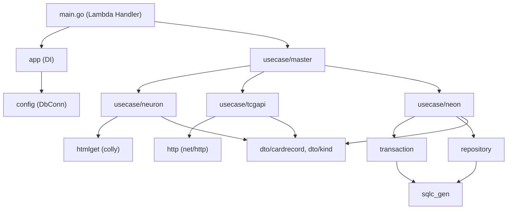
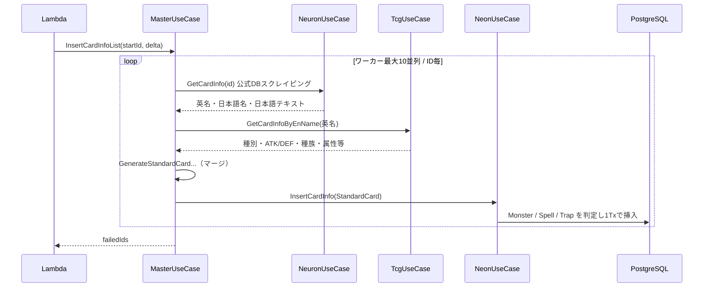

# infoInsert リポジトリ構成分析

## 1. 概要

| 項目 | 内容 |
|---|---|
| 役割 | 遊戯王カード情報を外部2ソースから集めて PostgreSQL（Neon）に登録する **AWS Lambda** |
| 言語 | Go 1.23.5（module: `atomisu.com/ocg-statics/infoInsert`） |
| 規模 | Go 約10,400行（テスト含む） |
| 実行形態 | コンテナイメージ Lambda（`provided:al2023`, arm64）→ [Dockerfile](../../code/cardApiCall/infoInsert/Dockerfile) |
| 呼び出し元 | Airflow DAG（`ocg/db_insert.py` の `invoke_lambda_function`） |

**入出力**（[main.go](../../code/cardApiCall/infoInsert/main.go)）

```json
// Input                      // Output
{ "startId": 100, "delta": 10 }  { "failedIds": [103, 107] }
```

### 主要ライブラリ

| ライブラリ | 用途 |
|---|---|
| `aws-lambda-go` | Lambda ハンドラ |
| `samber/do` | DI コンテナ |
| `gocolly/colly` | 公式DB（Neuron）のスクレイピング |
| `lib/pq` + `sqlc` | PostgreSQL アクセス（型安全なコード生成） |
| `zap` | ロギング |
| `testify` | テスト |

---

## 2. ディレクトリ構成とレイヤー

```
infoInsert/
├── main.go                 # Lambda エントリポイント
├── app/                    # DI コンテナ組み立て
├── config/                 # DB接続（本番 / テスト）・テストデータ
├── env/                    # 環境変数ヘルパー
├── usecase/                # ★ビジネスロジック
│   ├── base.go             #   共通基底（DB接続の保持）
│   ├── master/             #   オーケストレーション（並列取込）
│   ├── neuron/             #   公式DBからの取得・整形
│   ├── tcgapi/             #   YGOPRODeck API からの取得
│   └── neon/               #   DB 登録・参照（card/monster/spell/trap）
├── htmlget/                # colly によるHTML取得（インフラ層）
├── http/                   # 素の net/http クライアント（インフラ層）
├── repository/             # sqlc_gen をラップしたリポジトリ（テーブル単位）
├── transaction/            # トランザクション境界ヘルパー
├── sqlc/                   # schema.sql + queries/*.sql（SQL原本）
├── sqlc_gen/               # sqlc 自動生成コード
├── dto/
│   ├── cardrecord/         # StandardCard 等の中間表現・変換関数
│   └── kind/               # 属性・種族・リンクマーカー等の区分値
├── util/                   # 文字列分割・sql.Null* 変換
└── api/ cmd/ docs/ domain/ handler/ middleware/   # .gitkeep のみ（未使用）
```

### レイヤー依存関係



---

## 3. 処理フロー



- **Neuron**（公式DB）: 日本語名・日本語テキスト・英語名を取得
- **TCG API**（YGOPRODeck）: 英語名をキーに数値系・分類系データを取得
- **Neon**: `Type` 文字列に `Monster`/`Trap`/`Spell` が含まれるかで振り分け
  - モンスターは `cards` → `monsters` → 融合/S/X/儀式/P/リンク の各サブテーブルへ同一Tx内で挿入

### DB スキーマ（[schema.sql](../../code/cardApiCall/infoInsert/sqlc/db/schema.sql)）

- マスタ: `attributes`, `races`, `monster_types`, `spell_types`, `trap_types`
- 本体: `cards`
- 種別: `monsters`, `spells`, `traps`
- モンスター拡張: `fusion_` / `synchro_` / `xyz_` / `ritual_` / `pendulum_` / `link_monsters`

---

## 4. 設計パターン

| パターン | 実装箇所 | 説明 |
|---|---|---|
| DI コンテナ | [dependency_injection.go](../../code/cardApiCall/infoInsert/app/dependency_injection.go) | `samber/do` で UseCase を登録。グローバル初期化でコールドスタート時のみ構築 |
| ジェネリクス基底コンストラクタ | [usecase/base.go](../../code/cardApiCall/infoInsert/usecase/base.go), `repository/base.go`, `htmlget/base.go`, `http/base.go` | `NewXxx[T](constructor func(*base) T)` で共通フィールドを埋め込む統一スタイル |
| Interface + 非公開 impl | 各 UseCase | `XxxUseCase` interface / `xxxUseCaseImpl` struct。テスト時に `do.Override` で差替え可能 |
| Unit of Work 風 Tx | [transaction.go](../../code/cardApiCall/infoInsert/transaction/transaction.go) | `ExecTx(ctx, func(q) error)` 内で Repository を生成して使う |
| ワーカープール | [master.go](../../code/cardApiCall/infoInsert/usecase/master/master.go#L68-L117) | jobs/results チャネル + WaitGroup。失敗IDのみ収集 |
| SQL ファースト | `sqlc/` → `sqlc_gen/` | SQL を書いて Go コードを生成 |

### テスト
- ほぼ全 repository / usecase に `_test.go` あり
- 実DB（`test_ocg_statics`, `sslmode=disable`）を使う結合テスト寄り（[test_database.go](../../code/cardApiCall/infoInsert/config/test_database.go)）
- `htmlget` / `http` のテストは外部サイトへ実アクセスする模様

---

## 5. 気になった点・改善候補

> [!WARNING]
> 以下はコードリーディングによる指摘で、実行検証はしていません。

### 🔴 不具合の可能性が高いもの

1. **コミット失敗が握りつぶされる**（[transaction.go:L26-L41](../../code/cardApiCall/infoInsert/transaction/transaction.go#L26-L41)）
   - 戻り値が名前付きでないため、`defer` 内で `err = txx.Commit()` しても呼び出し元には返らない
   - さらにCommit失敗時に `err = txx.Rollback()` で上書きされる
   - → **コミット失敗でも成功扱い**になり、`failedIds` に載らない
   - 修正: `func (...) ExecTx(...) (err error)` にし、Commit/Rollback エラーを適切に合成
2. **スクレイピング失敗を無視**（[htmlget/base.go:L48-L54](../../code/cardApiCall/infoInsert/htmlget/base.go#L48-L54)）
   - `Visit` のエラーをログ出力するだけで `nil` を返す
   - → 空の英名で TCG API を叩き、"no data found" という分かりにくいエラーになる
3. **存在しないカードIDでも処理続行**（[neuron.go:L50-L54](../../code/cardApiCall/infoInsert/usecase/neuron/neuron.go#L50-L54)）
   - Warn ログのみでエラーを返さない（結果的に後段で失敗するが原因が追いにくい）
4. **モンスタータイプ解決失敗を黙ってスキップ**（[neon_monster.go:L59-L69](../../code/cardApiCall/infoInsert/usecase/neon/neon_monster.go#L59-L69)）
   - 未登録タイプがあっても不完全なデータで登録成功してしまう

### 🟡 堅牢性・運用面

5. **`ctx` が外部呼び出しに伝播していない**
   - `http.Get(url)`（[http/base.go:L26](../../code/cardApiCall/infoInsert/http/base.go#L26)）はタイムアウト無し・ctx無視
   - Lambda タイムアウト時にキャンセルされない → `http.NewRequestWithContext` + タイムアウト付き Client 推奨
6. **HTTP ステータスコード未チェック**: 4xx/5xx でも body を JSON パースする
7. **DB 接続失敗で `log.Fatalln`**（[database.go:L29](../../code/cardApiCall/infoInsert/config/database.go#L29)）
   - プロセスが即終了し、その後の `return` は到達不能。DI 経由ならエラー返却で十分
8. **接続プール未設定**: 最大10並列ワーカーに対し `SetMaxOpenConns` 等なし（Neon の接続上限に注意）
9. **外部サイトへのレート制御なし**: 公式DBへ最大10並列アクセス。colly の `LimitRule` 等の検討余地
10. **ロガーを都度生成**: `zap.NewDevelopment()` をリクエスト/Repository 毎に生成。DI で共有し本番は `NewProduction` が望ましい

### ⚪ 構成の整理

11. **空ディレクトリ**: `api/ cmd/ docs/ domain/ handler/ middleware/` は `.gitkeep` のみ
12. **パッケージ名 `http`** が標準ライブラリと衝突（`http/base.go` 内で `net/http` も import しており紛らわしい）
13. **テスト用コードが本番パッケージに混在**: `config/test_database.go`, `config/test_data.go` が本番バイナリにも含まれる
14. **`UseCaseImpl` が DB 接続を全 UseCase に注入**: `neuron` / `tcgapi` は DB 不要
15. 細かい点: `usecase/base.go:L27` コメントに文字化け（`作成す∂る`）

---

## 6. まとめ

- **クリーンアーキテクチャ風のレイヤード構成**（UseCase / Repository / Infra）で、DI とジェネリクス基底により一貫したスタイル
- sqlc による SQL ファースト、Tx 境界の明示、ワーカープールによる並列化など**骨格は良好**
- 一方で **エラーハンドリングの甘さ（特に Tx コミット失敗の握りつぶし）** と **ctx/タイムアウト未伝播** は、Lambda + Airflow でリトライ判定に `failedIds` を使う以上、優先度高めで直す価値あり
