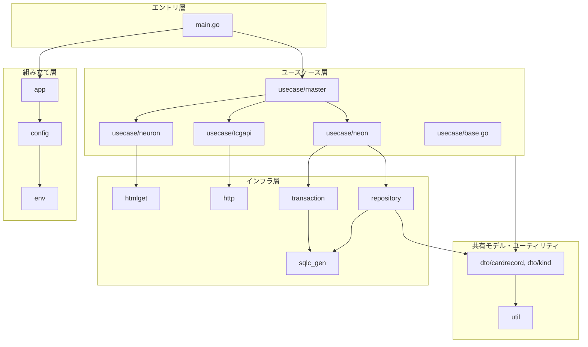
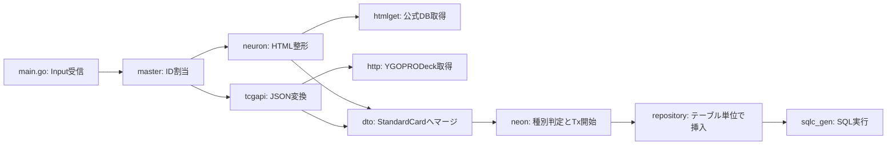

# infoInsert 各層の役割

`code/cardApiCall/infoInsert` を構成する各層（パッケージ）について、**責務・依存してよい相手・してはいけないこと**を整理する。
記述は 2026-10 時点の実装に基づく。全体像は [01_infoInsert_repository_analysis.md](./01_infoInsert_repository_analysis.md) を参照。

---

## 1. 層の全体像

依存の向きは原則 **上 → 下**（エントリ → ユースケース → インフラ）。共有モデル（`dto`）はどの層からも参照される。

---

## 2. 層ごとの役割

### 2.1 エントリ層 — `main.go`

| 項目 | 内容 |
|---|---|
| 責務 | Lambda イベントの受信、JSON → `Input` 変換、入力バリデーション、ユースケースの呼び出し、`Output` 返却 |
| 依存先 | `app`（DI コンテナ）、`usecase/master`（interface 経由） |
| やらないこと | ビジネスロジック、DB・外部 API への直接アクセス |
| 実装 | [main.go](../../code/cardApiCall/infoInsert/main.go) |

- DI コンテナはグローバル変数で 1 回だけ初期化し、Lambda のウォームスタート時に再利用する。
- 将来 API Gateway 等の入口を増やす場合は、空ディレクトリの `handler/` に同種の責務を置く想定。

### 2.2 組み立て層 — `app` / `config` / `env`

| パッケージ | 責務 |
|---|---|
| `app` | `samber/do` の Injector を作り、DB 接続と各 UseCase のコンストラクタを登録する（[dependency_injection.go](../../code/cardApiCall/infoInsert/app/dependency_injection.go)） |
| `config` | 環境変数から接続文字列を作り、`*sql.DB` を `DbConn` で包んで提供する。テスト用 DB 接続もここにある |
| `env` | `os.LookupEnv` のラッパー。デフォルト値付きで文字列・整数を取得する |

- **オブジェクトの生成と配線だけ**を担当し、処理ロジックは持たない。
- テストでは `do.Override` により、DB 接続や UseCase を差し替えられる。

### 2.3 ユースケース層 — `usecase/`

アプリケーションの「何をするか」を表す中心の層。どの UseCase も **interface（公開）+ impl 構造体（非公開）+ `NewXxxUseCase(i *do.Injector)`** の形でそろえている。

| UseCase | 責務 | 主な依存 |
|---|---|---|
| `usecase/base.go` | 共通の基底 `UseCaseImpl`。DB 接続を持ち `ProduceConnDB()` で渡す。ジェネリクスのコンストラクタ `NewUseCase[T]` を提供 | `config` |
| `master` | **オーケストレーション**。1 枚分の取り込み（Neuron → TCG → マージ → Neon）と、ワーカープールで ID 範囲を並列処理する | `neuron`, `tcgapi`, `neon`, `dto` |
| `neuron` | 公式 DB から取得した HTML を **日本語名・日本語テキスト・ペンデュラムテキスト・英名** に整形する | `htmlget`, `util`, `dto` |
| `tcgapi` | 英名で YGOPRODeck API を呼び、レスポンス JSON を `TcgApiCard` に変換する。API が受け付けない記号もここで除去する | `http`, `dto` |
| `neon` | DB への登録と参照。カード種別（Monster / Spell / Trap）の判定、**トランザクション境界の決定**、名前 → マスタ ID の解決、サブテーブルへの振り分け | `transaction`, `repository`, `sqlc_gen`, `dto` |

**この層のルール**

- トランザクションの開始・終了は UseCase が決める（`transaction.ExecTx` のコールバック内で Repository を生成する）。
- 外部サービスごとに UseCase を分け、`master` だけがそれらを組み合わせる。
- `domain/` は空なので、ドメインのルール（例: `Type` 文字列による種別判定、リンクマーカーのビットマスク化）は現在 `usecase/neon` と `dto/kind` に分かれて置かれている。

### 2.4 インフラ層

外部とのやり取りを隠す層。UseCase から呼ばれる。

| パッケージ | 責務 | 実装の要点 |
|---|---|---|
| `htmlget` | colly でページを取得し、CSS セレクタごとに抽出したテキストを `map[SelectorKey]string` で返す | セレクタ定義と URL は [htmlget/neuron.go](../../code/cardApiCall/infoInsert/htmlget/neuron.go) |
| `http` | `net/http` で GET し、レスポンス本文を `[]byte` で返す。YGOPRODeck 用の URL 組み立ても担当 | [http/tcg.go](../../code/cardApiCall/infoInsert/http/tcg.go) |
| `repository` | **テーブル単位**で sqlc の Queries を包み、DB の型（`sql.Null*` など）を `dto` の型に変換する。操作ごとの所要時間とエラーを zap で記録する | 例: [repository/race.go](../../code/cardApiCall/infoInsert/repository/race.go) |
| `transaction` | `Run`（コア層: `*sql.Tx` 制御）/ `RunWith`（アダプタ層）/ `ExecTx` / `ExecNonTx` でトランザクション境界を提供。詳細は [03_generic_transaction_pattern.md](./03_generic_transaction_pattern.md) 参照 | [transaction.go](../../code/cardApiCall/infoInsert/transaction/transaction.go) |
| `sqlc_gen` | `sqlc/` の SQL から**自動生成**されたコード。**手で編集しない** | 生成元: [sqlc.yaml](../../code/cardApiCall/infoInsert/sqlc.yaml) |

**この層のルール**

- Repository はトランザクションを開始しない。受け取った `Queries`（Tx 付き/なし）をそのまま使う。
- Repository は他の Repository を呼ばない。複数テーブルにまたがる処理は UseCase でまとめる。
- SQL を変えるときは `sqlc/queries/*.sql` または `sqlc/db/schema.sql` を直して再生成する。

### 2.5 共有モデル・ユーティリティ — `dto` / `util`

| パッケージ | 責務 |
|---|---|
| `dto/cardrecord` | 層の間で受け渡すカードデータの型。`NeuronExtractedData`・`TcgApiCard`（取得結果）、`StandardCard`（マージ後の共通形式）、`*SelectResult`（DB 取得結果）。変換関数 `GenerateStandardCardFromNeuronAndTCGAPIResult` と `ToInsertCardParamsExceptMonster` も持つ |
| `dto/kind` | 属性・種族・モンスタータイプ・魔法/罠タイプなどの区分値と、リンクマーカー文字列 → ビットマスク変換 |
| `dto/base.go` | Select 結果の共通フィールド（`AbstractSelectResult`） |
| `util` | 文字列の整形（改行・タブでの分割など）、Go の値 → `sql.Null*` 変換 |

---

## 3. 1 枚のカードがどの層を通るか

| ステップ | 層 | 受け取る型 → 返す型 |
|---|---|---|
| 公式 DB 取得 | `htmlget` | URL → `map[SelectorKey]string` |
| 整形 | `usecase/neuron` | `cardID` → `NeuronExtractedData` |
| API 取得 | `http` | 英名 → `[]byte` |
| 変換 | `usecase/tcgapi` | 英名 → `TcgApiCard` |
| マージ | `dto/cardrecord` | 上の 2 つ → `StandardCard` |
| 登録 | `usecase/neon` → `repository` | `StandardCard` → `card.ID` |

---

## 4. 現状の層構造で気になる点

コードを読んで気づいた点で、動かしての確認はしていない。

| 点 | 内容 | 方向性 |
|---|---|---|
| `dto` が `sqlc_gen` に依存 | `StandardCard.ToInsertCardParamsExceptMonster()` が sqlc の型を返すため、共有モデルがインフラの型を知っている | DB 型への変換は `repository` に移す |
| UseCase がインフラを直接生成 | `neuron` / `tcgapi` が `htmlget.NewNeuronHtmlGetter()` や `http.NewTCGRest()` を関数の中で `new` している | DI に登録して interface で受け取れば、モックでテストできる |
| DB 不要な UseCase も DB 接続を持つ | `NewUseCase` が全 UseCase に `DbConn` を入れるため、`neuron` / `tcgapi` も DB に依存する | 基底を「DB あり / なし」に分ける |
| `neon` に一部 `sqlc_gen` 直接利用 | 参照系（`GetMonsterCardByID` など）は `transaction` を通さず `sqlc_gen.New(...)` を直接呼ぶ | `tr.ExecNonTx` にそろえる |
| ドメイン層が空 | 種別判定などのルールが `usecase/neon` と `dto/kind` に分かれている | ルールが増えたら `domain/` に集める |
| パッケージ名 `http` | 標準ライブラリの `net/http` と名前が同じ | `tcgclient` などに改名 |

---

## 5. 新しくコードを足すときの置き場所

| 追加したいもの | 置き場所 |
|---|---|
| 新しい外部 API / サイトからの取得 | インフラ（`http` / `htmlget`）＋ それを包む UseCase を新設し、`app` に登録 |
| 新しいテーブル・クエリ | `sqlc/` に SQL を追加 → `sqlc generate` → `repository/` にラッパーを追加 |
| 複数テーブルにまたがる登録・更新 | `usecase/neon`（トランザクション境界はここ） |
| 複数の UseCase を組み合わせる処理 | `usecase/master` |
| 区分値・変換ルール | `dto/kind` |
| 新しい入口（API Gateway など） | `handler/`（現在は空） |
