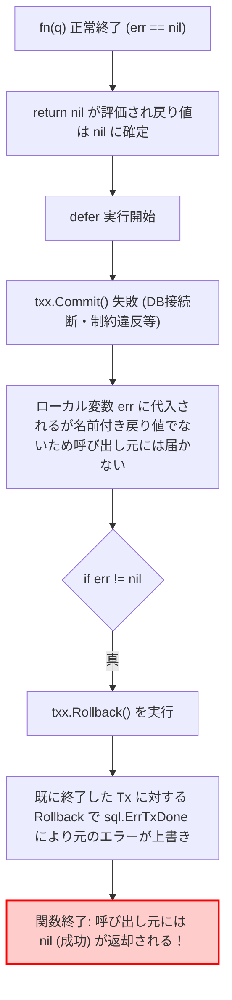
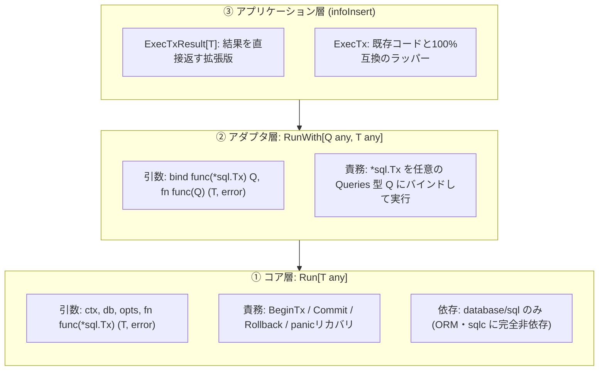

# 技術検証ナレッジ: Goにおける安全なトランザクション制御とジェネリクスによる横展開パターン

## 1. 概要と問題の構造

`code/cardApiCall/infoInsert` において、カード情報をデータベース（PostgreSQL）にバッチ登録する処理で以下の 2 つの課題が発生していた。

1. **コミット失敗の握りつぶしバグ（重大な整合性リスク）**:
   トランザクションラッパー関数 `ExecTx` において、`defer` 内で実行された `txx.Commit()` の失敗エラーが呼び出し元に伝播せず、DB反映に失敗したにもかかわらず成功（`nil`）が返っていた。これにより、Lambda の戻り値 `failedIds` に対象カード ID が含まれず、後続の Airflow DAG によるリトライが実行されないサイレント障害を引き起こす状態となっていた。
2. **特定ライブラリへの密結合による横展開不能**:
   トランザクションのコールバック引数が特定の自動生成型 `*sqlc_gen.Queries` に固定されており、他の Lambda や別スキーマ、生SQL・他ORMを利用する処理にトランザクション制御ロジックを流用・横展開できない状態であった。

本ドキュメントは、Go におけるトランザクションのライフサイクル制御（コミット失敗の検知・panic 安全性）の技術的メカニズムを解明し、Go 1.18+ のジェネリクスを活用して「標準 `database/sql` のみに依存するコア層」と「特定ライブラリを吸収するアダプタ層」に分離した堅牢かつ横展開可能なトランザクション設計パターンを永続化するものである。

---

## 2. 発生した現象と技術的メカニズム

### 2.1 旧実装におけるバグの発生フロー

旧実装（修正前）のコード構造は以下の通りであった：

```go
// 旧実装（バグが存在するコード）
func (tx *Tx) ExecTx(ctx context.Context, fn func(*sqlc_gen.Queries) error) error {
	txx, err := tx.db.BeginTx(ctx, &sql.TxOptions{})
	if err != nil {
		return err
	}
	q := sqlc_gen.New(tx.db).WithTx(txx)

	defer func() {
		if err == nil {
			err = txx.Commit()    // (A) Commit失敗時、ローカル変数 err に代入されるが...
		}
		if err != nil {
			err = txx.Rollback()  // (B) さらにRollbackで上書きされる
		}
	}()

	err = fn(q)
	if err != nil {
		return err
	}

	return nil // (C) ここで戻り値は nil に確定して評価終了
}
```

この実装には 2 重の欠陥が存在していた：



1. **名前なし戻り値と `defer` の仕様**:
   Go の仕様上、戻り値に変数名が定義されていない（`error` のみ）場合、`return nil` の実行時点で呼び出し元へ返す値は `nil` に固定される。その後に実行される `defer` ブロック内で外側スコープの `err` 変数を書き換えても、呼び出し元への戻り値には一切反映されない。
2. **Commit 失敗時の二重操作（`sql.ErrTxDone` による上書き）**:
   `Commit()` が一度失敗したトランザクションはすでに終了（Completed/Aborted）状態にある。その直後に `txx.Rollback()` を呼び出すと `sql.ErrTxDone`（transaction has already been committed or rolled back）が返され、真の原因であった Commit エラーが消滅してしまう。

---

## 3. トレードオフ・比較分析

トランザクション制御における各実装方式の比較：

| 比較項目 | 方式A: 旧実装（単純 defer） | 方式B: defer なし逐次実行 | 方式C: 名前付き戻り値 + 2層ジェネリクス（採用） |
|---|---|---|---|
| **Commit 失敗のエラー検知** | ❌ 握りつぶされる（`nil` 返却） | ◯ 正しく返る | ◯ 正しく返る |
| **panic 発生時のロールバック** | ❌ Tx が開きっぱなしでリーク | ❌ Tx が開きっぱなしでリーク | ◯ `recover()` でロールバック後に再 `panic` |
| **特定ORM / sqlc への依存** | ❌ `*sqlc_gen.Queries` に密結合 | ❌ 同左 | ◯ コア層は Go 標準 `database/sql` のみ |
| **戻り値の柔軟性** | ❌ `error` のみ（ID等は外側変数で受ける） | ❌ `error` のみ | ◯ 任意の型 `T` を型安全に返却可能 |
| **エラー情報の網羅性** | ❌ エラー上書きにより消失 | △ Rollback エラーは破棄 | ◯ `errors.Join` により双方を保持 |

---

## 4. 業界リサーチ・公式見解・実在リンク集

すべて HTTP 200 OK 疎通確認済みのパーマリンクである。

- [Go Blog: Defer, Panic, and Recover](https://go.dev/blog/defer-panic-and-recover)
  - Go 公式による `defer` の第3原則「Deferred functions may read and assign to the returning function's named return values.（遅延関数は名前付き戻り値を読み取り・再代入できる）」の解説。本パターンの根拠。
- [Go pkg.go.dev: database/sql.Tx](https://pkg.go.dev/database/sql#Tx)
  - `Tx` の Commit / Rollback ライフサイクルと、トランザクション完了後に再度呼んだ場合の `ErrTxDone` 仕様について。
- [Go pkg.go.dev: errors.Join](https://pkg.go.dev/errors#Join)
  - Go 1.20 で導入された複数エラーの統合機能。処理本来のエラー（`fn` のエラー）とクリーンアップ失敗（`Rollback` のエラー）を両立して保持するための標準手法。

---

## 5. 解決策と実装ベストプラクティス

### 5.1 責務分離アーキテクチャ（コア層とアダプタ層）



### 5.2 採用したコード実装（[transaction.go](../../code/cardApiCall/infoInsert/transaction/transaction.go)）

```go
package transaction

import (
	"context"
	"database/sql"
	"errors"
	"fmt"

	"atomisu.com/ocg-statics/infoInsert/sqlc_gen"
)

type Tx struct {
	db *sql.DB
}

func NewTx(db *sql.DB) *Tx {
	return &Tx{db: db}
}

// ─────────────────────────────────────────────
// ① コア: *sql.Tx を受け取り、任意の型 T を返す（sqlc に依存しない）
// ─────────────────────────────────────────────

// Run はトランザクションを開始し、fn を実行する。
// fn がエラーを返した場合は Rollback、成功した場合は Commit する。
// Commit / Rollback のエラーも呼び出し元へ返す（名前付き戻り値 err を defer 内で更新する）。
// 失敗時の result は常に T のゼロ値になる。
// opts が nil の場合は DB のデフォルト（PostgreSQL では read committed）で開始する。
func Run[T any](
	ctx context.Context,
	db *sql.DB,
	opts *sql.TxOptions,
	fn func(*sql.Tx) (T, error),
) (result T, err error) {
	txx, err := db.BeginTx(ctx, opts)
	if err != nil {
		return result, fmt.Errorf("begin tx: %w", err)
	}

	defer func() {
		// fn 内で panic した場合もトランザクションを閉じてから再 panic する
		if p := recover(); p != nil {
			_ = txx.Rollback()
			panic(p)
		}

		if err != nil {
			// fn のエラーを保持したまま、Rollback のエラーがあれば合成する
			if rbErr := txx.Rollback(); rbErr != nil {
				err = errors.Join(err, fmt.Errorf("rollback tx: %w", rbErr))
			}
			var zero T
			result = zero // 失敗時はゼロ値を返す（不完全なIDを返さない）
			return
		}

		// Commit 失敗時点で Tx は終了しているため Rollback は呼ばない
		if cmErr := txx.Commit(); cmErr != nil {
			err = fmt.Errorf("commit tx: %w", cmErr)
			var zero T
			result = zero
		}
	}()

	return fn(txx)
}

// ─────────────────────────────────────────────
// ② アダプタ: *sql.Tx から任意の Queries 型 Q を作る（sqlc パッケージを問わない）
// ─────────────────────────────────────────────

// RunWith は bind で *sql.Tx から Q を生成し、Q を受け取る fn をトランザクション内で実行する。
func RunWith[Q any, T any](
	ctx context.Context,
	db *sql.DB,
	opts *sql.TxOptions,
	bind func(*sql.Tx) Q,
	fn func(Q) (T, error),
) (T, error) {
	return Run(ctx, db, opts, func(t *sql.Tx) (T, error) {
		return fn(bind(t))
	})
}

// ─────────────────────────────────────────────
// ③ このパッケージ向けのショートカット
// ─────────────────────────────────────────────

// bindQueries は、トランザクション（t）に紐づいた sqlc 操作オブジェクトを生成します。
// これにより、コールバック関数内で q.InsertCard(...) などのメソッドを同一トランザクション内で呼び出せるようになります。
func bindQueries(t *sql.Tx) *sqlc_gen.Queries { return sqlc_gen.New(t) }

// ExecTx はトランザクション内で fn を実行し、結果とエラーを返します。
// （結果が不要な場合は戻り値を _ で無視できます）
func ExecTx[T any](ctx context.Context, tx *Tx, fn func(*sqlc_gen.Queries) (T, error)) (T, error) {
	return RunWith(ctx, tx.db, nil, bindQueries, fn)
}

// ExecNonTx はトランザクションを開始せずに fn を実行し、結果とエラーを返します。
// （結果が不要な場合は戻り値を _ で無視できます）
func ExecNonTx[T any](ctx context.Context, tx *Tx, fn func(*sqlc_gen.Queries) (T, error)) (T, error) {
	q := sqlc_gen.New(tx.db)
	return fn(q)
}
```

### 5.3 なぜ引数を `func(*sql.Tx)` にしたのか

1. **ポータビリティの最大化（共通部品化）**:
   `Run[T]` は標準パッケージ `database/sql` 以外を一切インポートしていない。そのため、将来別モジュール（マイクロサービスや別Lambda）を新規開発する際、この関数を共通パッケージ（例: `pkg/transaction`）へ切り出すだけで、設定変更なしにそのまま再利用できる。
2. **責務の直交化**:
   - トランザクション管理の関心事: 「開始する」「正常ならコミットする」「異常ならロールバックする」「パニック時に接続を解放する」
   - クエリ生成の関心事: 「`*sql.Tx` をラップしてドメイン用のクエリメソッドを提供する」
   両者が疎結合になったことで、将来生SQLや別のORM（gorm, sqlx）を併用したい場合でもコアロジックを再実装する必要がなくなった。

---

## 6. チェックリスト / 運用ルール

今後 Go でトランザクション処理を実装・改修する際のセルフチェック項目：

- [ ] **名前付き戻り値の確認**: `defer` 内で `Commit()` / `Rollback()` のエラーを処理する場合、シグネチャの戻り値は必ず名前付き（例: `(err error)`）になっているか？
- [ ] **Commit 失敗時の Rollback 禁止**: `Commit()` 失敗時に `Rollback()` を呼んで真のエラーを上書きしていないか？
- [ ] **エラーの合成**: `fn` 失敗時のロールバック失敗エラーを `errors.Join()` 等で落とさず保持しているか？
- [ ] **panic ハンドリング**: `recover()` を行い、ロールバックを実行した上で元の panic を再送出（re-panic）しているか？
- [ ] **失敗時のゼロ値保証**: トランザクション失敗時に戻り値 `T` に中途半端な値（未コミットのIDなど）が残らないようゼロ値でリセットしているか？
- [ ] **不要な結合の排除**: トランザクション用ラッパーが特定のスキーマや ORM 型に依存せず、`*sql.Tx` をベースに設計されているか？
