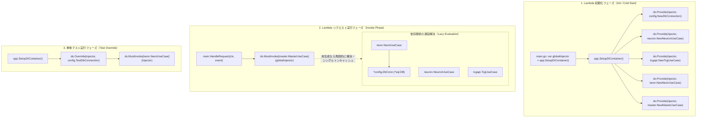

# 技術検証ナレッジ: samber/do と Go ジェネリクスを活用した軽量 DI コンテナアーキテクチャ

## 1. 概要と問題の構造

`code/cardApiCall/infoInsert` は AWS Lambda 環境で動作するバッチ処理であり、カード情報のスクレイピング（Neuron）、外部 Web API 連携（YGOPRODeck / TCG API）、および PostgreSQL（Neon）へのデータ登録・トランザクション制御を担当する。

このような多層アーキテクチャ（Entry / UseCase / Infra / Model）において、以下の設計課題が存在していた：

1. **Lambda 実行環境におけるコールドスタート遅延の最小化**:
   - `google/wire` のような静的コード生成ツールはビルド手順が肥大化しやすく、`uber-go/fx` などのリフレクションを多用するフレームワークは起動時オーバーヘッドが大きく、Lambda の初期化処理（Init Phase）に悪影響を与える。
2. **テスト容易性（Testability）の確保**:
   - 単体テスト・統合テストにおいて、本番用 DB 接続や外部通信クライアントを安全かつ局所的にモック・テスト用 DB 接続へ差し替える仕組み（DI オーバーライド）が必要。
3. **ボイラープレートコードの肥大化抑制**:
   - すべての UseCase が DB 接続を必要とするわけではない（例: HTML 整形を行う `neuron` や HTTP 通信を行う `tcgapi`）が、共通基底の生成処理で定型コードが重複しやすい。

本リポジトリでは、Go 1.18+ の型安全なジェネリクスを活用した DI ライブラリ **`samber/do`** と、独自定義の **ジェネリクスコンストラクタ `usecase.NewUseCase[T]`** を組み合わせることで、リフレクション不要で高速・型安全・テスタブルな DI 方式を採用している。

---

## 2. 発生した現象と技術的メカニズム

### 2.1 samber/do の DI ライフサイクルと全体フロー



### 2.2 依存関係解決の仕組み

1. **遅延評価（Lazy Singleton）**:
   `do.Provide` を呼び出した時点では、インスタンス化関数（ファクトリ）が登録されるだけでインスタンスは生成されない。初回 `do.Invoke[T]` 時にのみ実行され、以降はシングルトンとしてメモリにキャッシュされる。
2. **Lambda Init スコープでの初期化**:
   `main.go` のパッケージ変数 `globalInjector = app.SetupDIContainer()` として 1 度だけ登録することで、後続の Lambda ウォームスタンバイ実行時にファクトリ登録コストがゼロになる。
3. **テストにおける安全な上書き**:
   `do.Override(injector, ...)` を呼ぶことで、既存の型登録をテスト用の実装（テストDB接続など）に非破壊で差し替えることができる。

---

## 3. DI 方式のトレードオフ・比較分析

本方式と他メジャーな Go DI 方式を比較した結果は以下の通りである。

| 比較項目 | `samber/do`（本採用方式） | `google/wire`（コード生成型） | `uber-go/fx`（リフレクション型） | 手動 DI（Pure Go） |
| :--- | :--- | :--- | :--- | :--- |
| **型安全性** | **高**（Go ジェネリクスによりコンパイル時に型検証） | **極高**（コンパイル前に静的コード生成） | **低**（`interface{}` とリフレクションによる実行時判定） | **極高**（完全コンパイル時検査） |
| **初期化速度 / コールドスタート** | **極小**（ファクトリポインタの保持のみ、リフレクションなし） | **ゼロ**（通常の関数呼び出しと等価） | **中〜大**（リフレクション解析によるオーバーヘッドあり） | **ゼロ** |
| **テスト時のモック差し替え** | **極めて容易**（`do.Override` 呼出しのみ） | **やや煩雑**（WireSet を再構築または手動生成） | **容易**（モックオプション提供） | **やや煩雑**（構造体初期化を手動ですべて組み立て） |
| **コード自動生成の手間** | **なし**（`go generate` 不要） | **あり**（ファイル追加・更新ごとに再生成必須） | **なし** | **なし** |
| **Lambda との親和性** | **極めて高い**（軽量かつ手動生成不要） | 高い | やや不向き（Init Phase でリフレクション負荷） | 高い |

**採用理由**:
Lambda 開発においては `wire` のような事前生成ステップを CI/ローカルで管理するコストを削減しつつ、リフレクションフリーな速度と `do.Override` による簡潔なテスト差し替えを実現できる `samber/do` が最適解となる。

---

## 4. 業界リサーチ・公式見解・実在リンク集

- [samber/do (GitHub)](https://github.com/samber/do) - Go 1.18+ ジェネリクスを活用した軽量 DI パッケージ（HTTP 200 確認済み）
- [Go pkg.go.dev: github.com/samber/do](https://pkg.go.dev/github.com/samber/do) - `do.Provide`, `do.Invoke`, `do.Override` の API リファレンス（HTTP 200 確認済み）
- [AWS Lambda Documentation: Defining Lambda function handler in Go](https://docs.aws.amazon.com/lambda/latest/dg/golang-handler.html) - ハンドラー外（初期化フェーズ）での接続・DI初期化のベストプラクティス（HTTP 200 確認済み）

---

## 5. 解決策と実装ベストプラクティス

本プロジェクトにおける DI 実装は、以下の 3 つの階層で役割分担されている。

### ① コンテナセットアップ層（`app/dependency_injection.go`）
コンテナを生成し、必要な依存コンポーネントを型安全に登録する。

```go
func SetupDIContainer() *do.Injector {
    injector := do.New()

    // 1. インフラ / 接続
    do.Provide(injector, config.NewDbConnection)

    // 2. ユースケース（上位層）
    do.Provide(injector, neuron.NewNeuronUseCase)
    do.Provide(injector, tcgapi.NewTcgUseCase)
    do.Provide(injector, neon.NewNeonUseCase)
    do.Provide(injector, master.NewMasterUseCaseForDI) // DIアダプタを登録

    return injector
}
```

### ② ジェネリクスを活用した基底ユースケース生成（`usecase/base.go`）
DB 接続を必要とするユースケースのために、ジェネリクス関数 `NewUseCase[T]` を提供し、型キャストや重複コードを排除する。

```go
// UseCaseImpl は DB 接続を保持する共通基底
type UseCaseImpl struct {
    dbConn *config.DbConn
}

// NewUseCase は渡されたコンストラクタ関数を使って新規のユースケースを作成する
func NewUseCase[T interface{ UseCase }](i *do.Injector, constructor func(*UseCaseImpl) T) (T, error) {
    dbConn, err := do.Invoke[*config.DbConn](i)
    if err != nil {
        var zero T
        return zero, err
    }

    return constructor(&UseCaseImpl{
        dbConn: dbConn,
    }), nil
}
```

### ③ Pure DI コンストラクタと DI アダプタの分離（`usecase/master/master.go`）
コンストラクタ本体は `*do.Injector` を受け取らず、必要なインターフェースのみを直接受け取る（Pure DI 原則）。
DI コンテナへのバインドは別のアダプタ関数 `NewMasterUseCaseForDI` が担当する。

```go
// 1. 純粋なコンストラクタ（Pure DI: 外部ライブラリ samber/do に一切非依存）
func NewMasterUseCase(
    neuronUC neuron.NeuronUseCase,
    tcgapiUC tcgapi.TcgUseCase,
    neonUC neon.NeonUseCase,
) MasterUseCase {
    return &masterUseCaseImpl{
        neuronUseCase: neuronUC,
        tcgapiUseCase: tcgapiUC,
        neonUseCase:   neonUC,
    }
}

// 2. samber/do コンテナ用のアダプタ関数
func NewMasterUseCaseForDI(i *do.Injector) (MasterUseCase, error) {
    neuronUC, err := do.Invoke[neuron.NeuronUseCase](i)
    if err != nil {
        return nil, err
    }
    tcgapiUC, err := do.Invoke[tcgapi.TcgUseCase](i)
    if err != nil {
        return nil, err
    }
    neonUC, err := do.Invoke[neon.NeonUseCase](i)
    if err != nil {
        return nil, err
    }

    return NewMasterUseCase(neuronUC, tcgapiUC, neonUC), nil
}
```

### ④ テスト時における局所オーバーライド（`usecase/neon/neon_card_test.go`）
テストケースごとにコンテナを取得し、`do.Override` でテスト用 DB コネクションに差し替える。

```go
injector := app.SetupDIContainer()
// 本番用 DB コネクションをテスト用 DB にオーバーライド
do.Override(injector, config.TestDbConnection)

neonUseCase := do.MustInvoke[neon.NeonUseCase](injector)
```

---

## 6. チェックリスト / 運用ルール

新規にサービス・リポジトリ・ユースケースを追加する際は、以下の項目を順守すること：

- [ ] **インターフェースの分離**: UseCase は必ず `interface`（公開）と `impl 構造体`（非公開）を分離して定義しているか？
- [ ] **DI コンテナへの登録**: 新規コンポーネントを追加した際、`app/dependency_injection.go` に `do.Provide(injector, ...)` を追記したか？
- [ ] **循環参照の禁止**: パッケージ間で A → B, B → A となるような循環依存が発生していないか？（`master` のみが複数の個別 UseCase を束ねるルールを守る）
- [ ] **テスト時のオーバーライド**: 単体・結合テストでモックやテスト用DBを使う場合、テスト関数内で個別に `SetupDIContainer()` を呼び出して `do.Override` を適用しているか？（グローバルコンテナを直接上書きして他テストを汚染していないか？）
