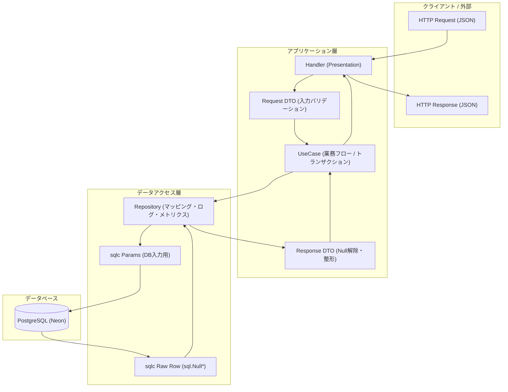

# DTO 設計方針: なぜ Entity を排し、DTO を防波堤とするのか

本ドキュメントは、`code/cardApiCall/infoInsert` をはじめとする本リポジトリの Go アプリケーションにおいて、**「なぜ DDD 的な Entity を導入せず、DTO（Data Transfer Object）を中心に据えるのか」** というアーキテクチャの基本方針と設計原則をまとめたものです。

---

## 1. アーキテクチャの基本方針

本プロジェクトの基本方針は以下の 1 行に集約されます：

> **「教条的な Entity は作らないが、境界を守る DTO は絶対に用意する」**

これは、過剰なレイヤリング（Clean Architecture の教条主義）による**詰め替え地獄**を避けつつ、sqlc の生型を外部に垂れ流す**ノーガード戦法（アンチパターン）**を徹底排除するための最も実用的（Pragmatic）な設計判断です。



---

## 2. 2 つのアンチパターン vs 本方針の比較

Go での DB 連携アプリケーション設計において、極端なアプローチはどちらも破綻を招きます。

### ❌ アンチパターン 1: DDD 教条主義による「多重詰め替え地獄」

```text
Request DTO → Entity (Validate) → sqlc Params → DB → sqlc Row → Entity → Response DTO
```

- **問題点**:
  - 中身がほぼ同じフィールドを持つ構造体を 1 回のリクエストで **3〜4 回も手作業で詰め替える** 虚無コードが量産される。
  - Go には自動マッパー（Java の MapStruct 等）がないため、手動コピーと単体テストの保守コストが爆発する。
  - 状態遷移のない ETL やデータ連携において、Entity に書くべき「振る舞い」が存在せず、ただの入れ物と化す。

### ❌ アンチパターン 2: sqlc 貫通「ノーガード戦法」

```text
HTTP Request → Handler (UseCase) → sqlc Params → DB → sqlc Row → HTTP Response
```

- **問題点**:
  - **JSON に `sql.NullString` が漏洩する**: API レスポンスが `{"name": {"String": "青眼の白龍", "Valid": true}}` のような最悪の JSON になる。
  - **DB スキーマ変更が API 仕様を即死させる**: テーブルのカラム名変更や型変更が、外部 API の互換性破壊に直結する。
  - **複数テーブル JOIN や集約に対応できない**: 画面表示やユースケースに必要な構造を柔軟に表現できない。

### ⭕ 本プロジェクトの採用方針: 「DTO 中心アーキテクチャ」

```text
Request DTO → UseCase → Repository (sqlc Params 変換) → DB → Repository (sqlc Row から変換) → Response DTO
```

- **メリット**:
  - **変換は最小限の 1 往復のみ**: DTO と sqlc の間でのみ詰め替えを行うため、コード量と保守コストを最小化。
  - **高い安全性とカプセル化**: DB の都合（`sql.Null*` や内部カラム名）を DTO の内側に完全に封じ込める。
  - **DB 制約を最大限活用**: 最強のバリデーションである DB の `NOT NULL`、`UNIQUE`、`FOREIGN KEY`、`CHECK` 制約を活かし、アプリ側の車輪の再発明を防ぐ。

---

## 3. DTO が果たす「4 つの防波堤」（責務）

DTO は単なるデータの入れ物ではなく、外部環境とデータベースの間に立つ**防波堤**として以下の 4 つの重要責務を担います。

### ① `sql.Null*` 型のカプセル化・無害化
sqlc が生成する `sql.NullString`, `sql.NullInt64`, `sql.NullTime` などのデータベース都合の型を、Go のプリミティブ型（`string`）やポインタ型（`*time.Time`）に変換し、UseCase や外部インターフェースに漏らしません。

```go
// ⭕ DTO 側で Null を解除して安全な型に変換
func FromSelectCardPackRow(row sqlc_gen.CardPack) CardPackDTO {
    var releaseDate *time.Time
    if row.ReleaseDate.Valid {
        releaseDate = &row.ReleaseDate.Time
    }
    return CardPackDTO{
        ID:          row.ID,
        PackCode:    row.PackCode,
        NameJa:      row.NameJa,
        NameEn:      row.NameEn.String, // sql.NullString を string に展開
        ReleaseDate: releaseDate,        // sql.NullTime を *time.Time に展開
    }
}
```

### ② DB スキーマと API 仕様のデカップリング（疎結合化）
データベースのカラム名（例: `release_date_jst`）と、API の JSON プロパティ名（例: `releaseDate`）を DTO のタグによって切り離します。これにより、DB のリファクタリングが外部クライアントに影響を与えません。

### ③ 入力値バリデーション・JSON シリアライズの境界
HTTP リクエストの JSON デコード、必須チェック、フォーマット変換を DTO の責務とします。不正なリクエストは DTO の生成・バインド時点で弾き、UseCase や DB に汚染されたデータを渡しません。

### ④ 複数テーブル JOIN 結果の表現（集約ビュー）
sqlc が出力するフラットな JOIN 結果（例: `SelectFullMonsterCardInfoRow`）を、カード本体・モンスター属性・リンクマーカー配列といった構造的なオブジェクトに再構築する責務を持ちます。

---

## 4. 実装パターンとテンプレートの活用

新規機能やテーブル追加時は、[docs/02_go_architecture/templates/dto.go.jinja](./templates/dto.go.jinja) を用いて DTO を作成します。

### 配置場所の原則
- DTO は [code/cardApiCall/infoInsert/dto/](../../code/cardApiCall/infoInsert/dto) 配下に定義します。
- カード関連の DTO は [code/cardApiCall/infoInsert/dto/cardrecord/](../../code/cardApiCall/infoInsert/dto/cardrecord) に集約します。

### 標準的な DTO 実装パターン

```go
package cardrecord

import (
    "database/sql"
    "time"
    "atomisu.com/ocg-statics/infoInsert/sqlc_gen"
    "atomisu.com/ocg-statics/infoInsert/util"
)

// CardPackDTO はカードパックのデータ転送構造体
type CardPackDTO struct {
    ID          int64      `json:"id"`
    PackCode    string     `json:"packCode"`
    NameJa      string     `json:"nameJa"`
    NameEn      string     `json:"nameEn"`
    ReleaseDate *time.Time `json:"releaseDate"`
}

// FromSelectCardPackRow: sqlc の Raw Row から DTO への変換（出力防波堤）
func FromSelectCardPackRow(row sqlc_gen.CardPack) CardPackDTO {
    var releaseDate *time.Time
    if row.ReleaseDate.Valid {
        releaseDate = &row.ReleaseDate.Time
    }
    return CardPackDTO{
        ID:          row.ID,
        PackCode:    row.PackCode,
        NameJa:      row.NameJa,
        NameEn:      row.NameEn.String,
        ReleaseDate: releaseDate,
    }
}

// ToInsertParams: DTO から sqlc の InsertParams への変換（入力防波堤）
func (d *CardPackDTO) ToInsertParams() sqlc_gen.InsertCardPackParams {
    var releaseDate sql.NullTime
    if d.ReleaseDate != nil {
        releaseDate = sql.NullTime{Time: *d.ReleaseDate, Valid: true}
    }
    return sqlc_gen.InsertCardPackParams{
        PackCode:    d.PackCode,
        NameJa:      d.NameJa,
        NameEn:      util.ParseAsSqlNullString(d.NameEn),
        ReleaseDate: releaseDate,
    }
}
```

---

## 5. 設計チェックリスト

新しい機能やテーブルを追加する際は、以下の原則を満たしているか確認してください：

- [ ] sqlc が生成した型（`sqlc_gen.*Row` や `sql.Null*`）が UseCase の戻り値や Handler にそのまま露出していないか？
- [ ] DTO の内部で `sql.Null*` の `Valid` チェックが行われ、Go プリミティブやポインタに適切にアンパックされているか？
- [ ] 振る舞いのない無意味な Entity 層（`domain/`）を増やして多重詰め替えを行っていないか？
- [ ] 外部 API / JSON 仕様と DB カラム名が DTO のタグ定義によって適切にデカップリングされているか？
