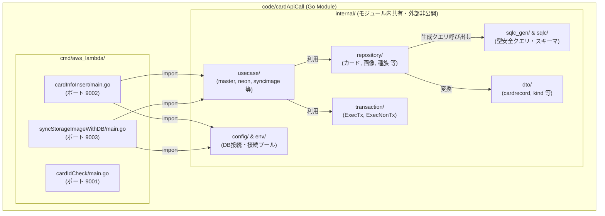

# Go マルチ Lambda パッケージアーキテクチャ標準ガイド

本ドキュメントは、`code/cardApiCall` において複数の AWS Lambda 関数（カード情報挿入バッチ、画像ストレージ同期バッチ等）を運用するにあたり、**データベース・Repository・DTO などの共通コードを二重管理せず一元管理しつつ、コンテナサイズと独立性を担保するための Go 標準パッケージアーキテクチャ** の設計原則および実装構成をまとめたものです。

---

## 1. 背景と課題

### 1.1 発生していた課題
本システムでは、外部 API（Neuron / YGOPRODeck）からカード情報を収集してデータベースに登録するバッチ（`cardInfoInsert`）に加え、S3/オブジェクトストレージへカード画像を保存・同期して DB の URL を更新するバッチ（`syncStorageImageWithDB`）が必要となりました。

しかし、両者は同じ PostgreSQL の `card_images` テーブルをはじめとする DB リソースを操作します。もしそれぞれの Lambda ごとに独立したモジュールを作成し、`sqlc`, `repository`, `dto`, `transaction`, `config` などのコードをコピー＆ペーストして配置した場合、以下の **「二重管理の致命的リスク」** が生じる状態でした：

1. **スキーマ変更時の片系障害**:
   カラム追加や型変更時に、片方の `schema.sql` や `sqlc generate`、Repository の追従を忘れてデプロイし、本番で障害が発生する。
2. **保守コストとテスト工数の倍増**:
   DB 接続プール管理やトランザクション基盤（Unit of Work）、共通 DTO を複数箇所で管理することによる認知負荷とメンテナンスコストの増大。

---

## 2. 検討したアーキテクチャと意思決定

二重管理を回避しつつ、サーバーレスの要件（コンテナサイズ肥大化防止、実行環境の分離）を満たすため、複数の選択肢を比較検討しました。

| 選択肢 | DB・共通コード管理 | AWS Lambda 関数 | 評価と採否 |
| :--- | :--- | :--- | :--- |
| **A. 単一 Lambda (Mode 引数)** | 一元管理 | 1 つ | 手軽だが、タイムアウト（最大15分）やメモリ設定、CloudWatch ログが混ざるため採用見送り |
| **B. Go Workspace / 外部共通モジュール** | 共通 `pkg` 等へ抽出 | 別々 (2つ) | Docker ビルドコンテキストがリポジトリルートに引き上げられ、CI/CD やローカル環境のオーバーヘッドが過大 |
| **C. Go 公式標準 layout (`cmd/` + `internal/`)** | **`internal/` で一元管理** | **別々 (2つ)** | **【採用】** Go 言語仕様による保護、コンテナサイズの最小化、エントリポイントの明確な分離をすべて満たす |

### Go 公式推奨レイアウトの採用
Go 公式ドキュメント（[Organizing a Go module - Multiple programs with supporting packages](https://go.dev/doc/modules/layout)）で推奨されている標準レイアウトに準拠し、以下の設計を適用しました：

- **`cmd/` 配下に各バイナリのエントリポイントを配置**:
  Lambda ごとに実行可能な `main.go` を独立して定義。さらに将来の CLI や別種バッチの追加を見据えて `cmd/aws_lambda/<lambda_name>/` 配下に集約。
- **`internal/` によるコンパイラレベルのカプセル化**:
  Go コンパイラの仕様により、`internal/` 配下のパッケージは **そのモジュール（`cardApiCall`）内からしか import できない** 制限が強制されます。安全に共通ロジックを共有・保護できます。



---

## 3. ディレクトリ構造

```text
code/cardApiCall/
├── go.mod                                          # モジュールルート (atomisu.com/ocg-statics/cardApiCall, Go 1.24)
├── go.sum
│
├── cmd/
│   └── aws_lambda/                                 # ★ 各 Lambda のエントリポイント
│       ├── cardIdCheck/
│       │   ├── Dockerfile                          # cardIdCheck 専用コンテナビルド
│       │   └── main.go                             # カードID存在チェック Lambda ハンドラー
│       │
│       ├── cardInfoInsert/
│       │   ├── Dockerfile                          # cardInfoInsert 専用コンテナビルド
│       │   ├── main.go                             # カード情報初期挿入 Lambda ハンドラー
│       │   └── app/                                # DI コンテナ初期化 (dependency_injection.go)
│       │
│       └── syncStorageImageWithDB/
│           ├── Dockerfile                          # syncStorageImage 専用コンテナビルド
│           ├── main.go                             # 画像ストレージ同期 Lambda ハンドラー
│           └── app/                                # DI コンテナ初期化 (dependency_injection.go)
│
├── internal/                                       # ★ モジュール内部ロジック（Go 言語仕様で外部非公開）
│   ├── config/                                     # DB接続・プール管理 (database.go, test_database.go)
│   ├── transaction/                                # トランザクション境界 (ExecTx, ExecNonTx)
│   ├── sqlc.yaml                                   # sqlc 設定ファイル
│   ├── sqlc/                                       # db/schema.sql, queries/*.sql
│   ├── sqlc_gen/                                   # sqlc 自動生成コード（直接編集禁止）
│   ├── repository/                                 # 各テーブル Repository 実装 & base.go
│   ├── dto/                                        # 共通 DTO (cardrecord/, kind/ 等)
│   ├── usecase/                                    # ユースケース層
│   │   ├── base.go                                 # UseCase 基底 (NewUseCase, ProduceConnDB)
│   │   ├── master/                                 # カード情報初期挿入オーケストレーション
│   │   ├── neon/                                   # Neon DB 保存 UseCase 群
│   │   ├── neuron/                                 # Neuron スクレイピング UseCase
│   │   ├── tcgapi/                                 # YGOPRODeck API 連携 UseCase
│   │   └── syncimage/                              # 画像ストレージ同期 UseCase
│   ├── htmlget/                                    # スクレイピング基底・実装
│   ├── http/                                       # HTTP 通信基底 (base.go)
│   ├── env/                                        # 環境変数定義
│   └── util/                                       # 汎用ユーティリティ
│
├── infoInsert/                                     # ※ 既存資産の安全性担保のため無傷で保持
└── cardidcheck/                                    # ※ 独立モジュールとして無傷で保持
```

---

## 4. 各層の責務とルール

### 4.1 `cmd/aws_lambda/<lambda_name>/`
- **責務**:
  - AWS Lambda のイベントハンドラー（`HandleRequest`）の定義。
  - DI コンテナ（`app.SetupDIContainer()`）の初期化と、リクエストごとの UseCase 呼び出し。
  - 入出力 JSON のマッピングと入力バリデーション（`startId`, `delta` の正当性チェック）。
- **ルール**:
  - ビジネスロジックや直接の DB アクセス（SQL 実行）を書いてはならない。
  - 必ず `internal/usecase` を DI 経由で呼び出す。

### 4.2 `internal/usecase/`
- **責務**:
  - トランザクション境界の制御（`transaction.ExecTx` / `transaction.ExecNonTx`）。
  - 外部 API、スクレイピング、DB Repository のオーケストレーション。
  - 共通基底として [base.go](../../code/cardApiCall/internal/usecase/base.go)（`UseCaseImpl`, `NewUseCase[T]`）を使用。
- **ルール**:
  - `cmd/` 配下のパッケージを import してはならない（循環参照防止）。

### 4.3 `internal/repository/`
- **責務**:
  - `internal/sqlc_gen` の自動生成クエリをラップし、テーブル単位の CRUD 操作を提供。
  - DB 型（`sql.Null*` 等）と DTO 型の相互変換。
- **ルール**:
  - トランザクションのコミット/ロールバック操作を行ってはならない。

---

## 5. コンテナビルドと最適化方針

マルチバイナリ構成において、「余計なコードを含んでコンテナイメージが肥大化するのではないか」という懸念を、**マルチステージビルドと最小限のファイルコピー** により解決しています。

```dockerfile
# code/cardApiCall/cmd/aws_lambda/cardInfoInsert/Dockerfile
FROM golang:1.24 AS build
ENV GOOS=linux
ENV GOARCH=arm64
WORKDIR /cardApiCall

# 依存関係のキャッシュ
COPY go.mod go.sum ./
RUN go mod download

# 共通内部コードと対象の Lambda エントリポイントのみをコピー
COPY internal/ ./internal/
COPY cmd/aws_lambda/cardInfoInsert/ ./cmd/aws_lambda/cardInfoInsert/

# 対象バイナリのみをビルド
RUN go build -tags lambda.norpc -o main ./cmd/aws_lambda/cardInfoInsert/main.go

# 実行環境イメージ（不要なビルドツール・他 Lambda のコードは一切含まれない）
FROM public.ecr.aws/lambda/provided:al2023
COPY --from=build /cardApiCall/main ./main
ENTRYPOINT [ "./main" ]
```

- **コンテキスト**: `./code/cardApiCall` を指定してビルド。
- **成果物**: 最終ステージのコンテナには、対象 Lambda の実行バイナリ（`main`）のみが格納されるため、**コンテナサイズは単体 Lambda と同等の最小サイズを維持** します。

---

## 6. CI/CD およびローカル検証の整備

### 6.1 GitHub Actions ワークフロー
[.github/workflows/lamda-cardinsert-deploy.yml](../../.github/workflows/lamda-cardinsert-deploy.yml) および [.github/workflows/lamda-idcheck-deploy.yml](../../.github/workflows/lamda-idcheck-deploy.yml) において、各 Lambda エントリポイントおよび内部共通コードの変更を検知して自動デプロイします。

### 6.2 ローカル Docker Compose
[compose.yaml](../../compose.yaml) にて、全 3 つの Lambda を独立したポートで同時に起動・検証できます：
- `cardapicall_idcheck`: ポート `9001`（`./cmd/aws_lambda/cardIdCheck/Dockerfile`）
- `cardapicall_infoinsert`: ポート `9002`（`./cmd/aws_lambda/cardInfoInsert/Dockerfile`）
- `cardapicall_syncstorageimage`: ポート `9003`（`./cmd/aws_lambda/syncStorageImageWithDB/Dockerfile`）

### 6.3 運用スクリプト一覧
| スクリプト | 用途 |
| :--- | :--- |
| [`scripts/code/cardApiCall/cardidcheck/build_and_push_to_ecr.sh`](../../scripts/code/cardApiCall/cardidcheck/build_and_push_to_ecr.sh) | cardIdCheck ECR ビルド＆プッシュ手動実行 |
| [`scripts/code/cardApiCall/cardinfoinsert/test_all.sh`](../../scripts/code/cardApiCall/cardinfoinsert/test_all.sh) | `internal` 構造に対応した全単体・結合テストの実行 |
| [`scripts/code/cardApiCall/cardinfoinsert/local_test.sh`](../../scripts/code/cardApiCall/cardinfoinsert/local_test.sh) | ポート `9002` へのリクエストテスト（デフォルト: startId=100, delta=10） |
| [`scripts/code/cardApiCall/syncstorageimage/local_test.sh`](../../scripts/code/cardApiCall/syncstorageimage/local_test.sh) | ポート `9003` へのリクエストテスト |
| [`scripts/code/cardApiCall/cardinfoinsert/build_and_push_to_ecr.sh`](../../scripts/code/cardApiCall/cardinfoinsert/build_and_push_to_ecr.sh) | cardInfoInsert ECR ビルド＆プッシュ手動実行 |
| [`scripts/code/cardApiCall/syncstorageimage/build_and_push_to_ecr.sh`](../../scripts/code/cardApiCall/syncstorageimage/build_and_push_to_ecr.sh) | syncStorageImage ECR ビルド＆プッシュ手動実行 |
| [`scripts/code/cardApiCall/internal/sqlc_generate.sh`](../../scripts/code/cardApiCall/internal/sqlc_generate.sh) | `internal/sqlc.yaml` からの sqlc コード自動生成 |

---

## 7. 既存資産（`infoInsert`, `cardidcheck`）の安全性

既存の [code/cardApiCall/infoInsert](../../code/cardApiCall/infoInsert) および [code/cardApiCall/cardidcheck](../../code/cardApiCall/cardidcheck) は、今回のリファクタリングにおいて **一切変更を加えていません**。  
万が一のトラブル時にもいつでも元のコード・テストを参照・実行可能な状態を維持しています。
