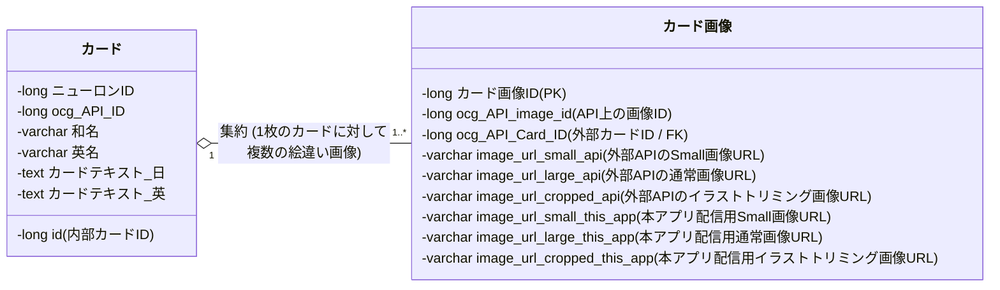
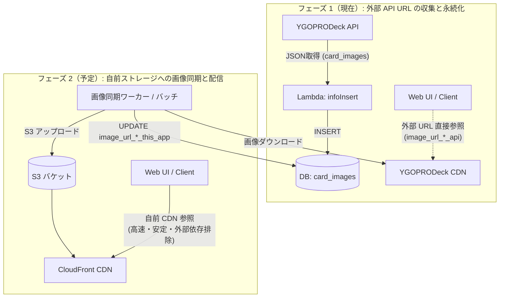

# カード画像データ管理設計 (Card Image Data Architecture)

## 1. 概要と背景

本ドキュメントは、遊戯王カードの画像情報を外部 API（YGOPRODeck / TCG API）から取得し、システム内で永続化・配信するためのデータモデル設計とアーキテクチャ方針を定義する。

### 1.1 背景と課題
従来、本システム（`infoInsert`）はカードのテキスト情報・数値情報（攻撃力、守備力、効果テキスト、種別・属性など）のみを収集し、Neon（PostgreSQL）に格納していた。
しかし、UI/Web アプリケーションでのカード一覧表示やデッキ構築・詳細表示においてカード画像が必須となったため、TCG API のレスポンスに含まれる画像メタデータを取得・保持し、将来的な S3 等への画像キャッシュ配信（`this_app`）を見据えたデータ構造へと拡張する必要が生じた。

---

## 2. クラス図とデータモデルの変更

[docs/01_data_prepare/card_class_diagram.md](../01_data_prepare/card_class_diagram.md) に反映されたクラス構造および関連は以下の通りである。

### 2.1 クラス関連図 (Mermaid)



### 2.2 1対多（`1..*`）の設計意図：絵違い（オルタナティブアート）対応
1枚のカード（同一の `ocg_API_ID` / カードテキスト / 効果）であっても、遊戯王カードには複数の絵違い（イラスト違い、レアリティ違い）が存在する。
そのため、カードとカード画像の多重度は **`1:N`（1対多）** で設計されている。

---

## 3. 各フィールドの定義と用途

| フィールド名 | 型 | 用途・説明 |
| :--- | :--- | :--- |
| **カード画像ID** | `BIGINT (PK)` | 本アプリの DB 内で発番するサロゲートキー。 |
| **ocg_API_image_id** | `BIGINT` | TCG API（YGOPRODeck）が返却する `card_images[].id`。画像単位の一意キー。 |
| **ocg_API_Card_ID** | `BIGINT (FK)` | 親カードの `ocg_api_id`（`cards` テーブルまたは API 上のカード ID）。 |
| **image_url_small_api** | `VARCHAR` | 外部 API 提供の軽量サムネイル画像 URL（例: `https://images.ygoprodeck.com/images/cards_small/XXXX.jpg`）。 |
| **image_url_large_api** | `VARCHAR` | 外部 API 提供の高解像度カード全体画像 URL（例: `https://images.ygoprodeck.com/images/cards/XXXX.jpg`）。 |
| **image_url_cropped_api** | `VARCHAR` | 外部 API 提供のイラスト枠部分のみを切り抜いた画像 URL（例: `https://images.ygoprodeck.com/images/cards_cropped/XXXX.jpg`）。 |
| **image_url_small_this_app** | `VARCHAR (Nullable)` | 本アプリ側でキャッシュ・ホストした画像（S3 / CloudFront 等）の Small URL。 |
| **image_url_large_this_app** | `VARCHAR (Nullable)` | 本アプリ側でキャッシュ・ホストした画像の Large URL。 |
| **image_url_cropped_this_app** | `VARCHAR (Nullable)` | 本アプリ側でキャッシュ・ホストした画像の Cropped URL。 |

---

## 4. DTO 定義の拡張

Go コード側（`code/cardApiCall/infoInsert/dto/cardrecord/carddto.go`）において、TCG API の JSON レスポンス構造に合わせて以下の DTO を定義・連携している。

```go
// CardImage は、TCG API から返却される画像情報
type CardImage struct {
    ID              int64  `json:"id"`
    ImageUrlSmall   string `json:"image_url_small"`
    ImageUrlLarge   string `json:"image_url_large"`
    ImageUrlCropped string `json:"image_url_cropped"`
}

// TcgApiCard に CardImages ([]CardImage) を追加
type TcgApiCard struct {
    ID                    int64       `json:"id"`
    Name                  string      `json:"name"`
    Desc                  string      `json:"desc"`
    CardImages            []CardImage `json:"card_images"`
    ...
}
```

---

## 5. 画像配信アーキテクチャの変遷と将来展望



1. **フェーズ 1（現状）**:
   - `infoInsert` により TCG API から画像 URL メタデータを取得し DB に保存する。
   - クライアントは `image_url_*_api` を参照して画像を表示する。
2. **フェーズ 2（自前配信化）**:
   - 外部 CDN のレートリミットやリンク切れ、表示速度低下を防ぐため、画像を S3 へ転送・キャッシュ。
   - `image_url_*_this_app` に CloudFront 経由の URL をセットし、本番環境の配信基盤として利用する。

---

## 6. 参照リンク（HTTP 200 確認済み）

- [YGOPRODeck API Guide](https://ygoprodeck.com/api-guide/) - `card_images`（`image_url`, `image_url_small`, `image_url_cropped`）の公式仕様
