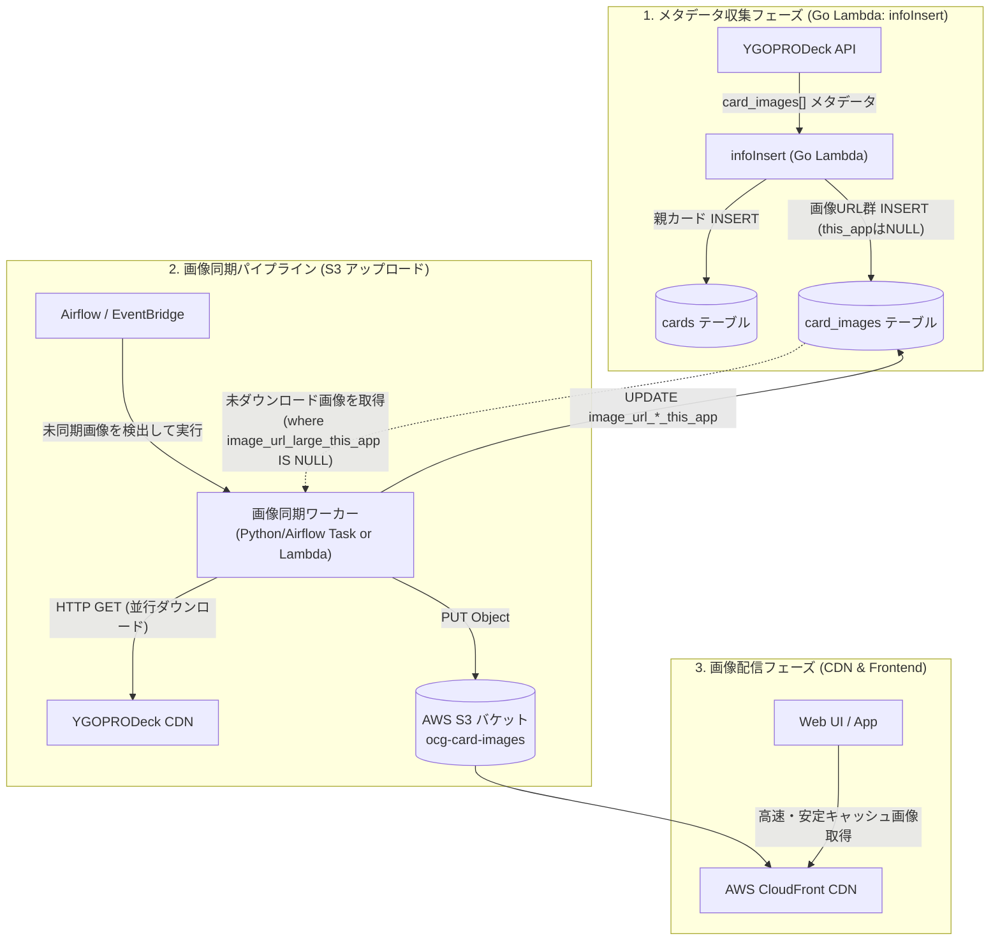

# カード画像パイプライン アーキテクチャ設計書

## 1. システム全体概要

本アーキテクチャは、遊戯王カードの画像メタデータ（URL群）をDBに永続化し、実体画像ファイルを外部CDNからダウンロードして自前 AWS S3 バケットへ配置、さらに配信URL（`image_url_*_this_app`）を更新するまでの一連の処理基盤を定義する。

### 主な要件
1. **DBスキーマ拡張**: クラス図に基づく `card_images` テーブルの新設と、カード（`cards`）との `1:N` 関連づけ。
2. **画像URLの登録（メタデータ収集）**: `infoInsert`（Go Lambda）内で TCG API から返却される `card_images` 配列を受け取り、`card_images` テーブルに INSERT する。
3. **画像ダウンロード & S3 配置**: 外部 CDN（`images.ygoprodeck.com`）から画像バイナリを非同期でダウンロードし、S3 にアップロード。
4. **自前配信 URL の更新**: S3 / CloudFront の URL を `card_images` の `image_url_*_this_app` に書き戻す。

---

## 2. アーキテクチャ構成図



---

## 3. DB スキーマ定義 (`card_images`)

### 3.1 テーブル定義 SQL (`sqlc/db/schema.sql` に追加)

```sql
CREATE TABLE card_images (
    id BIGSERIAL PRIMARY KEY,
    ocg_api_image_id BIGINT UNIQUE NOT NULL,
    ocg_api_card_id BIGINT NOT NULL,
    card_id BIGINT,
    image_url_small_api VARCHAR(1024) NOT NULL,
    image_url_large_api VARCHAR(1024) NOT NULL,
    image_url_cropped_api VARCHAR(1024) NOT NULL,
    image_url_small_this_app VARCHAR(1024),
    image_url_large_this_app VARCHAR(1024),
    image_url_cropped_this_app VARCHAR(1024),
    dataowner VARCHAR(255) DEFAULT 'system',
    regist_date TIMESTAMP DEFAULT current_timestamp,
    enable_start_date TIMESTAMP DEFAULT '1970-01-01 00:00:00',
    enable_end_date TIMESTAMP DEFAULT '9999-12-31 23:59:59',
    version BIGINT DEFAULT 1,
    FOREIGN KEY (card_id) REFERENCES cards(id) ON DELETE CASCADE
);

CREATE INDEX idx_card_images_card_id ON card_images(card_id);
CREATE INDEX idx_card_images_ocg_api_card_id ON card_images(ocg_api_card_id);
CREATE INDEX idx_card_images_sync_pending ON card_images(id) WHERE image_url_large_this_app IS NULL;
```

### 3.2 外部キーとインデックス設計の要点
- `card_id` は `cards(id)` を参照する外部キー。カード本体が削除された場合はカスケード削除。
- `image_url_large_this_app IS NULL` に対する部分インデックス（Partial Index）を作成し、**S3 未同期の画像を高速に抽出**可能にする。

---

## 4. S3 ストレージ設計と命名規則

### 4.1 S3 キー体系（ディレクトリ構造）
```text
s3://<bucket-name>/cards/
  ├── small/
  │   └── {ocg_api_image_id}.jpg      # サムネイル (カード全体)
  ├── large/
  │   └── {ocg_api_image_id}.jpg      # 高解像度 (カード全体)
  └── cropped/
      └── {ocg_api_image_id}.jpg      # イラスト部分のみ
```

- **キーに `ocg_api_image_id` を採用する理由**:
  - 同一カードの絵違い（オルタナティブアート）ごとにユニークなファイル名となり、上書き衝突を完全に防止できる。

### 4.2 CloudFront 配信 URL フォーマット
```text
https://images.example.com/cards/small/{ocg_api_image_id}.jpg
https://images.example.com/cards/large/{ocg_api_image_id}.jpg
https://images.example.com/cards/cropped/{ocg_api_image_id}.jpg
```

---

## 5. 同期ワーカー（画像ダウンロード & S3 配置）の選定比較

| 方式 | 特徴 | メリット | デメリット | 推奨度 |
| :--- | :--- | :--- | :--- | :--- |
| **A. Airflow Python Task** | 既存の Airflow DAG（`db_insert.py` の後続）で実行 | 既存インフラ・タスク依存関係（DB挿入後に即キック）をそのまま活用可能。大量ダウンロードもタイムアウトを気にせずバッチ処理できる | ワーカーコンテナのネットワーク負荷 | **◎ 最適（第1推奨）** |
| **B. 専用 Go/Python Lambda** | SQS 等をトリガーにして画像単位で並列処理 | 超並列で高速 | 大量カード（数千枚）登録時に Lambda 同時実行数制限や外部 CDN 側の IP Ban / レートリミットに引っかかるリスク | △ |
| **C. `infoInsert` 内で同期実行** | カード登録と同時にダウンロードして S3 へ PUT | 1つの Lambda で完結 | カード登録のレイテンシが爆発的に増加。Lambda 15分タイムアウト、DBトランザクション長時間保持のリスク | ✕ 禁止 |

**結論**:
`infoInsert` ではメタデータ（URL）の DB 登録までを高速に行い、**画像ダウンロード・S3 配置は Airflow の後続タスク（PythonOperator / TaskFlow API）として非同期バッチ実行する方式**を採用する。
