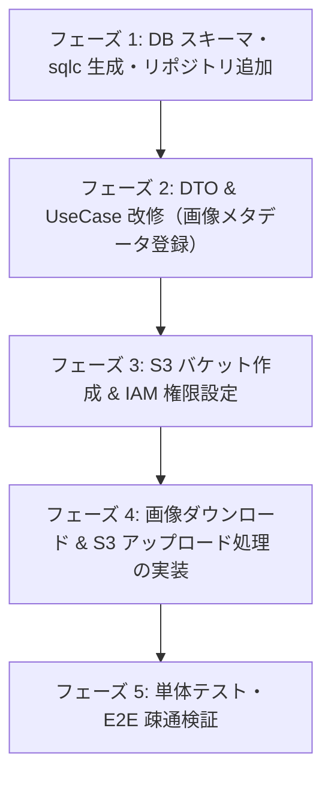

# カード画像テーブル作成・S3配置 実装作業手順書

本手順書は、カード画像テーブルの新設、`infoInsert` での画像メタデータ登録、および実体画像の S3 アップロードと URL 更新を実行するためのステップバイステップガイドである。

---

## 全体作業工程



---

## フェーズ 1: DB スキーマ定義と sqlc コード生成

### 1.1 `schema.sql` に `card_images` テーブルを追加
`code/cardApiCall/infoInsert/sqlc/db/schema.sql` の末尾にテーブル定義を追記する。
```sql
CREATE TABLE card_images (
    id BIGSERIAL PRIMARY KEY,
    ocg_api_image_id BIGINT UNIQUE NOT NULL,
    ocg_api_card_id BIGINT NOT NULL,
    card_id BIGINT,
    image_url_small_api VARCHAR(1024) NOT NULL,
    image_url_large_api VARCHAR(1024) NOT NULL,
    image_url_cropped_api VARCHAR(1024) NOT NULL,
    image_url_small_this_app VARCHAR(1024),
    image_url_large_this_app VARCHAR(1024),
    image_url_cropped_this_app VARCHAR(1024),
    dataowner VARCHAR(255) DEFAULT 'system',
    regist_date TIMESTAMP DEFAULT current_timestamp,
    enable_start_date TIMESTAMP DEFAULT '1970-01-01 00:00:00',
    enable_end_date TIMESTAMP DEFAULT '9999-12-31 23:59:59',
    version BIGINT DEFAULT 1,
    FOREIGN KEY (card_id) REFERENCES cards(id) ON DELETE CASCADE
);

CREATE INDEX idx_card_images_card_id ON card_images(card_id);
CREATE INDEX idx_card_images_sync_pending ON card_images(id) WHERE image_url_large_this_app IS NULL;
```

### 1.2 `card_image.sql` クエリファイルの作成
`code/cardApiCall/infoInsert/sqlc/queries/card_image.sql` を新規作成する。
```sql
-- name: InsertCardImage :one
INSERT INTO card_images (
    ocg_api_image_id,
    ocg_api_card_id,
    card_id,
    image_url_small_api,
    image_url_large_api,
    image_url_cropped_api
) VALUES (
    $1, $2, $3, $4, $5, $6
)
ON CONFLICT (ocg_api_image_id) DO UPDATE
SET
    card_id = EXCLUDED.card_id,
    image_url_small_api = EXCLUDED.image_url_small_api,
    image_url_large_api = EXCLUDED.image_url_large_api,
    image_url_cropped_api = EXCLUDED.image_url_cropped_api
RETURNING *;

-- name: ListPendingSyncCardImages :many
SELECT * FROM card_images
WHERE image_url_large_this_app IS NULL
LIMIT $1;

-- name: UpdateCardImageThisAppUrls :one
UPDATE card_images
SET
    image_url_small_this_app = $2,
    image_url_large_this_app = $3,
    image_url_cropped_this_app = $4
WHERE id = $1
RETURNING *;
```

### 1.3 `sqlc generate` の実行
```bash
cd code/cardApiCall/infoInsert
# sqlc による Go コード再生成
bash scripts/code/cardApiCall/infoinsert/sqlc_generate.sh
```

### 1.4 `repository/card_image.go` の作成
`CardImageRepository` を新設し、`InsertCardImage` 等のメソッドを実装する（`*sqlc_gen.Queries` を引数に受け取る設計）。

---

## フェーズ 2: DTO & UseCase の改修（画像メタデータの永続化）

### 2.1 `StandardCard` への画像リスト追加
`code/cardApiCall/infoInsert/dto/cardrecord/carddto.go`:
```go
type StandardCard struct {
    ...
    CardImages []CardImage `json:"cardImages"`
}

// GenerateStandardCardFromNeuronAndTCGAPIResult 内でマージ
cardInfo := StandardCard{
    ...
    CardImages: tcgAPICard.CardImages,
}
```

### 2.2 `usecase/neon` での画像登録呼び出し
`usecase/neon/neon_card.go` の `InsertCardInfo`（トランザクション内）で、カード本体の登録後に画像メタデータを登録する。
```go
// transaction.ExecTx 内
cardID, err := u.cardRepo.InsertCard(ctx, q, cardInfo)
if err != nil {
    return 0, err
}

// 画像の登録
for _, img := range cardInfo.CardImages {
    _, err = u.cardImageRepo.InsertCardImage(ctx, q, sqlc_gen.InsertCardImageParams{
        OcgApiImageID:       img.ID,
        OcgApiCardID:        cardInfo.TcgID,
        CardID:              sql.NullInt64{Int64: cardID, Valid: true},
        ImageUrlSmallApi:    img.ImageUrlSmall,
        ImageUrlLargeApi:    img.ImageUrlLarge,
        ImageUrlCroppedApi:  img.ImageUrlCropped,
    })
    if err != nil {
        return 0, err // 自動ロールバック
    }
}
```

---

## フェーズ 3: AWS S3 バケット作成 & IAM 設定

### 3.1 S3 バケット作成
Terraform または AWS CLI で S3 バケットを作成：
```bash
aws s3api create-bucket \
    --bucket ocg-statistics-card-images \
    --region ap-northeast-1 \
    --create-bucket-configuration LocationConstraint=ap-northeast-1
```
- パブリックアクセスブロックを有効化し、CloudFront OAC（Origin Access Control）経由のみアクセス許可する構成を推奨。

### 3.2 Airflow / 実行ロールへの S3 権限付与
```json
{
    "Effect": "Allow",
    "Action": [
        "s3:PutObject",
        "s3:GetObject"
    ],
    "Resource": "arn:aws:s3:::ocg-statistics-card-images/cards/*"
}
```

---

## フェーズ 4: S3 画像同期処理の実装（Airflow タスク）

### 4.1 画像同期スクリプト / タスク関数の実装
`pipeline/dags/ocg/image_sync.py`（または `pipeline/scripts/sync_card_images.py`）:
1. DB（Neon）から `WHERE image_url_large_this_app IS NULL` のレコードを取得。
2. 各画像（Small, Large, Cropped）を外部 URL から `requests.get` でストリーム取得。
3. `boto3.client('s3').upload_fileobj` で S3 の `cards/{type}/{image_id}.jpg` にアップロード。
4. S3 / CloudFront URL を生成し、`card_images` の `image_url_*_this_app` を UPDATE。

### 4.2 Airflow DAG への組み込み
`pipeline/dags/ocg/db_insert.py` の `insert_cards` Lambda 実行タスクの後続に `sync_card_images` タスクを接続：
```python
# DAG 内の依存関係
insert_cards_task >> sync_card_images_task
```

---

## フェーズ 5: 動作検証とテスト

1. **DB マイグレーション検証**:
   - ローカル Docker PostgreSQL（ポート 5555）に `card_images` テーブルを作成。
2. **Go テストの実行**:
   ```bash
   bash scripts/code/cardApiCall/infoinsert/test_all.sh
   ```
3. **ローカル S3 同期テスト**:
   - サンプルカード（例: `ID=4005`）のカード画像が S3 に正常に PUT され、DB の `image_url_*_this_app` が更新されることを確認。
