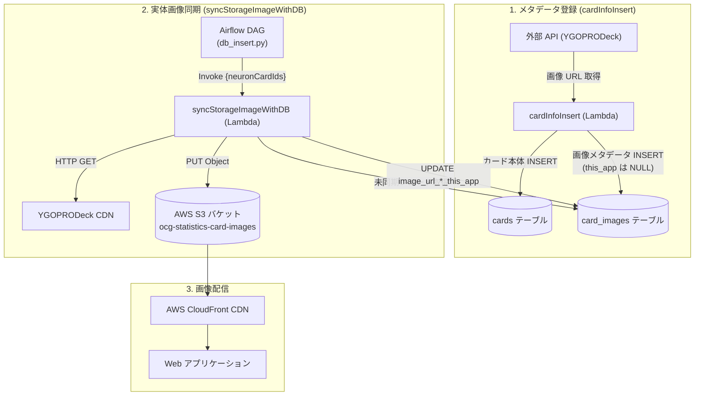
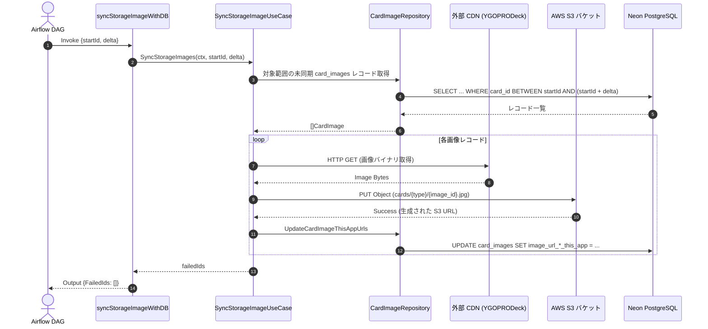

# カード画像パイプライン 実装・運用手順書

本ドキュメントは、遊戯王カード画像メタデータのデータベース永続化、S3 への実体画像アップロード、および本アプリ配信 URL（`image_url_*_this_app`）の更新を行うカード画像パイプラインの実装仕様および構築手順書である。

---

## 1. システム全体フロー

カード画像パイプラインは、メタデータ収集を担当する **`cardInfoInsert`** と、画像実体の取得・S3 保存を担当する **`syncStorageImageWithDB`** の 2 つの AWS Lambda 関数、およびそれらを順次実行する Airflow DAG で構成される。



---

## 2. データベース定義と Repository 層

### 2.1 テーブル定義 (`card_images`)
[internal/sqlc/db/schema.sql](../../code/cardApiCall/internal/sqlc/db/schema.sql) において、カード（`cards`）と 1:N（絵違い対応）で関連づけられる `card_images` テーブルを定義する。

```sql
CREATE TABLE card_images (
    id BIGSERIAL PRIMARY KEY,
    ocg_api_image_id BIGINT UNIQUE NOT NULL,
    ocg_api_card_id BIGINT NOT NULL,
    card_id BIGINT,
    image_url_small_api VARCHAR(1024) NOT NULL,
    image_url_large_api VARCHAR(1024) NOT NULL,
    image_url_cropped_api VARCHAR(1024) NOT NULL,
    image_url_small_this_app VARCHAR(1024),
    image_url_large_this_app VARCHAR(1024),
    image_url_cropped_this_app VARCHAR(1024),
    dataowner VARCHAR(255) DEFAULT 'system',
    regist_date TIMESTAMP DEFAULT current_timestamp,
    enable_start_date TIMESTAMP DEFAULT '1970-01-01 00:00:00',
    enable_end_date TIMESTAMP DEFAULT '9999-12-31 23:59:59',
    version BIGINT DEFAULT 1,
    FOREIGN KEY (card_id) REFERENCES cards(id) ON DELETE CASCADE
);

CREATE INDEX idx_card_images_card_id ON card_images(card_id);
CREATE INDEX idx_card_images_sync_pending ON card_images(id) WHERE image_url_large_this_app IS NULL;
```

### 2.2 sqlc クエリ定義
[internal/sqlc/queries/card_image.sql](../../code/cardApiCall/internal/sqlc/queries/card_image.sql) に必要な操作を定義する。

- `InsertCardImage`: メタデータ初期登録（UPSERT）
- `ListPendingSyncCardImages`: 未同期画像レコードの取得
- `UpdateCardImageThisAppUrls`: S3 / CloudFront URL の書き戻し

```bash
# sqlc による Go コード生成
bash scripts/code/cardApiCall/internal/sqlc_generate.sh
```

### 2.3 Repository 実装
[internal/repository/card_image.go](../../code/cardApiCall/internal/repository/card_image.go) にて、`CardImageRepository` を実装する。DB 型（`sql.Null*`）から DTO 型への変換および操作ログ記録を担当する。

---

## 3. メタデータ登録処理 (`cardInfoInsert`)

カード情報収集バッチ（[cmd/aws_lambda/cardInfoInsert](../../code/cardApiCall/cmd/aws_lambda/cardInfoInsert)）にて、外部 API レスポンスから画像 URL 群を抽出し、同一トランザクション内で保存する。

### 3.1 DTO 連携
[internal/dto/cardrecord/carddto.go](../../code/cardApiCall/internal/dto/cardrecord/carddto.go) の `StandardCard` に画像スライス `CardImages []CardImage` を保持し、TCG API（YGOPRODeck）のレスポンスをマージする。

### 3.2 トランザクション内永続化
[internal/usecase/neon/neon_card.go](../../code/cardApiCall/internal/usecase/neon/neon_card.go) の `InsertCardInfo` において、`cards` テーブルへの親カード登録に続いて `card_images` への INSERT を `transaction.ExecTx` 内で一括実行する。

---

## 4. 実体画像同期 Lambda (`syncStorageImageWithDB`)

画像実体の取得と S3 アップロード、DB 更新を行う専用 Lambda 関数（[cmd/aws_lambda/syncStorageImageWithDB](../../code/cardApiCall/cmd/aws_lambda/syncStorageImageWithDB)）の実装仕様。

### 4.1 入出力インターフェース
[main.go](../../code/cardApiCall/cmd/aws_lambda/syncStorageImageWithDB/main.go) は `cardInfoInsert` と共通の `startId` / `delta` 形式を採用する。

```go
type Input struct {
    StartId int64 `json:"startId"`
    Delta   int64 `json:"delta"`
}

type Output struct {
    FailedIds []int64 `json:"failedIds"`
}
```

### 4.2 ユースケース処理フロー
[internal/usecase/syncimage/sync_storage_image.go](../../code/cardApiCall/internal/usecase/syncimage/sync_storage_image.go) に実装する処理ロジック：



1. **対象レコード取得**:
   `card_id` が `startId` 〜 `startId + delta` の範囲で、`image_url_large_this_app IS NULL` であるレコードを取得。
2. **画像ダウンロード & S3 アップロード**:
   - `image_url_small_api`, `image_url_large_api`, `image_url_cropped_api` をストリーム取得。
   - S3 の `cards/small/{image_id}.jpg`, `cards/large/{image_id}.jpg`, `cards/cropped/{image_id}.jpg` に PUT。
3. **DB 更新**:
   - 生成された S3 / CloudFront URL を `image_url_*_this_app` に UPDATE。

---

## 5. インフラ構成 (AWS S3 & IAM)

### 5.1 S3 バケット作成
画像配信用 S3 バケットを作成する：

```bash
aws s3api create-bucket \
    --bucket ocg-statistics-card-images \
    --region ap-northeast-1 \
    --create-bucket-configuration LocationConstraint=ap-northeast-1
```
- パブリックアクセスブロックを有効化し、CloudFront OAC（Origin Access Control）経由のみアクセス許可する構成を推奨。

### 5.2 Lambda 実行ロールへの IAM 権限
`syncStorageImageWithDB` Lambda が S3 へアクセスできるよう、以下のポリシーをアタッチする：

```json
{
    "Version": "2012-10-17",
    "Statement": [
        {
            "Effect": "Allow",
            "Action": [
                "s3:PutObject",
                "s3:GetObject"
            ],
            "Resource": "arn:aws:s3:::ocg-statistics-card-images/cards/*"
        }
    ]
}
```

---

## 6. Airflow パイプライン連携と動作検証

### 6.1 Airflow DAG ([pipeline/dags/ocg/db_insert.py](../../pipeline/dags/ocg/db_insert.py))
カード情報挿入タスクの後続として画像同期タスクを接続する：

```python
invoke_lambda_function_task = LambdaInvokeFunctionOperator(
    task_id="invoke_lambda_function",
    region_name='ap-northeast-1',
    function_name=os.environ.get('OCG_LAMBDA_FUNCTION_NAME', 'invalid-lambda-function-name'),
    payload='''{
        "ocgCardIds": {{ task_instance.xcom_pull(task_ids='generate_card_ids') | tojson }}
    }''',
)

invoke_sync_image_lambda_task = LambdaInvokeFunctionOperator(
    task_id="invoke_sync_image_lambda",
    region_name='ap-northeast-1',
    function_name=os.environ.get('OCG_SYNC_IMAGE_LAMBDA_FUNCTION_NAME', 'ocg-syncstorageimage'),
    payload='''{
        "neuronCardIds": {{ task_instance.xcom_pull(task_ids='generate_card_ids') | tojson }}
    }''',
)

# 依存関係
invoke_lambda_function_task >> invoke_sync_image_lambda_task >> update_id_task
```

### 6.2 ローカル検証手順
Docker Compose を起動し、ローカル環境で検証を実行する：

```bash
# 1. ローカルコンテナ起動
docker compose up -d

# 2. カード情報初期挿入の実行 (ポート 9002)
bash scripts/code/cardApiCall/cardinfoinsert/local_test.sh 100 10

# 3. 画像ストレージ同期の実行 (ポート 9003)
bash scripts/code/cardApiCall/syncstorageimage/local_test.sh 100 10

# 4. 単体・結合テストの実行
bash scripts/code/cardApiCall/cardinfoinsert/test_all.sh
```
