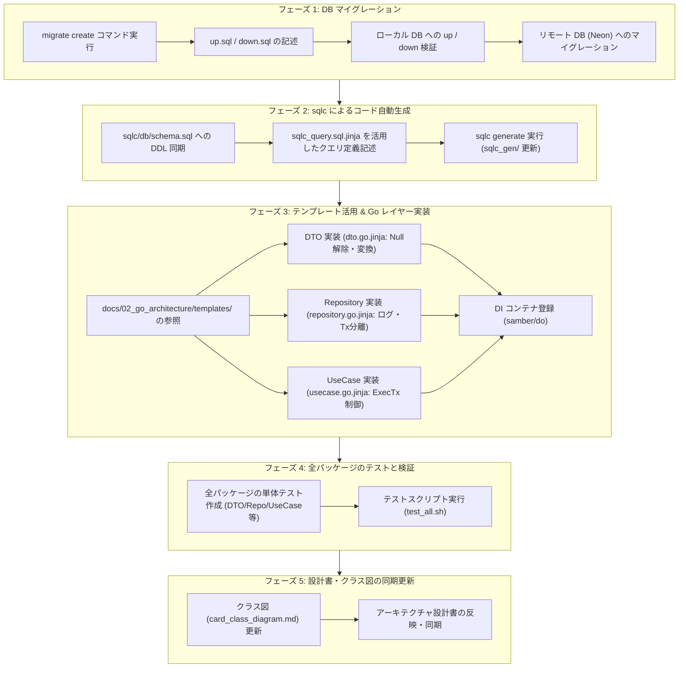

# 新規テーブル追加・実装完全ガイド (New Table Implementation Workflow Guide)

本ドキュメントは、本リポジトリ（`ocg_statistics`）において**新規テーブルを追加・マイグレーションし、コードテンプレートを活用して Go アプリケーション（`code/cardApiCall/infoInsert`）などの各レイヤーへ安全に組み込むための標準実装手順書**です。

---

## 1. 全体ワークフロー概要

新規テーブルを追加する際は、データベース層のマイグレーションからコードテンプレートによる Go 雛形生成、レイヤー実装、DI 登録、テストスクリプトによる検証まで、一連の依存関係に沿って進めます。



---

## 2. フェーズ 1: DB マイグレーションの作成と適用

マイグレーションファイルは [database/migrate/db/migrations](../../database/migrate/db/migrations) に連番形式で配置します。

### 2.1 マイグレーションファイルの生成

プロジェクトルートで以下のコマンドを実行し、連番付きの `.up.sql` と `.down.sql` を生成します。

```bash
# golang-migrate コマンドでファイルを生成 (例: create_card_packs_table)
migrate create -ext sql -dir database/migrate/db/migrations -seq create_card_packs_table
```

生成されるファイル例：
- `database/migrate/db/migrations/000003_create_card_packs_table.up.sql`
- `database/migrate/db/migrations/000003_create_card_packs_table.down.sql`

### 2.2 DDL の記述ルール

#### `up.sql` (適用スクリプト)
- テーブル名、カラム名は **スネークケース (`snake_case`)**。
- 主キー (`PRIMARY KEY`)、外部キー (`FOREIGN KEY`)、および検索インデックス (`INDEX`) を明示的に設定。
- タイムスタンプ管理カラム（`created_at`, `updated_at`）を適切に付与。

```sql
-- 000003_create_card_packs_table.up.sql 例
CREATE TABLE IF NOT EXISTS card_packs (
    id BIGSERIAL PRIMARY KEY,
    pack_code VARCHAR(50) NOT NULL UNIQUE,
    name_ja VARCHAR(255) NOT NULL,
    name_en VARCHAR(255),
    release_date DATE,
    created_at TIMESTAMP WITH TIME ZONE NOT NULL DEFAULT CURRENT_TIMESTAMP,
    updated_at TIMESTAMP WITH TIME ZONE NOT NULL DEFAULT CURRENT_TIMESTAMP
);

CREATE INDEX IF NOT EXISTS idx_card_packs_pack_code ON card_packs (pack_code);
```

#### `down.sql` (ロールバックスクリプト)
- `up.sql` で作成したテーブル・型・インデックスを完全に復元（削除）できるように記述。

```sql
-- 000003_create_card_packs_table.down.sql 例
DROP TABLE IF EXISTS card_packs;
```

### 2.3 ローカル DB での動作確認

Docker Compose でローカル PostgreSQL を起動し、マイグレーションの Up / Down 両方が成功することを確認します。

```bash
# 1. ローカル DB コンテナの起動
docker compose up -d ocg_db_local

# 2. マイグレーションを適用 (Up)
bash scripts/database/local_migration_up.sh

# 3. ロールバックが正常に動作するか確認 (Down)
bash scripts/database/local_migration_down.sh

# 4. 再度 Up を実行して最新状態にする
bash scripts/database/local_migration_up.sh
```

> [!NOTE]
> 初期化スクリプト [database/localsetup/sql/](../../database/localsetup/sql) はコンテナ初回構築時用のフルダンプです。開発中のスキーマ変更はマイグレーションファイル経由で適用します。

### 2.4 リモート DB (Neon) への適用

ローカルでの検証完了後、ステージング / 本番の Neon DB へマイグレーションを適用します。

```bash
# .env の NEONDB_CONNECTION_STRING を読み込んで適用
bash scripts/database/remote_migration_up.sh
```

---

## 3. フェーズ 2: sqlc スキーマ・クエリ更新とコード生成

[code/cardApiCall/internal](../../code/cardApiCall/internal)（および互換性維持のための既存 `infoInsert`）では、SQL から型安全な Go コードを自動生成するツールとして [sqlc](https://sqlc.dev/) を採用しています。マルチ Lambda 共通基盤として `code/cardApiCall/internal/` 配下で一元管理されています（詳細は [docs/02_go_architecture/06_multi_lambda_package_architecture.md](../02_go_architecture/06_multi_lambda_package_architecture.md) 参照）。

### 3.1 `schema.sql` への DDL 反映（必須）

sqlc はマイグレーションディレクトリではなく、[code/cardApiCall/internal/sqlc/db/schema.sql](../../code/cardApiCall/internal/sqlc/db/schema.sql) を参照してコード生成を行います。
新しく作成したテーブルの `CREATE TABLE` 文を `schema.sql` の末尾に追加してください。

### 3.2 テンプレートを活用したクエリ定義ファイルの作成 (`.sql`)

[code/cardApiCall/internal/sqlc/queries/](../../code/cardApiCall/internal/sqlc/queries) 配下に新規テーブル用の `.sql` ファイル（例: `card_pack.sql`）を作成します。

ゼロから書くのではなく、[docs/02_go_architecture/templates/sqlc_query.sql.jinja](../02_go_architecture/templates/sqlc_query.sql.jinja) を活用して CRUD や JOIN クエリの骨格を定義します。

#### テンプレートパラメータ例 (`sqlc_query.sql.jinja`)
```yaml
table_name: "card_packs"
entity_name: "CardPack"
primary_key:
  name: "id"
  type: "bigint"
  auto_increment: true
fields:
  - name: "pack_code"
    type: "varchar"
  - name: "name_ja"
    type: "varchar"
  - name: "name_en"
    type: "varchar"
  - name: "release_date"
    type: "date"
search_fields:
  - name: "pack_code"
    pascal_name: "PackCode"
```

#### 生成される SQL クエリファイル例 (`card_pack.sql`)
```sql
-- code/cardApiCall/infoInsert/sqlc/queries/card_pack.sql

-- name: SelectCardPackByID :one
SELECT * FROM card_packs
WHERE id = $1 LIMIT 1;

-- name: SelectCardPackByPackCode :one
SELECT * FROM card_packs
WHERE pack_code = $1 LIMIT 1;

-- name: InsertCardPack :one
INSERT INTO card_packs (
    pack_code, name_ja, name_en, release_date
) VALUES (
    $1, $2, $3, $4
)
RETURNING *;

-- name: DeleteCardPack :exec
DELETE FROM card_packs
WHERE id = $1;
```

### 3.3 `sqlc generate` によるコード自動生成

クエリ定義を記述したら、以下のスクリプト（または internal ディレクトリ）で Go コードを再生成します。

```bash
# スクリプトを実行してコード生成
bash scripts/code/cardApiCall/internal/sqlc_generate.sh
```

> [!TIP]
> 生成されたモデルやクエリ関数は [code/cardApiCall/internal/sqlc_gen/](../../code/cardApiCall/internal/sqlc_gen) に配置されます。このディレクトリ内のコードは手動で直接編集しないでください。

---

## 4. フェーズ 3: テンプレート活用 & Go アプリケーション層の実装

本リポジトリでは、アーキテクチャの責務分離（[docs/02_go_architecture/02_infoInsert_layer_responsibilities.md](../02_go_architecture/02_infoInsert_layer_responsibilities.md)）と実装品質の均一化のため、**Jinja2 テンプレート集（[docs/02_go_architecture/templates/](../02_go_architecture/templates)）** を提供しています。

### 4.1 テンプレート一覧と対象レイヤー

各レイヤーの実装時は、対応するテンプレートをベースにボイラープレートを構築します。詳細なパラメータ仕様は [docs/02_go_architecture/templates/README.md](../02_go_architecture/templates/README.md) を参照してください。

| テンプレートファイル | 対象レイヤー / 配置先 | 主な自動化・共通化内容 |
|---|---|---|
| [`sqlc_query.sql.jinja`](../02_go_architecture/templates/sqlc_query.sql.jinja) | `sqlc/queries/*.sql` | CRUD / 検索 / JOIN クエリ骨格 |
| [`dto.go.jinja`](../02_go_architecture/templates/dto.go.jinja) | `dto/cardrecord/*.go` | 層間データ転送構造体、`sql.Null*` 解除・マッピング関数 |
| [`repository.go.jinja`](../02_go_architecture/templates/repository.go.jinja) | `repository/*.go` | `Queries` 受領、zap 構造化ログ、所要時間計測（`defer`）、DTO 変換 |
| [`usecase.go.jinja`](../02_go_architecture/templates/usecase.go.jinja) | `usecase/<package>/*.go` | `samber/do` コンストラクタ、`transaction.ExecTx` によるトランザクション制御 |

---

### 4.2 DTO レイヤの実装 (`dto/`)

sqlc が生成した構造体（`sql.NullString` や `sql.NullInt64` 等の Raw Row）から、上位層で安全に扱えるプリミティブ型・値オブジェクトへのマッピング関数を実装します。

- **利用テンプレート**: [docs/02_go_architecture/templates/dto.go.jinja](../02_go_architecture/templates/dto.go.jinja)
- **配置先**: [code/cardApiCall/infoInsert/dto/cardrecord/](../../code/cardApiCall/infoInsert/dto/cardrecord)

```go
// dto/cardrecord/card_pack_dto.go 例
package cardrecord

import (
	"database/sql"
	"time"
	"atomisu.com/ocg-statics/infoInsert/sqlc_gen"
)

type CardPackDTO struct {
	ID          int64      `json:"id"`
	PackCode    string     `json:"packCode"`
	NameJa      string     `json:"nameJa"`
	NameEn      string     `json:"nameEn"`
	ReleaseDate *time.Time `json:"releaseDate"`
}

func FromSelectCardPackRow(row sqlc_gen.CardPack) CardPackDTO {
	var releaseDate *time.Time
	if row.ReleaseDate.Valid {
		releaseDate = &row.ReleaseDate.Time
	}
	return CardPackDTO{
		ID:          row.ID,
		PackCode:    row.PackCode,
		NameJa:      row.NameJa,
		NameEn:      row.NameEn.String,
		ReleaseDate: releaseDate,
	}
}
```

### 4.3 Repository レイヤの実装 (`repository/`)

Repository は `*sqlc_gen.Queries` を引数として受け取り、クエリ実行・構造化ログ・メトリクス計測・DTO 変換を担当します。

- **利用テンプレート**: [docs/02_go_architecture/templates/repository.go.jinja](../02_go_architecture/templates/repository.go.jinja)
- **配置先**: [code/cardApiCall/infoInsert/repository/](../../code/cardApiCall/infoInsert/repository)

> [!IMPORTANT]
> **Repository レイヤの厳格ルール**:
> 1. **トランザクション（`db.Begin` / `tx.Commit` / `tx.Rollback`）を Repository 内で制御してはなりません。** トランザクション境界は必ず UseCase レイヤに委譲します。
> 2. `repository/base.go` の共通ログ関数（`logDBOperation`, `logDBError`, `logDBResult`）を用いて `defer` でログ・処理時間を計測してください。

```go
// repository/card_pack.go 例
package repository

import (
	"context"
	"time"

	"atomisu.com/ocg-statics/infoInsert/dto/cardrecord"
	"atomisu.com/ocg-statics/infoInsert/sqlc_gen"
	"go.uber.org/zap"
)

type CardPackRepository interface {
	GetCardPackByID(ctx context.Context, id int64) (cardrecord.CardPackDTO, error)
	InsertCardPack(ctx context.Context, params sqlc_gen.InsertCardPackParams) (sqlc_gen.CardPack, error)
}

type cardPackRepositoryImpl struct {
	queries *sqlc_gen.Queries
}

func NewCardPackRepository(queries *sqlc_gen.Queries) CardPackRepository {
	return &cardPackRepositoryImpl{queries: queries}
}

func (r *cardPackRepositoryImpl) GetCardPackByID(ctx context.Context, id int64) (cardrecord.CardPackDTO, error) {
	start := time.Now()
	logDBOperation("SelectCardPackByID", zap.Int64("id", id))

	row, err := r.queries.SelectCardPackByID(ctx, id)
	if err != nil {
		logDBError("SelectCardPackByID", err, zap.Int64("id", id))
		return cardrecord.CardPackDTO{}, err
	}

	logDBResult("SelectCardPackByID", time.Since(start), zap.Int64("id", id))
	return cardrecord.FromSelectCardPackRow(row), nil
}
```

---

### 4.4 UseCase レイヤの実装 (`usecase/`)

業務フローのオーケストレーションを行います。トランザクション制御が必要な場合は、[docs/X_important/lambda/rules/01_transaction_boundary_rules.md](../X_important/lambda/rules/01_transaction_boundary_rules.md) に従って `transaction.ExecTx` を用います。

- **利用テンプレート**: [docs/02_go_architecture/templates/usecase.go.jinja](../02_go_architecture/templates/usecase.go.jinja)
- **既存実装例**: [neon_spell.go](../../code/cardApiCall/infoInsert/usecase/neon/neon_spell.go), [neon_card.go](../../code/cardApiCall/infoInsert/usecase/neon/neon_card.go)

```go
// usecase/neon/neon_card_pack.go 例
package neon

import (
	"context"
	"fmt"

	"atomisu.com/ocg-statistics/infoInsert/dto/cardrecord"
	"atomisu.com/ocg-statistics/infoInsert/repository"
	"atomisu.com/ocg-statistics/infoInsert/sqlc_gen"
	"atomisu.com/ocg-statistics/infoInsert/transaction"
)

func (n *neonUseCaseImpl) InsertCardPackInfo(ctx context.Context, packDto cardrecord.CardPackDTO) (int64, error) {
	// 1. 外部通信・事前バリデーションは Tx の「外」で行う
	tr := transaction.NewTx(n.ProduceConnDB())

	// 2. トランザクション境界の開始（ExecTx コールバック内で Repository を生成・実行）
	return transaction.ExecTx(ctx, tr, func(q *sqlc_gen.Queries) (int64, error) {
		packRepo := repository.NewCardPackRepository(q)

		pack, err := packRepo.InsertCardPack(ctx, sqlc_gen.InsertCardPackParams{
			PackCode: packDto.PackCode,
			NameJa:   packDto.NameJa,
			NameEn:   packDto.NameEn,
			// ...
		})
		if err != nil {
			return 0, fmt.Errorf("failed to insert card pack: %w", err)
		}

		return pack.ID, nil
	})
}

// 3. 参照系（トランザクション不要）の場合は ExecNonTx を使用
func (n *neonUseCaseImpl) GetCardPackByID(ctx context.Context, id int64) (cardrecord.CardPackDTO, error) {
	tr := transaction.NewTx(n.ProduceConnDB())
	return transaction.ExecNonTx(ctx, tr, func(q *sqlc_gen.Queries) (cardrecord.CardPackDTO, error) {
		packRepo := repository.NewCardPackRepository(q)
		return packRepo.GetCardPackByID(ctx, id)
	})
}
```

> [!WARNING]
> **外部 I/O 処理を `transaction.ExecTx` の中に配置してはなりません。**
> HTTP リクエストやスクレイピング処理を Tx 内に含めると、コネクションプールの枯渇やデッドロックの原因になります。

---

### 4.5 DI コンテナへの登録 (`app/dependency_injection.go`)

新規ユースケースや追加サービスを定義した場合は、[code/cardApiCall/infoInsert/app/dependency_injection.go](../../code/cardApiCall/infoInsert/app/dependency_injection.go) の `SetupDIContainer` に `samber/do` で登録します。

```go
// app/dependency_injection.go
func SetupDIContainer() *do.Injector {
    injector := do.New()
    // DBコネクション
    do.Provide(injector, config.NewDbConnection)

    // 新規ユースケースの登録 (必要時)
    // do.Provide(injector, pack.NewCardPackUseCase)
    ...
    return injector
}
```

---

## 5. フェーズ 4: 全パッケージに対する単体テストと検証

新規テーブルを追加・改修した際は、一部の処理だけでなく**作成・変更に関わるすべてのパッケージ（DTO / Repository / UseCase）に対して単体テスト（`*_test.go`）を作成**します。

### 5.1 各パッケージごとのテスト実装方針

#### ① DTO パッケージ (`dto/`)
- **テスト内容**: sqlc 生成型（Raw Row）から DTO への変換関数（`FromSelect...Row`）のテスト。
- **検証ポイント**:
  - `sql.NullString`、`sql.NullInt64`、`sql.NullTime` などの Nullable フィールドが `Valid=true`（値あり）の場合に正しく変換されるか。
  - `Valid=false`（DB 上で `NULL`）の場合に、Go 側のゼロ値・空文字・`nil` ポインタへ期待通りマッピングされるか。

#### ② Repository パッケージ (`repository/`)
- **テスト内容**: sqlc ラッパーとしてのクエリ実行、エラーハンドリング、および戻り値変換のテスト。
- **検証ポイント**:
  - 正常系: クエリが正しく実行され、期待する DTO が返却されるか。
  - 異常系: DB エラー発生時に適切にエラーがラップされて呼び出し元に返るか。

#### ③ UseCase パッケージ (`usecase/`)
- **テスト内容**: トランザクション制御を含む業務フロー全体のオーケストレーションテスト。
- **検証ポイント**:
  - **トランザクション整合性**: [01_transaction_boundary_rules.md](../X_important/lambda/rules/01_transaction_boundary_rules.md) に従い、`transaction.ExecTx` による正常系の Commit およびエラー発生時の自動 Rollback が機能しているか。
  - **関連フィールド整合性**: [02_related_fields_unit_test_rules.md](../X_important/lambda/rules/02_related_fields_unit_test_rules.md) に従い、親テーブル（`cards` 等）の ID が子テーブル（新規テーブル）の外部キーに正しく連携・保存されているか。

### 5.2 テスト実行スクリプトの実行 (`test_all.sh`)

DB を使用するテスト（`repository`、`usecase/neon` 等）はローカル DB を共有するため、単純に `go test ./...` を実行すると並列実行によるデータの競合・不整合が発生します。
そのため、テストの検証には**必ず用意されているスクリプト [scripts/code/cardApiCall/infoinsert/test_all.sh](../../scripts/code/cardApiCall/infoinsert/test_all.sh) を実行してください。**

```bash
# プロジェクトルートからテストスクリプトを実行
bash scripts/code/cardApiCall/infoinsert/test_all.sh
```

> [!IMPORTANT]
> `test_all.sh` は以下のように DB 競合を回避する構成になっています：
> 1. **DB 不要な独立テスト**: 高速化のため並列実行 (`./util/...`, `./htmlget/...`, `./http/...`, `./usecase/tcgapi/...`)
> 2. **同一 DB を共有するテスト**: 競合回避のため `-p 1` で直列実行 (`./repository/...`, `./usecase/neon/...`, `./usecase/master/...`)
>
> 新規パッケージやサブパッケージを追加した場合は、`scripts/code/cardApiCall/infoinsert/test_all.sh` の対象パスへの追記も忘れないようにしてください。

---

## 6. フェーズ 5: 設計書・クラス図ドキュメントの同期更新（必須）

コードやテストの実装完了後、**必ず設計ドキュメントを最新のテーブル・DTO 構造と同期**させます。ドキュメントとコードの乖離（Drift）を防ぐため、以下の手順を実施してください。

### 6.1 クラス図および対応表の更新

[docs/01_data_prepare/card_class_diagram.md](../01_data_prepare/card_class_diagram.md) を開き、以下の 2 点を反映します：

1. **クラス図 (Mermaid) の更新**:
   - 新規テーブルに相当するクラス（例: `カード画像`, `パック` 等）を追加。
   - 他のクラス（`カード` 等）とのリレーション（集約 `o--`、コンポジション `*-->`、汎化 `<|--`）を定義。
2. **実装（DB スキーマ・Go DTO）との対応表の更新**:
   - テーブル名（`schema.sql`）と Go DTO（`dto/cardrecord/`）の対応行を追記。

### 6.2 関連アーキテクチャドキュメントの整備

新規テーブルが特定の機能ドメイン（例: 画像パイプラインなら [docs/03_card_image/](../03_card_image)、インフラ連携なら [docs/00_infra/](../00_infra)）に属する場合は、該当ディレクトリ配下のアーキテクチャ資料やシーケンス図にも新規テーブル・処理フローを反映してください。

---

## 7. チェックリスト＆トラブルシューティング

### 7.1 作業完了チェックリスト

テーブル追加作業を完了する前に、以下の項目をすべて確認してください：

- [ ] `database/migrate/db/migrations/` に連番の `.up.sql` と `.down.sql` を両方作成したか？
- [ ] ローカル環境で `local_migration_up.sh` と `local_migration_down.sh` の両方を実行し、正常動作することを確認したか？
- [ ] `code/cardApiCall/infoInsert/sqlc/db/schema.sql` に新しいテーブル DDL を転記したか？
- [ ] `docs/02_go_architecture/templates/sqlc_query.sql.jinja` を参考に `sqlc/queries/` にクエリファイルを作成し、`sqlc generate` を実行したか？
- [ ] `docs/02_go_architecture/templates/` のテンプレートを活用して DTO / Repository / UseCase を実装したか？
- [ ] DTO で `sql.Null*` 型が正しく Go のプリミティブ／ポインタ型にマッピングされているか？
- [ ] Repository レイヤでトランザクション（Begin/Commit）を勝手に制御せず、引数の `*sqlc_gen.Queries` を用いているか？
- [ ] UseCase レイヤの `transaction.ExecTx` コールバック内に外部 I/O 通信を含めていないか？
- [ ] UseCase の参照系メソッドで `transaction.ExecNonTx` を使用しているか？
- [ ] DI コンテナ（`app/dependency_injection.go`）に必要な依存関係を登録したか？
- [ ] 新規追加・改修した全パッケージ（DTO / Repository / UseCase 等）に対して単体テスト（`*_test.go`）を作成したか？
- [ ] テストスクリプト `bash scripts/code/cardApiCall/infoinsert/test_all.sh` を実行し、全パッケージのテストがすべて PASS しているか？
- [ ] [docs/01_data_prepare/card_class_diagram.md](../01_data_prepare/card_class_diagram.md) のクラス図および対応表に新しいテーブル・DTO を追記したか？
- [ ] 関連するアーキテクチャ設計書（`docs/03_card_image/` 等）を同期更新したか？

### 7.2 よくあるトラブルと対処法

| トラブル | 原因 | 対処法 |
|---|---|---|
| `sqlc generate` で新しいテーブルが認識されない | `sqlc/db/schema.sql` にテーブル定義が追加されていない | マイグレーションの DDL を `sqlc/db/schema.sql` にコピーして再実行する |
| マイグレーション実行時に `Dirty database version X. Fix and force version.` が発生 | マイグレーション SQL の構文エラー等で途中失敗した | エラーの原因を修正後、`migrate -path ... -database ... force <version>` でバージョンを是正してから再実行する |
| トランザクション内でコネクションタイムアウトが発生する | `transaction.ExecTx` の中で HTTP リクエスト等の外部通信を行っている | 外部通信処理を `transaction.ExecTx` の前（外側）に移動する |
| `scripts/code/cardApiCall/infoinsert/sqlc_generate.sh` がエラーになる | スクリプト内の相対パス指定の差異 | `cd code/cardApiCall/infoInsert && sqlc generate` を実行する |
