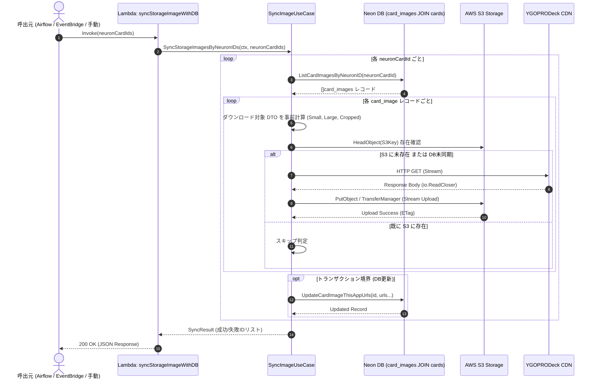

# S3 画像同期 API 仕様書 (Sync Storage Images API Specification)

本ドキュメントは、遊戯王カード画像の実体ファイルを外部 CDN（YGOPRODeck CDN 等）からストリーミング取得し、自前ストレージ（AWS S3）へ同期した上で DB（Neon / PostgreSQL）の配信 URL レコードを更新する Lambda 関数 `syncStorageImageWithDB` の API 仕様および Go 実装設計を定義する。

---

## 1. 概要と責務

### 1.1 目的
`cardInfoInsert` Lambda によって `card_images` テーブルに登録された外部 API URL（`image_url_*_api`）に基づき、画像実体バイナリを S3 に永続化し、本アプリ用配信 URL（`image_url_*_this_app`）を DB に書き戻す。

### 1.2 主な処理要件
1. **入力**: 対象 Neuron CID（`cards.neuron_id`）のリストを受け取る。
2. **既存登録情報の突合**:
   - DB（`card_images` テーブルを `cards` テーブルと JOIN）より対象カードの画像レコード群を取得する（`ListCardImagesByNeuronID`）。
   - S3 上にすでにオブジェクトが存在するかを検証する。
3. **ダウンロード対象 DTO の事前計算**:
   - 同期対象のバリエーション（Small / Large / Cropped）ごとに S3 保存キー・パスおよび tcg_api 上の ID を算出する。
4. **Stream によるダウンロード＆プッシュ**:
   - メモリ上に画像全量を一度に保持せず、外部 HTTP レスポンスストリームから S3 へのストリーミングアップロードを行う。
5. **成功した ID の集計**:
   - 同期に成功した画像の `ocg_api_image_id` および親カードの `neuron_id` を集計する。
6. **DB レコードの更新**:
   - S3 バケットの配信パス（または CloudFront 配信 URL）を算出し、`card_images` テーブルの `image_url_*_this_app` カラムを更新する。

---

## 2. API インターフェース仕様 (Lambda I/O)

### 2.1 リクエスト仕様 (Input Event)

```json
{
  "neuronCardIds": [
    4000,
    4001
  ]
}
```

| フィールド名 | 型 | 必須 | 説明 | 例 |
| :--- | :--- | :---: | :--- | :--- |
| `neuronCardIds` | `[]int64` | ○ | 同期対象とする親カードの `neuron_id`（Neuron CID）リスト。空配列の場合はエラー。 | `[4000, 4001]` |

### 2.2 レスポンス仕様 (Output Event)

```json
{
  "totalProcessedCards": 2,
  "successfulNeuronCardIds": [
    4000
  ],
  "failedNeuronCardIds": [
    4001
  ],
  "syncedImageCount": 3,
  "skippedImageCount": 0,
  "errors": [
    {
      "neuronCardId": 4001,
      "ocgApiImageId": 46986414,
      "message": "failed to stream image to S3: connection timeout"
    }
  ]
}
```

| フィールド名 | 型 | 説明 |
| :--- | :--- | :--- |
| `totalProcessedCards` | `int` | 対象となったカードの総件数。 |
| `successfulNeuronCardIds` | `[]int64` | 全画像の同期または検証が完全に成功した親カードの `neuron_id` リスト。 |
| `failedNeuronCardIds` | `[]int64` | 画像同期中にエラーが発生した親カードの `neuron_id` リスト。 |
| `syncedImageCount` | `int` | S3 に新規アップロードおよび DB 更新された画像数（Small/Large/Cropped 合計）。 |
| `skippedImageCount` | `int` | S3 に既に存在し、DB も更新済みのため同期をスキップした画像数。 |
| `errors` | `[]SyncError` | 発生したエラーの詳細リスト。 |

---

## 3. 処理シーケンス図 (Sequence Diagram)



---

## 4. 詳細処理フロー

### 4.1 Step 1: 既存登録情報の突合
1. 引数で渡された `neuronCardIds` の各 ID について、`cards` テーブルと JOIN して `card_images` テーブルから該当レコードを検索する（`WHERE c.neuron_id = $1`）。
2. レコードが存在しない場合、対象カードが未インサートであるため `failedNeuronCardIds` に記録しスキップする。
3. 取得した `card_images` レコード内の `image_url_*_this_app` を検査する。
4. S3 クライアントの `HeadObject` API を用いて、S3 上の対象キーに実体ファイルが存在するか突合する。
   - S3 に存在し、かつ DB の `image_url_*_this_app` も設定済みの場合は同期不要（スキップ）。
   - S3 に未存在、または DB の URL が NULL の場合は同期対象としてキューイングする。

### 4.2 Step 2: ダウンロード対象 DTO の事前計算
1枚のカード画像レコードに対し、以下の 3 種類の画像タイプ（バリエーション）が存在する。

| バリエーション | 外部取得元 URL カラム | S3 格納キー（パス） | DB 更新先カラム |
| :--- | :--- | :--- | :--- |
| **Small** | `image_url_small_api` | `cards/small/{ocg_api_image_id}.jpg` | `image_url_small_this_app` |
| **Large** | `image_url_large_api` | `cards/large/{ocg_api_image_id}.jpg` | `image_url_large_this_app` |
| **Cropped** | `image_url_cropped_api` | `cards/cropped/{ocg_api_image_id}.jpg` | `image_url_cropped_this_app` |

各バリエーションについて、事前に以下の構造体（DTO）を計算・生成する。
```go
type ImageSyncTaskDTO struct {
    CardImageID    int64
    NeuronID       int64
    OcgApiImageID  int64
    Variant        ImageVariant // Small, Large, Cropped
    SourceURL      string
    S3Key          string
    DestinationURL string
}
```

### 4.3 Step 3: ダウンロードからの Stream プッシュ
1. **ストリーミングアップロードパイプライン**:
   - `http.Get(task.SourceURL)` で取得した `response.Body`（`io.ReadCloser`）をメモリに一括ロード（`io.ReadAll`）せず、AWS SDK の S3 Transfer Manager（`feature/s3/transfermanager`）に直接渡してアップロードを実行する。
   - これにより、大量の画像処理時にも Lambda のメモリ消費量（フットプリント）を最小限（数 MB 程度）に抑える。
2. **並行処理と流量制御**:
   - 外部 CDN への過剰リクエスト（DDoS判定・Rate Limit）を回避するため、WorkerPool（Go Goroutine + バッファ付きチャネル/セマフォ）を用いて同時並行ダウンロード数を制御（例: デフォルト 5 並行）する。

### 4.4 Step 4: 成功した ID の集計
- 各画像タスクの完了ステータスを監視する。
- 1 枚のカード画像に紐づくすべてのバリエーション（Small/Large/Cropped）の S3 転送が成功した場合に、その `neuron_id` を `successfulNeuronCardIds` としてマークする。
- いずれかの画像でダウンロード・アップロードエラーが発生した場合は `failedNeuronCardIds` に追加し、詳細なエラーメッセージを記録する。

### 4.5 Step 5: DB レコードの更新
- **トランザクション境界原則 ([docs/X_important/lambda/rules/01_transaction_boundary_rules.md](../X_important/lambda/rules/01_transaction_boundary_rules.md)) の厳格遵守**:
  - **HTTP リクエストや S3 へのアップロード（外部 I/O）は絶対にトランザクション内に含めてはならない**。
  - S3 アップロードが完了した画像についてのみ、UseCase 層で DB トランザクション（`transaction.Run`）を開始し、`card_images` の `image_url_*_this_app` カラムを UPDATE する。
  - 計算される `DestinationURL` は、S3 バケットの URL 体系（または CloudFront 配信 URL）に準拠する:
    - 例: `https://{s3-bucket-name}.s3.{region}.amazonaws.com/cards/large/{ocg_api_image_id}.jpg` または CDN URL

---

## 5. Go 実装パッケージ・アーキテクチャ設計

マルチ Lambda 共通基盤アーキテクチャ（`cmd/aws_lambda/` + `internal/`）に準拠した構成とする。

```text
code/cardApiCall/
├── cmd/
│   └── aws_lambda/
│       └── syncStorageImageWithDB/
│           ├── main.go             # Lambda エントリポイント & リクエスト/レスポンス ハンドラー
│           ├── app/
│           │   └── dependency_injection.go # S3 クライアント, UseCase, Repo の DI 設定
│           └── Dockerfile
└── internal/
    ├── dto/
    │   └── image_sync.go           # 同期タスク DTO、I/O DTO
    ├── storage/
    │   ├── s3.go                   # S3 操作インターフェース (StorageClient)
    │   └── s3_impl.go              # AWS SDK v2 による S3 実装 (Stream アップロード, HeadObject)
    ├── repository/
    │   └── card_image.go           # card_images テーブル操作 (既存拡張)
    └── usecase/
        └── syncimage/
            ├── sync_storage_image.go      # ユースケース実装 (突合, 計算, Stream, DB更新)
            └── sync_storage_image_test.go # 単体テスト
```

### 5.1 Storage インターフェース定義 (`internal/storage/s3.go`)

外部サービスである S3 のモック化および単体テスト容易性を担保するため、ストレージインターフェースを定義する。

```go
package storage

import (
	"context"
	"io"
)

type StorageClient interface {
	// ObjectExists は指定キーが S3 に存在するか確認する (HeadObject)
	ObjectExists(ctx context.Context, key string) (bool, error)

	// UploadStream は Reader から読み込んだバイナリを S3 にストリーミング転送する
	UploadStream(ctx context.Context, key string, body io.Reader, contentType string) (string, error)
}
```

---

## 6. 単体テストおよびエラーハンドリング方針

1. **モックを用いた単体テスト**:
   - `StorageClient` のモック（TestStorageClient）を作成し、外部 S3 に接続することなく UseCase の突合ロジック、スキップ判定、DB更新フローをテストする。
2. **リトライと部分失敗**:
   - 個別カードの画像同期が失敗した場合でも、リクエスト全体の処理は中断せず、残りのカードの同期を継続する。
   - 失敗したカード ID と原因はレスポンスの `failedNeuronCardIds` および `errors` に格納して返却する。
