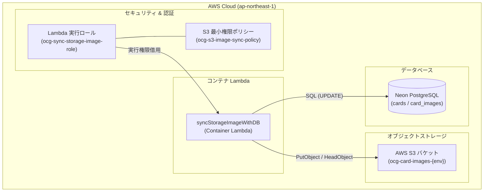

# 画像同期 API インフラ準備・要件定義書 (Infrastructure & Prerequisites Guide)

本ドキュメントは、S3 画像同期 Lambda 関数 `syncStorageImageWithDB` を稼働させるために必要となるインフラリソース（S3 バケット、IAM ロール・ポリシー、環境変数、IaC 設定、ローカル検証環境）の洗い出しと設計仕様を定義する。

---

## 1. 必要なインフラリソース全体図



### 必要リソース・準備チェックリスト

| 区分 | リソース名 / 項目 | 概要 | 状態 |
| :--- | :--- | :--- | :---: |
| **ストレージ** | **S3 バケット** | カード画像バイナリを永続化する専用バケット | **要新規作成** |
| **セキュリティ** | **IAM ロール** | Lambda 関数が AWS リソースを操作するための実行ロール | **要新規作成** |
| **セキュリティ** | **IAM ポリシー** | S3 の特定プレフィックスへの読み書き権限を付与する最小権限ポリシー | **要新規作成** |
| **IaC** | **OpenTofu モジュール** | S3 および Lambda の IaC 定義（`infra/opentofu/`） | **要追加** |
| **アプリケーション** | **Lambda 環境変数** | バケット名、リージョン、CDN URL 等の実行時パラメータ | **要定義** |
| **ローカル環境** | **Compose / 検証環境** | ローカル開発用の S3 互換ストレージ（MinIO / LocalStack） | **要整備** |

---

## 2. AWS S3 バケット仕様

### 2.1 バケット基本要件

| 項目 | 設定値 / 設計方針 | 備考・選定理由 |
| :--- | :--- | :--- |
| **バケット名規則** | `ocg-card-images-{project}-{env}`<br>（例: `ocg-card-images-statistics-dev`） | プロジェクト・環境（dev/stg/prod）ごとに一意な命名とする。 |
| **リージョン** | `ap-northeast-1` (東京) | Lambda 関数と同一リージョンに配置し、転送レイテンシとデータ転送コストを最小化。 |
| **ブロックパブリックアクセス** | **全ブロック有効（Enabled）** | バケット全体は完全に非公開とし、インターネットからの直接アクセスを遮断。 |
| **暗号化 (SSE)** | `SSE-S3 (AES-256)` | デフォルト暗号化を適用。KMS 管理コストを削減しつつ十分な安全性を確保。 |
| **バージョニング** | **無効（Disabled）** または **直近1世代のみ** | 画像は `ocg_api_image_id` で一意かつイミュータブル（不変）なため、履歴保持は不要。 |
| **ライフサイクルルール** | 不完全なマルチパートアップロードの破棄（7日後） | ストリームアップロード失敗時のゴミ残渣を自動清掃。 |

### 2.2 S3 ディレクトリ（オブジェクトキー）構造

```text
s3://ocg-card-images-{project}-{env}/
└── cards/
    ├── small/
    │   └── {ocg_api_image_id}.jpg   # サムネイル表示用 (カード全体)
    ├── large/
    │   └── {ocg_api_image_id}.jpg   # 詳細表示用高解像度 (カード全体)
    └── cropped/
        └── {ocg_api_image_id}.jpg   # カードイラスト枠のみ
```

- **キー命名原則**:
  - ファイル名には遊戯王固有の絵違い画像 ID（`ocg_api_image_id`）を採用。
  - 同一カードに複数の絵違い（イラストバリエーション）が存在してもキーが衝突しない構造とする。

---

## 3. IAM ロールおよび IAM ポリシー設計

最小権限の原則（Least Privilege）に基づき、`syncStorageImageWithDB` Lambda に付与する IAM ポリシーを定義する。

### 3.1 IAM ロール (信頼ポリシー)
Lambda サービスが本ロールを引き受けるための信頼関係ポリシー。

```json
{
  "Version": "2012-10-17",
  "Statement": [
    {
      "Effect": "Allow",
      "Principal": {
        "Service": "lambda.amazonaws.com"
      },
      "Action": "sts:AssumeRole"
    }
  ]
}
```

### 3.2 S3 アクセスポリシー (インライン / カスタムポリシー)
Lambda 関数に必要な権限は以下の 4 つに限定する。
1. **`s3:PutObject`**: 画像ストリームのアップロード
2. **`s3:GetObject` / `s3:HeadObject`**: S3 側の既存存在確認
3. **`s3:ListBucket`**: バケットおよびプレフィックスの探索（必要に応じて）

```json
{
  "Version": "2012-10-17",
  "Statement": [
    {
      "Sid": "AllowS3CardImageSyncOperations",
      "Effect": "Allow",
      "Action": [
        "s3:PutObject",
        "s3:GetObject",
        "s3:HeadObject"
      ],
      "Resource": "arn:aws:s3:::ocg-card-images-${project}-${env}/cards/*"
    },
    {
      "Sid": "AllowListBucketForExistenceCheck",
      "Effect": "Allow",
      "Action": [
        "s3:ListBucket"
      ],
      "Resource": "arn:aws:s3:::ocg-card-images-${project}-${env}",
      "Condition": {
        "StringLike": {
          "s3:prefix": [
            "cards/*"
          ]
        }
      }
    }
  ]
}
```

### 3.3 基本実行ポリシーのアタッチ
AWS 管理ポリシー `AWSLambdaBasicExecutionRole`（CloudWatch Logs 出力権限 `logs:CreateLogGroup`, `logs:CreateLogStream`, `logs:PutLogEvents`）をアタッチする。

---

## 4. Lambda 実行時パラメータ（環境変数仕様）

Lambda 関数 `syncStorageImageWithDB` に設定する環境変数の定義一覧。

| 環境変数名 | 必須 | 設定値の例 | 説明 |
| :--- | :---: | :--- | :--- |
| **`S3_BUCKET_NAME`** | ○ | `ocg-card-images-statistics-dev` | アップロード先となる AWS S3 バケット名。 |
| **`AWS_REGION`** | ○ | `ap-northeast-1` | S3 バケットが配置されている AWS リージョン。 |
| **`S3_ENDPOINT_URL`** | - | `http://minio:9000` (ローカル時のみ) | ローカル環境（MinIO / LocalStack）検証時に S3 エンドポイントを上書きするための URL。本番・AWS 上では未設定（空文字）。 |
| **`CDN_BASE_URL`** | - | `https://images.example.com` | CloudFront 等の CDN 配信ドメインがある場合、DB の `image_url_*_this_app` に書き込むベース URL。未設定時は S3 標準 URL を使用。 |
| **`IMAGE_SYNC_CONCURRENCY`** | - | `5` | 同時に外部 CDN からストリームダウンロードする並行ワーカー数（デフォルト: 5）。 |
| **`PG_DB_USER`** | ○ | `postgres` (本番は IaC から注入) | PostgreSQL / Neon 接続ユーザー。 |
| **`PG_DB_PASSWORD`** | ○ | `postgres` (本番は IaC から注入) | PostgreSQL / Neon 接続パスワード。 |
| **`PG_DB_HOST_PORT`** | ○ | `ocg_db_local:5432` / `ep-xxx.neon.tech` | PostgreSQL / Neon ホスト名とポート。 |
| **`PG_DB_NAME`** | ○ | `postgres` / `neondb` | 接続先データベース名。 |

---

## 5. OpenTofu (IaC) 実装方針

本プロジェクトのインフラコード規律に従い、S3 バケットおよび Lambda の IAM 権限を OpenTofu で管理する。

### 5.1 ディレクトリ配置方針
```text
infra/opentofu/
├── modules/
│   ├── s3/
│   │   └── cardImage/            # S3 バケット作成モジュール（新規追加）
│   │       ├── main.tf
│   │       ├── variables.tf
│   │       └── outputs.tf
│   └── lambda/
│       └── syncStorageImage/     # syncStorageImage 用 Lambda モジュール（新規追加）
│           ├── main.tf           # IAM ロール・ポリシー・Lambda 定義
│           ├── variables.tf
│           └── outputs.tf
└── env/
    └── dev/
        └── prepare_master/       # 開発環境のマスター管理（呼び出し追加）
            ├── main.tf
            └── variables.tf
```

### 5.2 IaC 実装の要点
1. **S3 バケットモジュール (`modules/s3/cardImage`)**:
   - `aws_s3_bucket`, `aws_s3_bucket_public_access_block`, `aws_s3_bucket_server_side_encryption_configuration` を定義。
   - バケット名および ARN を Output としてエクスポート。
2. **Lambda モジュール (`modules/lambda/syncStorageImage`)**:
   - S3 バケットの ARN を受け取り、前述の IAM ポリシーを作成して Lambda 実行ロールに紐付ける。
   - `environment` ブロックに `S3_BUCKET_NAME` を渡す。

---

## 6. ローカル開発・検証環境（MinIO / S3 エミュレーション）の整備方針

ローカルコンテナ環境（`compose.yaml`）で S3 へのアップロード処理を検証可能にするため、以下のいずれかのアプローチを採用する。

### 6.1 アプローチ A: MinIO コンテナの追加（推奨）
[compose.yaml](../../compose.yaml) に軽量な S3 互換ストレージである `minio` を追加する。

```yaml
  minio:
    image: minio/minio:RELEASE.2024-10-13T13-34-11Z
    container_name: ocg_minio_local
    ports:
      - "9005:9000"
      - "9006:9001"
    environment:
      MINIO_ROOT_USER: minioadmin
      MINIO_ROOT_PASSWORD: minioadmin
    command: server /data --console-address ":9001"
    volumes:
      - minio_data:/data
    networks:
      - ocg-network
```

- `syncStorageImageWithDB` コンテナの環境変数に以下を設定:
  - `S3_ENDPOINT_URL: http://minio:9000`
  - `S3_BUCKET_NAME: ocg-card-images-local`
  - `AWS_ACCESS_KEY_ID: minioadmin`
  - `AWS_SECRET_ACCESS_KEY: minioadmin`
- これにより、本番 AWS アカウントやインターネット環境に依存せず、完全オフラインでローカル画像同期の E2E 検証が可能となる。

### 6.2 アプローチ B: Go 単体テストでのインターフェースモック
- Go の単体テスト（`go test ./...`）では、`storage.StorageClient` インターフェースのインメモリ Mock 実装（`TestStorageClient`）を使用し、MinIO や AWS S3 なしで 100% のロジックカバレッジを担保する。
