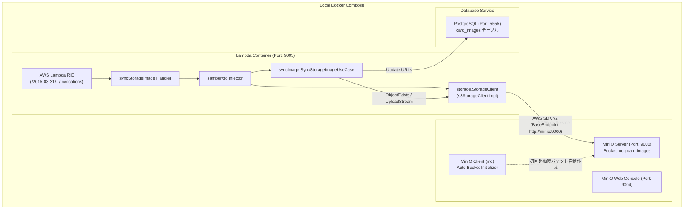

# ローカル MinIO テスト環境構築・検証手順書 (Local MinIO Testing Guide)

本ドキュメントは、カード画像同期 Lambda 関数 `syncStorageImageWithDB` をローカル環境で AWS アカウントなしで完全オフライン検証するための、MinIO 連携アーキテクチャ、DI (Dependency Injection) 設定、およびテスト実行手順をまとめたものです。

---

## 1. 背景と課題

`syncStorageImageWithDB` は、外部 CDN からストリーミング取得したカード画像バイナリを AWS S3 にアップロードし、保存先 URL を PostgreSQL（Neon）に記録します。
しかし、ローカル開発環境（Docker Compose）に S3 互換のオブジェクトストレージモックが存在しなかったため、以下の課題がありました：

1. **ローカル単体/結合検証の阻害**:
   ローカルで Lambda コンテナを起動しても、AWS S3 接続エラーとなり E2E テストが実行できない。
2. **コスト・権限リスク**:
   テストのたびに本番やクラウド上の S3 バケットと通信すると、ネットワークレイテンシやテスト用オブジェクトのクリーンアップ負荷が生じる。

これらを解決するため、**MinIO コンテナを Docker Compose に導入し、DI 経由でローカル環境でのみ MinIO を透過的に参照する構成** を構築しました。

---

## 2. アーキテクチャと DI 設計

### 2.1 アーキテクチャ構成図



### 2.2 S3 クライアント DI の拡張仕様 ([s3_impl.go](../../code/cardApiCall/internal/storage/s3_impl.go))

ビジネスロジック（`ObjectExists`, `UploadStream`, `GetDestinationURL`）は一切変更せず、DI コンテナ初期化関数 `NewS3StorageClientForDI` のみを拡張しました。

```go
func NewS3StorageClientForDI(i *do.Injector) (StorageClient, error) {
	ctx := context.Background()
	region := env.GetAsString("AWS_REGION", "ap-northeast-1")
	bucketName := env.GetAsString("CARD_IMAGE_BUCKET_NAME", env.GetAsString("S3_BUCKET_NAME", ""))
	cdnBaseURL := env.GetAsString("CARD_IMAGE_CDN_BASE_URL", env.GetAsString("CDN_BASE_URL", ""))
	endpointURL := env.GetAsString("AWS_ENDPOINT_URL", env.GetAsString("S3_ENDPOINT_URL", ""))
	usePathStyle := env.GetAsString("AWS_S3_USE_PATH_STYLE", env.GetAsString("S3_USE_PATH_STYLE", "false")) == "true"

	cfg, err := awsconfig.LoadDefaultConfig(ctx, awsconfig.WithRegion(region))
	if err != nil {
		return nil, fmt.Errorf("failed to load aws sdk config: %w", err)
	}

	s3Client := s3.NewFromConfig(cfg, func(o *s3.Options) {
		if endpointURL != "" {
			o.BaseEndpoint = aws.String(endpointURL)
			o.UsePathStyle = true // MinIO などのカスタムエンドポイント時は Path-Style を有効化
		}
		if usePathStyle {
			o.UsePathStyle = true
		}
	})
	return NewS3StorageClient(s3Client, bucketName, region, cdnBaseURL), nil
}
```

- **本番環境への配慮**:
  AWS 本番環境では `AWS_ENDPOINT_URL` や `AWS_S3_USE_PATH_STYLE` は未設定（空文字）となるため、標準の AWS S3 宛て（バーチャルホスト形式）となり、本番動作への副作用はありません。
- **MinIO への適応**:
  MinIO ではバケット名をサブドメインではなくパスで受ける必要があるため、カスタムエンドポイント指定時に `o.UsePathStyle = true` を設定しています。

---

## 3. Docker Compose 設定仕様 ([compose.yaml](../../compose.yaml))

### 3.1 MinIO およびバケット初期化サービス
```yaml
  minio:
    image: minio/minio:latest
    container_name: ocg_minio_local
    ports:
      - "9000:9000"  # S3 API
      - "9004:9001"  # Web Console (9001 は cardIdCheck と競合するため 9004 にバインド)
    environment:
      MINIO_ROOT_USER: minioadmin
      MINIO_ROOT_PASSWORD: minioadmin
    command: server /data --console-address ":9001"
    volumes:
      - minio_volume_ocg:/data
    restart: unless-stopped
    networks:
      - ocg-network

  minio_create_buckets:
    image: minio/mc:latest
    container_name: ocg_minio_create_buckets
    depends_on:
      - minio
    entrypoint: >
      /bin/sh -c "
      until (/usr/bin/mc alias set myminio http://minio:9000 minioadmin minioadmin); do
        echo '...waiting for minio to be ready...'
        sleep 1
      done;
      /usr/bin/mc mb --ignore-existing myminio/ocg-card-images;
      /usr/bin/mc anonymous set download myminio/ocg-card-images;
      echo 'Bucket ocg-card-images created successfully';
      exit 0;
      "
    networks:
      - ocg-network
```

### 3.2 syncStorageImage サービス環境変数
```yaml
  cardapicall_syncstorageimage:
    environment:
      PG_DB_USER: postgres
      PG_DB_PASSWORD: postgres
      PG_DB_HOST_PORT: ocg_db_local:5432
      PG_DB_NAME: postgres
      AWS_REGION: ap-northeast-1
      AWS_ACCESS_KEY_ID: minioadmin
      AWS_SECRET_ACCESS_KEY: minioadmin
      AWS_ENDPOINT_URL: http://minio:9000
      AWS_S3_USE_PATH_STYLE: "true"
      CARD_IMAGE_BUCKET_NAME: ocg-card-images
      CARD_IMAGE_CDN_BASE_URL: http://localhost:9000/ocg-card-images
    depends_on:
      minio:
        condition: service_started
      minio_create_buckets:
        condition: service_completed_successfully
      ocg_db_local:
        condition: service_started
```

---

## 4. テスト・検証手順

### 4.1 コンテナ起動
```bash
docker compose up -d minio minio_create_buckets cardapicall_syncstorageimage
```

### 4.2 ローカル結合テスト実行
[`scripts/code/cardApiCall/syncstorageimage/local_test.sh`](../../scripts/code/cardApiCall/syncstorageimage/local_test.sh) を使用してカード ID を送信します：

```bash
# カード ID 89631139（青眼の白龍）の画像同期をテスト
bash scripts/code/cardApiCall/syncstorageimage/local_test.sh "[89631139]"
```

**実行結果（初回実行時: 新規アップロード）**:
```json
{"totalProcessedCards":1,"successfulOcgCardIds":[89631139],"failedOcgCardIds":[],"syncedImageCount":24,"skippedImageCount":0,"errors":[]}
```

**実行結果（2回目実行時: 冪等性・スキップ動作）**:
```json
{"totalProcessedCards":1,"successfulOcgCardIds":[89631139],"failedOcgCardIds":[],"syncedImageCount":0,"skippedImageCount":24,"errors":[]}
```

### 4.3 MinIO および DB の確認
1. **MinIO Web Console**:
   ブラウザで [http://localhost:9004](http://localhost:9004) にアクセス（ユーザー: `minioadmin` / パスワード: `minioadmin`）。
   `ocg-card-images` バケット配下に `cards/small/*.jpg`, `cards/large/*.jpg`, `cards/cropped/*.jpg` が生成されていることを確認。
2. **HTTP 画像直接アクセス**:
   ```bash
   curl -I http://localhost:9000/ocg-card-images/cards/cropped/89631139.jpg
   # HTTP/1.1 200 OK が返ることを確認
   ```
3. **PostgreSQL DB の更新確認**:
   ```bash
   docker exec ocg-db-local psql -U postgres -d postgres -c "SELECT id, ocg_api_card_id, image_url_small_this_app FROM card_images WHERE ocg_api_card_id = 89631139 LIMIT 3;"
   ```

### 4.4 単体テスト一括実行
```bash
bash scripts/code/cardApiCall/syncstorageimage/test_all.sh
```
