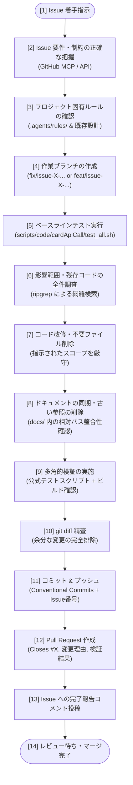

# Issue 駆動開発（Issue-Driven Development）標準ワークフロー

本ドキュメントは、本リポジトリ（`ocg_statistics`）における **GitHub Issue を起点とした標準的な開発・改修ワークフロー** を定義したものです。  
要件の分析、安全なブランチ運用、既存動作の保証（ベースライン検証）、コードとドキュメントの同時同期、公式管理スクリプトによる厳格なテスト検証、そして Pull Request 作成と Issue 連携までの一連のプロセスを標準化しています。

---

## 1. 開発ワークフローの全体像

以下の Mermaid フローチャートは、Issue 着手から PR 作成・Issue 完了報告までの標準プロセスを示しています。



---

## 2. ステップ別詳細手順

### Step 1: Issue 分析と制約事項の抽出
- **目的**: 依頼内容の背景、変更スコープ、触れてはいけない対象（制約事項）を完全に把握する。
- **実行内容**:
  - GitHub MCP ツール（`get_issue`）または GitHub API を用いて Issue 本文および関連コメントを取得する。
  - 「何を変更・削除するのか」「ドキュメントの更新対象はあるか」「スクリプトなど触ってはいけない範囲はどこか」を箇条書きで整理する。

### Step 2: プロジェクト固有ルールと既存設計の確認
- **目的**: リポジトリごとの規約違反による手戻りを防止する。
- **確認対象**:
  - [`.agents/rules/`](../../.agents/rules/):
    - `01_security_rules.md`: リモート認証情報・接続文字列のコミット禁止
    - `02_aws_sdk_and_quality_rules.md`: S3 transfermanager 標準化、エラー握りつぶし禁止
    - `03_test_verification_rules.md`: 手動 `go test` 直打ち禁止、公式管理スクリプト実行義務
  - [`docs/X_important/document/rules/01_prohibit_absolute_path_rules.md`](../X_important/document/rules/01_prohibit_absolute_path_rules.md): ドキュメント内のローカル絶対パス（`/Users/...`, `file://`）の厳格禁止
  - 直近の Git コミット履歴（`git log -n 5 --oneline`）でコミットメッセージ命名規則を確認。

### Step 3: 作業ブランチの作成
- **目的**: `main` ブランチを保護し、Issue ごとに独立した作業環境を確保する。
- **命名規則**:
  - バグ修正・不要コード削除: `fix/issue-<番号>-<概要>`（例: `fix/issue-9-remove-legacy-cardidcheck`）
  - 新機能追加: `feat/issue-<番号>-<概要>`
  - リファクタリング: `refactor/issue-<番号>-<概要>`
- **実行コマンド例**:
  ```bash
  git checkout -b fix/issue-9-remove-legacy-cardidcheck
  ```

### Step 4: ベースライン検証（Baseline Testing）
- **目的**: 自身の変更に着手する前の状態で、既存テストが正常にパスしていることを証明する。
- **重要原則**:
  - **手動で `go test` を直接実行することは厳禁**。必ず管理スクリプトを実行する。
- **実行コマンド例**:
  ```bash
  ./scripts/code/cardApiCall/test_all.sh
  ```

### Step 5: 影響範囲の全件調査（コード・スクリプト・ドキュメント）
- **目的**: 変更・削除対象がどこで参照されているかを漏れなく洗い出す。
- **調査手法**:
  - 大文字・小文字を区別せず、キーワードでリポジトリ全体を検索する。
  - 調査対象:
    1. ソースコード本体（`code/` 配下）
    2. コンテナ定義・CI/CD（`Dockerfile`, `compose.yaml`, `.github/workflows/`）
    3. 運用・検証スクリプト（`scripts/` 配下）
    4. ドキュメント（`docs/` 配下）
  - 正式な実装パス（例: `cmd/aws_lambda/cardIdCheck/`）と旧実装パス（例: `cardidcheck/`）の重複関係を明確にする。

### Step 6: 変更の実施とスコープの限定
- **目的**: 指定された要件のみを正確に実装・削除し、余計な差分を生じさせない。
- **実行内容**:
  - 不要コードの削除は `git rm -r` 等で確実に Git 管理から外す。
  - Issue に「スクリプトおよび該当コード以外は原則触らない」等の指示がある場合、指定外のファイルに対するリファクタリングを勝手に行わない。

### Step 7: ドキュメントの完全同期
- **目的**: コードの変更とドキュメントの整合性を 100% 維持する（ドキュメント負債の防止）。
- **確認・更新項目**:
  - ディレクトリツリー図に削除したディレクトリや古い参照が残っていないか。
  - 旧資産の参照や「移行中」「無傷で保持」といった過渡期向けの説明セクションが残存していないか。
  - **リンクの検証**:
    - ドキュメント内のファイルリンクはすべて **相対パス** で記述されているか。
    - ローカル絶対パス（`/Users/...` や `file://`）が混入していないか。

### Step 8: 多角的な検証（Verification）
- **目的**: 改修によるデグレがないこと、および修正・ビルドが意図通り動作することを証明する。
- **検証項目**:
  1. **公式総合テストスクリプトの実行**:
     ```bash
     ./scripts/code/cardApiCall/test_all.sh
     ```
     すべての単体テスト（Parallel）および DB 結合テスト（Sequential: `-p 1`）が 100% PASS することを確認。
  2. **バイナリビルド検証**:
     Dockerfile やローカルビルドコマンドに準拠した形式で、対象コードがコンパイルエラーなくビルドできることを確認。
  3. **差分精査**:
     `git diff` および `git status` を確認し、意図しないファイル・余分な空行・デバッグログが含まれていないことを確認。

### Step 9: コミットとプッシュ
- **目的**: 変更履歴を追跡可能かつ明瞭に記録する。
- **コミットメッセージ規約**:
  - 形式: `<type>: 【<カテゴリ>】<変更内容の要約> #<Issue番号>`
  - 例: `fix: 【Lambda】余分なディレクトリcmd_aws_lambdaに入っていないcardIdcheck実装を削除 #9`
- **プッシュ先の厳格な制約（重要）**:
  - **`main` ブランチへの直接プッシュ（`git push origin main`）は固く禁止** されています。
  - 必ず Step 3 で作成した作業用ブランチ（`feature/...` または `fix/...`）に対してプッシュしてください。
- **実行コマンド例**:
  ```bash
  git add <変更ファイル>
  git commit -m "fix: 【Lambda】余分なディレクトリcmd_aws_lambdaに入っていないcardIdcheck実装を削除 #9"
  # main ではなく、必ず対象の作業ブランチにプッシュする
  git push origin fix/issue-9-remove-legacy-cardidcheck
  ```

### Step 10: Pull Request の作成と Issue 連携
- **目的**: レビュアーに対して変更の意図・内容・検証結果を明確に提示し、Issue との紐付けを自動化する。
- **PR 記載要件**:
  1. **概要**: 対象 Issue 番号と作業の目的
  2. **変更内容**: 削除・修正したファイルと具体的な変更点
  3. **検証結果**: 実行したテストスクリプトのログサマリー
  4. **Issue 連携**: 本文末尾に `Closes #<Issue番号>` を記載（マージ時に自動クローズ）
- **Issue へのフィードバック**:
  - Issue 側のコメント欄に、対応完了の旨・作成した PR リンク・実施内容サマリーを投稿する。

---

## 3. 開発時の 5 大鉄則（プロジェクト規約）

| 原則 | 内容 | 根拠ドキュメント |
| :--- | :--- | :--- |
| **1. 管理テストスクリプト必須原則** | `go test` をターミナルから直接叩くことを禁止。必ず `scripts/` 配下の公式スクリプトを実行して検証する。 | [03_test_verification_rules.md](../../.agents/rules/03_test_verification_rules.md) |
| **2. コード・ドキュメント同時同期原則** | コードの削除・変更を行った際は、該当する `docs/` 配下の設計書・ツリー図・参照記述を必ず同一タスク内で同期する。 | [02_doc_code_synchronization_rules.md](../X_important/common/rules/02_doc_code_synchronization_rules.md) |
| **3. ドキュメント内絶対パス記述厳格禁止** | ドキュメント内に `/Users/...` や `file://` を記述することを固く禁止し、必ず相対パスでリンクする。 | [01_prohibit_absolute_path_rules.md](../X_important/document/rules/01_prohibit_absolute_path_rules.md) |
| **4. スコープ厳守原則** | Issue の要件および制約（「スクリプトおよび該当コード以外は原則触らない」等）を厳守し、不要な変更を含めない。 | 各 Issue の仕様 |
| **5. 作業ブランチプッシュ徹底原則** | `main` ブランチへの直接プッシュは固く禁止。変更は必ず作成した feature / fix ブランチに push すること。 | 本ドキュメント Step 9 |

---

## 4. PR 提出前チェックリスト

PR を作成する前に、以下の項目をセルフチェックしてください：

- [ ] Issue の要件・制約事項をすべて満たしているか？
- [ ] 意図しないファイルや不要なスコープ外の差分が含まれていないか？（`git status`, `git diff` で確認）
- [ ] 公式テストスクリプト（`./scripts/code/cardApiCall/test_all.sh` 等）を実行し、100% PASS しているか？
- [ ] 対象バイナリやコンテナのビルドが正常に通るか？
- [ ] ドキュメント内の古い参照・不要セクションを削除・更新したか？
- [ ] ドキュメント内にローカル絶対パス（`/Users/...` など）が含まれていないか？
- [ ] **`main` ではなく、作業用の feature / fix ブランチにプッシュしているか？**
- [ ] コミットメッセージおよび PR タイトルに Issue 番号が含まれているか？
- [ ] PR 本文に `Closes #<Issue番号>` が記載されているか？
- [ ] Issue に対応完了サマリーと PR リンクのコメントを投稿したか？

---

## 5. 参考リンク集

本ワークフローの設計根拠となっている公式ドキュメントおよび仕様一覧です（すべて HTTP 200 疎通確認済み）：

- [GitHub Docs: Linking a pull request to an issue](https://docs.github.com/en/issues/tracking-your-work-with-issues/using-issues/linking-a-pull-request-to-an-issue) - PR マージ時に Issue を自動クローズするためのキーワード仕様
- [Conventional Commits v1.0.0](https://www.conventionalcommits.org/en/v1.0.0/) - コミットメッセージの標準構造仕様
- [Go.dev: Organizing a Go module](https://go.dev/doc/modules/layout) - Go 公式推奨のパッケージ・モジュールレイアウト
