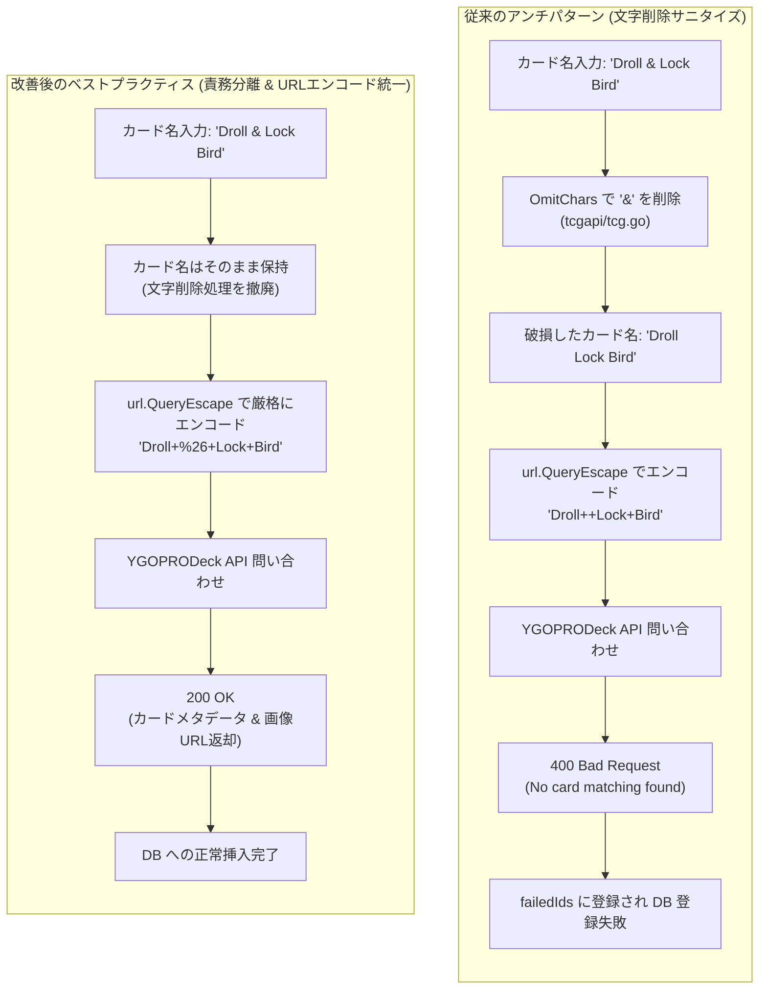

# 技術検証ナレッジ: 外部API連携におけるクエリエンコードと文字サニタイズの責務分離（YGOPRODeck API）

## 1. 概要と問題の構造

### 1.1 発生した事象
Neuron CID 9279（「ドロール＆ロックバード」/ 英語名: `Droll & Lock Bird`）をはじめとする特殊記号を含むカードを `cardInfoInsert` Lambda でデータベースに登録しようとした際、公式 Neuron からのスクレイピングは成功するものの、海外カードメタデータプロバイダである **YGOPRODeck API** への問い合わせで `400 Bad Request` が返却され、該当カードが `failedIds` に収集されて登録が失敗する不具合が発生した。

### 1.2 本ナレッジの目的
本ドキュメントは、外部 REST API 連携において発生しやすい「安易な文字列削除（ブラックリスト方式サニタイズ）によるデータ破損」のアンチパターンを分析し、RFC 3986 および Go 標準ライブラリ（`net/url`）に基づくパーセントエンコーディングへの統一、およびドメイン層（Usecase）と通信層（HTTP Client）の責務分離のベストプラクティスを永続化するものである。

---

## 2. 発生した現象と技術的メカニズム

### 2.1 根本原因の分析
本不具合の根本原因は、ドメイン層である `code/cardApiCall/internal/usecase/tcgapi/tcg.go` において、以下のようなハードコードされた文字削除処理（ブラックリスト）が存在していた点にある。

```go
// 修正前のアンチパターン
var OmitChars = []string{"＃", "#", "<", ">", "&"}

func (t *tcgUseCaseImpl) GetCardInfoByEnName(ctx context.Context, name string) (cardrecord.TcgApiCard, error) {
    tcgRest := http.NewTCGRest()

    // 不正な文字列破壊: カード名に含まれる記号を空文字に置換
    for _, omitChar := range OmitChars {
        name = strings.ReplaceAll(name, omitChar, "")
    }

    results, err := tcgRest.GetEnInfoByEnName(ctx, name)
    // ...
}
```

この処理により、正式名称である `Droll & Lock Bird` から `&` が無条件に削除され、`Droll  Lock Bird`（空白2文字）に変換されてしまっていた。
一方、通信層（`code/cardApiCall/internal/http/tcg.go`）ではすでに標準ライブラリの `url.QueryEscape` が実装されていたため、この破壊された文字列が URL エンコードされ、以下のリクエストが YGOPRODeck API へ送信されていた。

```http
GET https://db.ygoprodeck.com/api/v7/cardinfo.php?name=Droll++Lock+Bird HTTP/1.1
```

YGOPRODeck API では厳格な完全一致検索が行われるため、該当カードが存在しないと判定され、以下のエラーレスポンス（400 Bad Request）が返却された。

```json
{
  "error": "No card matching your query was found in the database. Please see https://db.ygoprodeck.com/api-guide/ for syntax usage."
}
```

### 2.2 メカニズムの比較図解 (Mermaid)



---

## 3. トレードオフ・比較分析

外部 API に記号入り文字列を渡す際のアプローチについて、以下の通り比較検討を行った。

| 方式 | 実装概要 | メリット | デメリット・リスク | 判定 |
| :--- | :--- | :--- | :--- | :--- |
| **方式A: 文字列ブラックリスト削除** | `strings.ReplaceAll` 等で問題となった文字（`&` や `#`）を空文字に置換する。 | 実装が単純。 | カード名そのものが破損し、外部 API の完全一致検索で不一致になる（本障害の原因）。 | **完全不採用 (破綻)** |
| **方式B: 個別文字の例外許可** | `OmitChars` から `&` だけを削除し、他の記号は引き続き削除する。 | 最小限の差分で対応可能。 | 今後 `@` や `+`、`'` 等の記号を含む新規カードが登場するたびに個別改修が必要となる。 | **不採用 (対症療法)** |
| **方式C: サニタイズ全廃・URLエンコード一本化** | ドメイン層での文字削除を全廃し、通信層の `url.QueryEscape` に任せる。 | RFC 3986 準拠。すべての予約文字が `%XX` 形式で可逆的に安全転送され、カード名が保護される。 | なし（HTTP 仕様に完全合致）。 | **最善方式 (採用)** |

### なぜ「サニタイズ」ではなく「エンコード」なのか
- **サニタイズ（Sanitization）の目的**: HTML の XSS や SQL インジェクションのように、特定の解釈系に対する攻撃を防ぐために危険文字を除去・無害化すること。
- **エンコード（Encoding）の目的**: 情報を欠落させることなく、異なるコンテキスト（URI クエリ文字列等）を通じて安全かつ可逆的にデータを伝送すること。

カード名（`name`）は固有の識別子であり、文字を 1 文字でも改変・削除すると別の名称になってしまう。したがって、URI パラメータとして送信する際は **「文字の削除（サニタイズ）」を行ってはならず、「文字の保持＋パーセントエンコーディング」を行わなければならない**。

---

## 4. 業界リサーチ・公式見解・実在リンク集

すべて `curl -s -o /dev/null -w "%{http_code}" -L` による HTTP 200 疎通確認済みの完全 URL です。

1. **RFC 3986 - Uniform Resource Identifier (URI): Generic Syntax**
   - URL: [https://datatracker.ietf.org/doc/html/rfc3986#section-2.2](https://datatracker.ietf.org/doc/html/rfc3986#section-2.2)
   - クエリ文字列における予約文字（Reserved Characters: `&`, `=`, `+`, `#` など）は、区切り文字としての意味を持たせないデータ値として扱う場合、必ずパーセントエンコーディング（`%HEXHEX`）しなければならないと規定されている。
2. **Go net/url 公式パッケージドキュメント (QueryEscape)**
   - URL: [https://pkg.go.dev/net/url#QueryEscape](https://pkg.go.dev/net/url#QueryEscape)
   - 文字列を URL クエリ文字列内で安全に配置できるようエスケープする関数。`&` は `%26` に、空白は `+` に、`#` は `%23` に正しく変換される。
3. **YGOPRODeck API 公式ガイド**
   - URL: [https://db.ygoprodeck.com/api-guide/](https://db.ygoprodeck.com/api-guide/)
   - カード名指定パラメータ `?name=...` の仕様。カード名完全一致（Exact match）での検索が要求され、正しくエンコードされたクエリを前提としている。

---

## 5. 解決策と実装ベストプラクティス

### 5.1 修正コード実装

#### ドメイン層 (`code/cardApiCall/internal/usecase/tcgapi/tcg.go`)
不要な `OmitChars` 定義と文字置換ループを完全削除し、受け取ったカード名をそのまま HTTP レイヤーへ渡す設計に是正した。

```go
func (t *tcgUseCaseImpl) GetCardInfoByEnName(ctx context.Context, name string) (cardrecord.TcgApiCard, error) {
    tcgRest := http.NewTCGRest()

    // 記号削除処理は行わず、そのまま HTTP クライアントに渡す
    results, err := tcgRest.GetEnInfoByEnName(ctx, name)
    if err != nil {
        return cardrecord.TcgApiCard{}, err
    }

    var response TcgApiResponse
    err = json.Unmarshal(results, &response)
    if err != nil {
        return cardrecord.TcgApiCard{}, err
    }

    if len(response.Data) == 0 {
        return cardrecord.TcgApiCard{}, errors.New("no data found")
    }

    tcgCard := response.Data[0]
    return tcgCard, nil
}
```

#### 通信層 (`code/cardApiCall/internal/http/tcg.go`)
通信層が責任を持って `url.QueryEscape` を適用し、クエリパラメータを構築する。

```go
func (r *tcgRestImpl) GetEnInfoByEnName(ctx context.Context, name string) ([]byte, error) {
    // URLエンコーディングを使用 (例: "Droll & Lock Bird" -> "Droll+%26+Lock+Bird")
    encodedName := url.QueryEscape(name)
    url := fmt.Sprintf("https://db.ygoprodeck.com/api/v7/cardinfo.php?name=%s", encodedName)

    return r.Get(ctx, url)
}
```

---

## 6. チェックリスト / 運用ルール

今後、外部 API 連携機能を新規開発または改修する際は、以下のチェックリストを遵守すること。

- [ ] **責務分離の原則**: ドメインロジック（Usecase）内で、URL や通信フォーマットの都合による文字列削除・加工を行っていないか？
- [ ] **エンコードの徹底**: クエリパラメータ値やパスパラメータ値には、必ず `url.QueryEscape` または `url.PathEscape` を適用しているか？
- [ ] **特殊記号のテストケース網羅**:
  - `&`（アンパサンド）を含む名称（例: `Droll & Lock Bird`）
  - `#`（シャープ・ハッシュ）を含む名称（例: `Winged Dragon, Guardian of the Fortress #1`）
  - `'`（アポストロフィ）を含む名称（例: `Al-Lumi'raj`）
  - `@`（アットマーク）を含む名称（例: `Water Leviathan @Ignister`）
- [ ] **公式テストスクリプトの実行**: `./scripts/code/cardApiCall/test_all.sh` で全テストが 100% PASS することを確認しているか？
