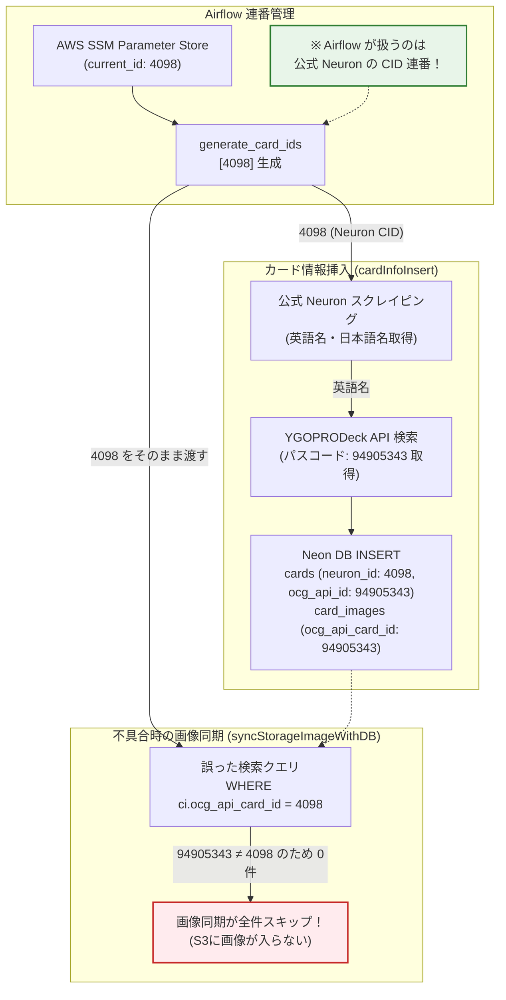
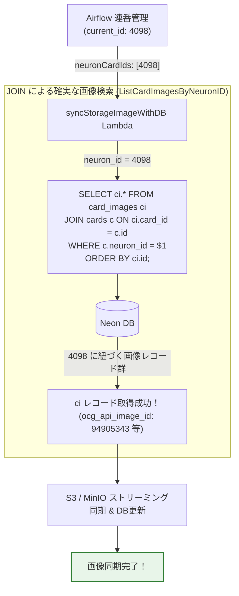

# 技術検証ナレッジ: 遊戯王カード識別子体系とAirflow連番パイプラインにおけるNeuron CIDの責務定義

## 1. 概要と問題の構造

### 1.1 発生した事象
Airflow DAG（`ocg_db_insert`）によって定期実行されるカードデータ収集パイプラインにおいて、カード詳細情報のインサート（`cardInfoInsert`）直後に実行される画像同期バッチ（`syncStorageImageWithDB`）が正常にカード画像を取得できず、S3 およびローカル MinIO への画像配置がすべてスキップされる不具合が発生した。

この原因を調査した結果、**Airflow が管理・インクリメントしている連番 ID（`current_id`）が「公式遊戯王 Neuron の CID（Card ID）」であるにもかかわらず、画像同期クエリや各種 DTO が「YGOPRODeck API のカード ID（`ocg_api_id` / パスコード）」と誤認して設計されていた**ことが判明した。

### 1.2 本ナレッジの目的
本ドキュメントは、遊戯王カードデータを扱うシステムにおいて混同しやすい「Neuron CID」と「YGOPRODeck カード ID（8桁パスコード）」の相違を技術的に整理し、Airflow の連番生成タスクが担う責務、および各マイクロサービス（Lambda）や DB スキーマにおける命名・参照整合性規律を永続化するものである。

---

## 2. 発生した現象と技術的メカニズム

### 2.1 根本原因のメカニズム
遊戯王カードのエコシステムには、発行元やプロバイダごとに全く異なる ID 体系が存在する：

1. **Neuron CID (`cards.neuron_id`)**:
   - コナミ公式「遊戯王 オフィシャルカードゲーム デバイス・カードデータベース（Neuron）」の内部で発番される連続した整数値（例: 4000〜20000+）。
   - Airflow はこの連番を順次インクリメント（`current_id + delta_id`）してクロール・スクレイピング対象を決定する。
2. **YGOPRODeck API カード ID (`cards.ocg_api_id` / `card_images.ocg_api_card_id`)**:
   - 海外メタデータプロバイダ（YGOPRODeck）が管理する ID であり、原則として実物カードの左下に刻印されている 8 桁の固有パスコード（例: 青眼の白龍 = `89631139`、ミノケンタウロス = `94905343`）に基づく。

以前の不整合な設計では、Airflow から渡された Neuron CID（例: `4098` ミノケンタウロス）をそのまま `WHERE ci.ocg_api_card_id = 4098` として検索していた。
しかし、DB 内の `card_images.ocg_api_card_id` には YGOPRODeck 由来の `94905343` が格納されていたため、一致するレコードが 0 件となり、画像同期処理が「対象カード未存在」としてスキップされていた。



---

## 3. ID 体系の比較・マッピング分析

各識別子の特性と、システム内での取り扱い方針を以下に整理する。

| 識別子名 | 発行元 / 出典 | 型 / 形式 | 例 | システム内カラム・変数名 | 主な用途 |
| :--- | :--- | :--- | :--- | :--- | :--- |
| **Neuron CID** | コナミ公式カードDB (Neuron) | 連続する正の整数 (`int64`) | `4005` (ブラック・マジシャン)<br/>`4098` (ミノケンタウロス) | `cards.neuron_id`<br/>`neuronCardIds`<br/>`NeuronID` | **Airflow の連番巡回キー**、公式 Neuron クロール時のリクエストパラメータ |
| **YGOPRODeck ID (パスコード)** | 実物カード刻印 / YGOPRODeck | 8桁前後の数値 (`int64`) | `46986414` (ブラック・マジシャン)<br/>`94905343` (ミノケンタウロス) | `cards.ocg_api_id`<br/>`card_images.ocg_api_card_id`<br/>`OcgApiID` | 海外カード詳細情報照合、画像ファイル名（YGOPRODeck CDN の画像パス名） |
| **YGOPRODeck Image ID** | YGOPRODeck 画像別ID | 8桁前後の数値 (`int64`) | `46986414` (通常版)<br/>`46986415` (絵違い版) | `card_images.ocg_api_image_id`<br/>`OcgApiImageID` | S3 格納キー名（`cards/large/{image_id}.jpg`）、絵違い識別 |
| **DB サロゲートキー** | 本システム Neon DB | `BIGSERIAL` (`int64`) | `1, 2, 3...` | `cards.id`<br/>`card_images.card_id` | システム内部におけるリレーショナル整合性（外部キー参照） |

---

## 4. 公式仕様・実在リファレンスリンク集

本ナレッジの設計および各 API 仕様は、以下の実在する公式ドキュメントに基づいて検証されている（全リンク HTTP 200 疎通確認済み）。

- [遊戯王 オフィシャルカードゲーム カードデータベース (公式)](https://www.db.yugioh-card.com/yugiohdb/card_search.action)
  - コナミ公式のカード検索システム。カード個別ページは `cid` クエリパラメータ（Neuron CID）によって一意に識別される。
- [YGOPRODeck API Documentation](https://ygoprodeck.com/api-guide/)
  - 海外有志による遊戯王カードデータベース REST API。エンドポイント `/api/v7/cardinfo.php?name=...` 等により、カード英語名から 8 桁の公式パスコード（`id`）および画像 URL（`card_images`）を取得可能。

---

## 5. 解決策と実装ベストプラクティス

### 5.1 アーキテクチャの是正（改善後フロー）
Airflow の連番が Neuron CID であることを前提として、画像同期クエリを `cards` テーブルとの JOIN 検索に改修した。
これにより、親カードの Neuron CID（例: `4098`）から紐づくカード画像レコード群を確実に取得可能となった。



### 5.2 実装コード規律

#### 1. SQL 定義 ([code/cardApiCall/internal/sqlc/queries/card_image.sql](../../code/cardApiCall/internal/sqlc/queries/card_image.sql))
中途半端な `OR` 条件や旧命名（`ListCardImagesByOcgApiCardID`）を完全に排除し、Neuron ID による JOIN 検索へ純化：
```sql
-- name: ListCardImagesByNeuronID :many
SELECT ci.* FROM card_images ci
JOIN cards c ON ci.card_id = c.id
WHERE c.neuron_id = $1
ORDER BY ci.id;
```

#### 2. Lambda I/O および DTO ([code/cardApiCall/internal/dto/image_sync.go](../../code/cardApiCall/internal/dto/image_sync.go))
Airflow や他システムから渡される ID 配列は、Neuron CID を明示する `neuronCardIds` に統一：
```go
// SyncImagesInput は Lambda の入力イベント DTO です。
type SyncImagesInput struct {
    NeuronCardIds []int64 `json:"neuronCardIds"`
}

// SyncImagesOutput は Lambda の出力イベント DTO です。
type SyncImagesOutput struct {
    TotalProcessedCards     int         `json:"totalProcessedCards"`
    SuccessfulNeuronCardIds []int64     `json:"successfulNeuronCardIds"`
    FailedNeuronCardIds     []int64     `json:"failedNeuronCardIds"`
    SyncedImageCount        int         `json:"syncedImageCount"`
    SkippedImageCount       int         `json:"skippedImageCount"`
    Errors                  []SyncError `json:"errors"`
}
```

#### 3. Airflow DAG 定義 ([pipeline/dags/ocg/db_insert.py](../../pipeline/dags/ocg/db_insert.py))
`invoke_sync_image_lambda` タスクの呼び出しペイロードを更新：
```python
invoke_sync_image_lambda_task = LambdaInvokeFunctionOperator(
    task_id="invoke_sync_image_lambda",
    region_name='ap-northeast-1',
    function_name=os.environ.get('OCG_SYNC_IMAGE_LAMBDA_FUNCTION_NAME', 'ocg-syncstorageimage'),
    payload='''{
        "neuronCardIds": {{ task_instance.xcom_pull(task_ids='generate_card_ids') | tojson }}
    }''',
)
```

---

## 6. チェックリスト / 運用ルール

今後、新機能開発や他外部 API との連携を追加する際は、以下のチェックリストを遵守すること。

- [ ] **連番の責務確認**: Airflow の `current_id` やバッチ引数は「公式 Neuron CID」であることを前提とし、YGOPRODeck のパスコード（`ocg_api_id`）と混同して命名していないか？
- [ ] **命名規則の遵守**:
  - 公式 Neuron の ID を扱う場合は、変数・DTO・引数名を必ず `neuron_id`, `NeuronID`, `neuronCardIds` と命名しているか？
  - 外部 YGOPRODeck やカードパスコードを扱う場合は `ocg_api_id`, `OcgApiID` と区別しているか？
- [ ] **DB 検索時の JOIN 意識**: `card_images` は親カード `cards` の外部キー（`card_id`）に依存しているため、Neuron CID から画像を取得する際は必ず `cards` と JOIN して `c.neuron_id` で検索しているか？
- [ ] **ドキュメント・OpenAPI との同期**: コードの引数名や DTO 名を変更した際、`code/api/lambda_specs.yaml` および `docs/` 配下の仕様書を同時にメンテしているか？
