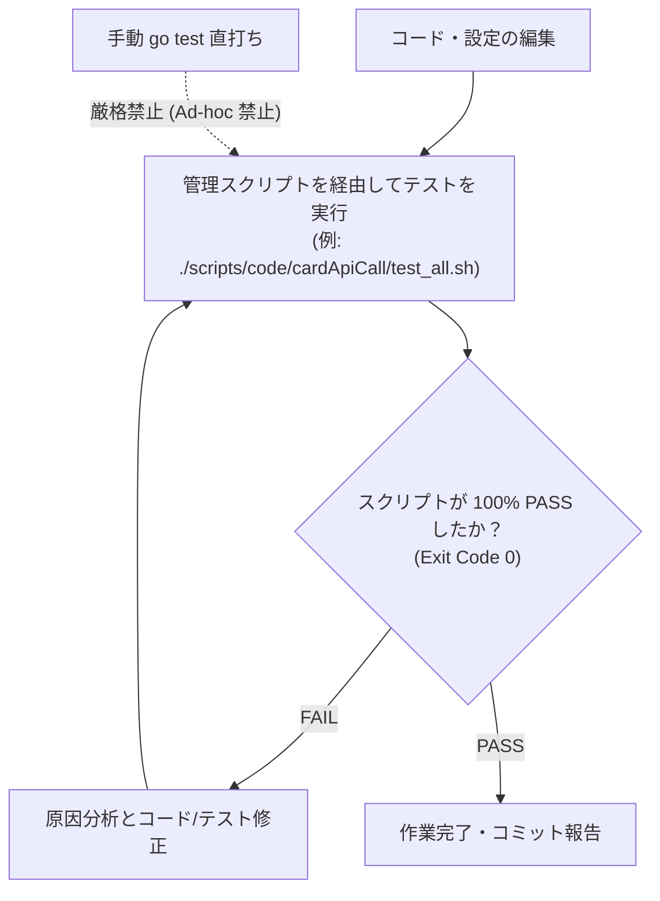

# ルール: スクリプトを介さない手動テスト実行の禁止および管理スクリプト経由の検証徹底

本リポジトリ（`ocg_statistics`）におけるすべてのテスト検証作業は、**管理されたスクリプト（`scripts/` 配下）を経由してのみ実行可能**とし、ターミナルからの手動（Ad-hoc）な `go test` コマンド直打ちによる検証を厳格に禁止します。

スクリプト全体のアーキテクチャ設計・標準規約については **[docs/06_scripts_general/](../../../06_scripts_general/01_script_architecture_and_design_policy.md)** を参照・保守してください。

---

## 1. 背景と目的

開発作業において、ターミナル上で手動（Ad-hoc）に `go test ./...` などのワンライナーを手打ちして検証を行うと、以下の深刻な問題が発生します：

1. **実行条件のブレ（環境競合・フレイキーテスト）**:
   - テスト用 DB（`ocg-db-local`）に対して直列実行フラグ（`-p 1`）を付け忘れて Truncate が並行で走り、原因不明のテスト失敗が頻発する。
2. **実行対象パッケージの抜け漏れとサイレントデグレ**:
   - 変更した特定パッケージだけを手打ちでテストして「OK」と判断し、共通モジュールや関連機能のデグレを見落とす。
3. **テストスクリプトの形骸化（Script Drift）**:
   - スクリプトを介さず手打ちで済ませることで、リポジトリ内の `test_all.sh` が古いパッケージパスのまま放置され、いざ CI や他者が実行した際にクラッシュする。

これらを未然に防ぎ、再現性と品質を担保するため、**「テスト実行はすべて管理された公式スクリプトを経由すること」** を義務付けます。

---

## 2. 厳格遵守ルール一覧

1. **ターミナルからの手動（Ad-hoc）ワンライナー `go test` 実行の禁止**:
   - シェル上で即興の `go test ./...` などを直接手打ちして「テスト完了」と判断してはならない。
2. **すべてのテスト検証は [scripts/](../../../../scripts) 配下のスクリプトを経由すること**:
   - **機能改修時**: 対象機能のスクリプト（例: `./scripts/code/cardApiCall/syncstorageimage/test_all.sh`、`./scripts/code/cardApiCall/cardinfoinsert/test_all.sh`）を実行する。
   - **作業完了前**: 総合テストスクリプト（`./scripts/code/cardApiCall/test_all.sh`）を実行し、全体にデグレがないことを検証する。
3. **スクリプトの仕様・設計は必ず [docs/06_scripts_general/](../../../06_scripts_general) に準拠すること**:
   - 新規スクリプトの作成や既存スクリプトの改修を行う際は、[docs/06_scripts_general/01_script_architecture_and_design_policy.md](../../../06_scripts_general/01_script_architecture_and_design_policy.md) に規定された標準仕様（`set -Ceu`、リポジトリルート自動解決、直列 `-p 1` 制御等）を厳格に遵守すること。
4. **パッケージ変更時のテストスクリプト同期義務**:
   - ディレクトリ構成やパッケージ構成を変更した際は、必ず該当する `test_all.sh` も同時に更新し、スクリプトが即座に動作する状態を維持すること。
5. **テスト未実行・失敗状態での作業完了報告の完全禁止**:
   - 管理スクリプトが 100% 成功（終了コード 0）したログをもって初めて作業完了とする。

---

## 3. テストスクリプト実行一覧

| 実行コマンド | 対象 | 実行タイミング |
| :--- | :--- | :--- |
| **`./scripts/code/cardApiCall/test_all.sh`** | **プロジェクト全体（総合回帰テスト）** | 作業完了前・PR作成前・共通モジュール改修時 |
| **`./scripts/code/cardApiCall/syncstorageimage/test_all.sh`** | 画像同期機能 (`syncStorageImageWithDB`) | 画像同期 Lambda および Storage 層の改修時 |
| **`./scripts/code/cardApiCall/cardinfoinsert/test_all.sh`** | カード情報登録機能 (`cardInfoInsert`) | カード登録 Lambda および スクレイピング層の改修時 |

---

## 4. 検証フロー

