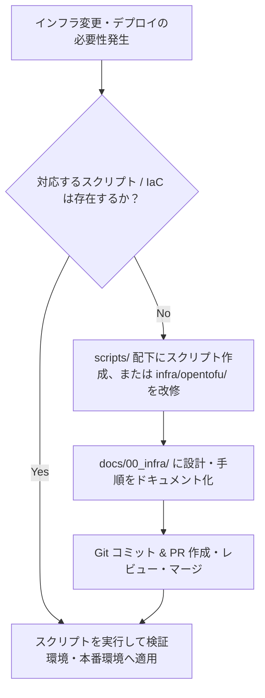

# ルール: スクリプトおよび IaC を介さない手動インフラデプロイの完全禁止

本リポジトリ（`ocg_statistics`）におけるすべてのインフラ環境（AWS、Neon DB、Airflow 等）に対するプロビジョニング・更新・デプロイ作業は、**管理されたスクリプト（`scripts/` 配下）および IaC（`infra/opentofu/`）を経由してのみ実行可能**とし、手動操作によるデプロイ・変更を厳格に禁止します。

インフラ全体の設計・アーキテクチャ概要・詳細な構築手順については [docs/00_infra/](../../../00_infra) を参照・保守してください。

---

## 1. 背景と目的

AWS マネジメントコンソールやクラウドダッシュボード上での手動操作（いわゆる ClickOps）や、ターミナルからの Ad-hoc な手打ち CLI 実行は、以下の重大な問題を引き起こします：

1. **再現性の欠如と環境差異（Configuration Drift）**:
   - 誰が・いつ・何を変更したかの履歴が残らず、ステージング／本番環境間での設定乖離が発生する。
2. **人為的ミス（ヒューマンエラー）のリスク**:
   - パラメータの打ち間違いや手順の抜け漏れによるサービス停止やデータ破損。
3. **Secrets・認証情報の漏洩リスク**:
   - コマンド履歴（`.bash_history` 等）へのクレデンシャル残留や不適切な権限付与。
4. **チーム開発・障害調査の破綻**:
   - 障害発生時に「コードとして記録されていない変更」が原因究明を著しく遅延させる。

これらを未然に防ぐため、**すべてのインフラ変更はバージョン管理されたスクリプト・コードを経由し、[docs/00_infra/](../../../00_infra) に記録されること**を義務付けます。

---

## 2. 遵守ルール一覧

1. **マネジメントコンソールからの手動変更の絶対禁止（ClickOps 禁止）**:
   - AWS コンソールや Neon Web ダッシュボード上で、リソース（Lambda, ECR, S3, RDS, IAM 等）の新規作成・設定変更・削除を行ってはならない。
2. **ターミナルからの Ad-hoc（手打ち）ワンライナー CLI 実行によるデプロイ禁止**:
   - シェル上で即興の `aws lambda update-function-code` や `aws ssm put-parameter` などを直接手打ちしてインフラを変更してはならない。
3. **すべてのデプロイ・変更は [scripts/](../../../../scripts) 配下のスクリプトを経由すること**:
   - コンテナイメージのビルド＆ECR プッシュ: [scripts/code/cardApiCall/infoinsert/build_and_push_to_ecr.sh](../../../../scripts/code/cardApiCall/infoinsert/build_and_push_to_ecr.sh)
   - DB マイグレーション適用: [scripts/database/](../../../../scripts/database) 配下のスクリプト
   - パラメータストア値の更新: [scripts/aws/preparemaster/](../../../../scripts/aws/preparemaster) 配下のスクリプト
4. **スクリプトが存在しない新規作業は、先にスクリプトまたは IaC をコミットすること**:
   - 自動化スクリプトが未作成のインフラ操作が必要となった場合は、まずスクリプト化または [infra/opentofu/](../../../../infra/opentofu) のコードとして実装し、PR レビュー・マージを経てから実行する。
5. **インフラの仕様・変更手順は必ず [docs/00_infra/](../../../00_infra) に記録すること**:
   - スクリプト追加や構成変更を行った際は、[docs/00_infra/](../../../00_infra) 配下に設計思想や実行手順をドキュメント化し、ナレッジの属人化を防ぐ。

---

## 3. 運用・記述例

### ⭕ 正しい運用例

#### 1. コンテナデプロイは管理されたスクリプトを使用
```bash
# ECR へのビルド・タグ付け・プッシュを一連のスクリプトで実行
bash scripts/code/cardApiCall/infoinsert/build_and_push_to_ecr.sh
```

#### 2. DB マイグレーションは専用スクリプトを使用
```bash
# リモート DB (Neon) への適用もスクリプトで安全に実行
bash scripts/database/remote_migration_up.sh
```

#### 3. SSM パラメータの更新もスクリプトで実行
```bash
# パラメータストアの更新もスクリプトを介して引数渡しで実行
bash scripts/aws/preparemaster/update_current_id.sh 12345
```

---

### ❌ 違反例（アンチパターン）

#### 1. AWS コンソールで直接リソースを変更する
```text
❌ 違反: AWS コンソールにログインし、Lambda の環境変数やタイムアウト値を手動でポチポチ書き換える
→ コードや Git 履歴に変更が残らず、次回のデプロイや環境再構築時に先祖返り・障害を引き起こす。
```

#### 2. ターミナルから直接 Ad-hoc にデプロイ CLI を叩く
```bash
# ❌ 違反: 手動で即興の CLI コマンドを叩いて Lambda コードを更新する
aws lambda update-function-code --function-name cardinsert --image-uri ...

# ❌ 違反: Neon の Web SQL Editor で直接 ALTER TABLE を実行する
ALTER TABLE cards ADD COLUMN new_col VARCHAR(50);
```
> ※必ず [scripts/database/](../../../../scripts/database) のマイグレーションスクリプトを使用してください。

#### 3. 手順書のみでスクリプト化されていない手動デプロイ
```text
❌ 違反: 「README に書かれた手順通りに 10 個の CLI コマンドを手作業で順番にコピペ実行する」
→ 手作業の介在はミスの温床。1 つのスクリプトにまとめ、引数や環境変数バリデーションを設けること。
```

---

## 4. インフラ変更フロー

新規のインフラ変更・デプロイを行う際は、以下のフローを厳格に遵守してください：



---

## 5. デプロイ前チェックリスト

インフラ変更・デプロイを行う際は、以下の項目をすべて確認してください：

- [ ] マネジメントコンソール上で手動作成・変更を行っていないか？
- [ ] 実行するデプロイコマンドは `scripts/` 配下にシェルスクリプトとして存在しているか？
- [ ] スクリプト内で環境変数の読み込みや未定義チェック（`set -Ceu` 等）が行われているか？
- [ ] データベース変更の場合、`database/migrate/` のマイグレーションファイルと適用スクリプトを経由しているか？
- [ ] インフラ構成や新規スクリプトの仕様が [docs/00_infra/](../../../00_infra) に記録・更新されているか？
